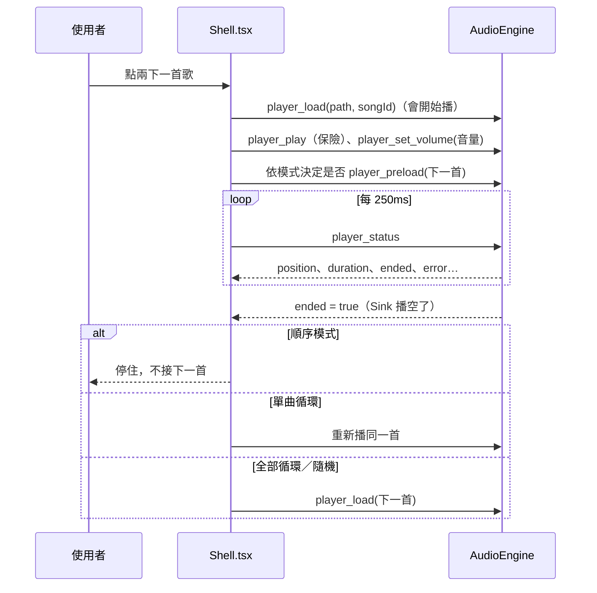
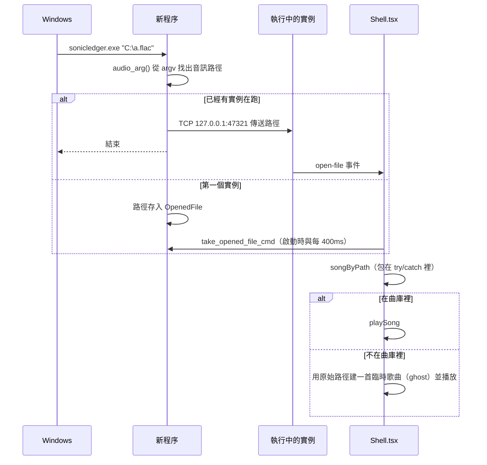

# 業務邏輯

改行為之前先讀對應章節。每一條都是使用者確認過、或修過 bug 才定下來的規則。

## 播放與播放模式

- 四種模式：**順序**（這首播完就停）、**全部循環**、**隨機**、**單曲循環**。模式按鈕旁要顯示文字，而且順序與全部循環的圖示和顏色要不同。
- 手動按下一首永遠會換歌；單曲循環只在自然播完時重播同一首。
- 前端依播放模式、佇列與「播完停止」決定待播曲。自然換曲只安裝同一播放世代已準備好的候選。明確無待播時，曲終轉為停止。
- `player_load` 會開始播；要停在某個位置但不出聲，用 `player_prepare`。先載入再暫停會漏出一點聲音。
- `player_load` 之後要直接呼叫 `playerSetVolume(音量)`，不能用 `muted ? 0 : 音量`，否則剛開始播的聲音會被歸零。
- 15 分鐘以上（或長度不明）的檔案用串流播放：不做峰值正規化，也不參與交叉淡化。交叉淡化只在兩首都是記憶體軌、而且模式是全部循環或隨機時混音。
- symphonia 0.5 不會修剪 AAC 開頭的 2112 個 priming 樣本（約 44ms），這是固定的，不是 seek 的 bug。

## 工作階段（重新開啟時接回進度）

- 存在 `app_config.session`。只在暫停、切歌、關閉時寫入，位置最多每 5 秒寫一次；不在 250ms 輪詢時寫。
- 啟動時停在上次的歌曲與位置，**不自動播放**。不存電台，也不自動重連電台。
- 曲庫裡已經不存在的 id（歌曲或佇列）直接丟掉，不報錯。
- 右鍵開啟與工作階段恢復同時發生時，以右鍵開啟的檔案為準：恢復流程的 token 要在任何 `await` 之前取樣（`openWithRestore.ts` 的 `sessionRestoreActions`）。

## 右鍵開啟與拖放

- 支援的副檔名以 `open_with.rs` 的清單為準，而且必須跟實際能解碼的格式一致（目前不一致，P0-2 會處理）。
- 開了視窗卻沒有出聲時，先看 `data/open-with.log`：沒有 argv 是檔案關聯的問題；有 `LOAD_ERR` 是解碼失敗；出現在 `LOAD_OK` 之後的 `CMD player_prepare`，代表工作階段恢復把剛開的歌換掉了。
- 拖放用 `classify_drop_cmd` 分類：一個檔案就直接播；資料夾就加入曲庫並掃描；拖進歌單頁籤的多個檔案就加入那個歌單，而且不換目前播放的歌。

## 曲庫與搜尋

- 缺檔標成 `missing=1`，不刪除列；掃描一個資料夾時，不能標記資料夾以外的歌。
- 音軌號與碟號存正整數或 NULL，不存 0。專輯檢視依碟號、音軌號、歌名排序；最近播放依播放時間排序。這兩個都不套用曲庫的排序鍵。
- 搜尋：每個詞都要符合（AND）。3 個字以上用 FTS5 trigram `MATCH`（任意位置的子字串、不分大小寫）；1–2 個字改用 `LIKE`。比對範圍是曲名、歌手、專輯、去空白的拼音、拼音首字母。搜尋結果要套用到清單上，不能只存在本機狀態裡。
- 歌曲清單必須虛擬捲動，10 萬首也不能一次畫成 DOM。
- 封面路徑是檔案系統路徑，要用 Tauri 的 file-src 轉換才能顯示。

## 掃描與標籤限制（SE7）

- 已支援的格式使用同一已驗證檔案 handle 掃描。每個文字欄位最多 4 KiB，每檔接受的 UTF-8 鍵和值合計最多 16 KiB，包含接受的重複項與 ReplayGain。超過預算的項目略過，已接受的欄位照常入庫。
- 受限掃描在配置前略過封面及二進位標籤，`cover_path` 維持 `None`。已選用受限解析後若容器範圍無效，回報 `Rejected`。
- 取樣率驗證 8000–384000 Hz、聲道 1–8，超出視為無效（含 0 值）；不使用 `.filter(|v| *v > 0)` 過濾零值，先檢查 0 值再檢查範圍，非法值拒絕入庫並記 `ScanError`。
- ffprobe 後備讀取的標籤進入共同處理前，套用相同 4 KB／16 KB 預算。
- 掃描結果契約：`ScanResult::Song(NewSong, Vec<ScanError>)` 正常入庫、`ScanResult::Rejected(Vec<ScanError>)` 拒絕入庫但錯誤仍彙整、`ScanResult::Skipped` 檔案系統層級跳過；單一檔案錯誤不導致整個掃描失敗。

## 歌單

- 頁籤就是工作區：開歌單會釘一個頁籤，關頁籤不會刪歌單；「全部歌曲」永遠在。開著的頁籤存在 `playlist_tabs`。
- 側欄不放刪除按鈕；「全部歌曲」「最近播放」是檢視，不能刪。
- 排序寫入用 `playlist_items.id`，不是 `song_id`。
- 智慧歌單依規則重算，不存項目，不能拖曳或移除項目。規則只能用欄位白名單（`query_smart_playlist_songs`），不接受自由 SQL。
- m3u：只處理 UTF-8 的 `.m3u` 與 `.m3u8`。相對路徑以 m3u 所在的資料夾展開。對不到的行逐一列出，不能默默丟掉。

## 等化器與音效

- 18 段半八度：31、63、87、125、175、250、350、500、700、1K、1.4K、2K、2.8K、4K、5.6K、8K、11K、16K。各段與前級都是 ±15 dB，有總開關（關閉時各段與前級都不作用）。
- `design_gains` 解各段之間的互相干擾，讓每段中心頻率的實際響應等於推桿值；畫面上的曲線由 `eq_response_cmd` 用同一套算出來，不能在前端另算一套近似值。
- 十種音效：速度、節奏、音高、低音、高音增強、人聲消除、合唱、鑲邊、回音、殘響。全部關閉時輸出要跟輸入逐樣本相同。速度、節奏、音高不作用於電台。
- 改參數時不重開音源（不能每拖一下推桿就 `restart_from`）。
- 預設 `{ name, bands, preamp?, bind? }`。種子是本播放器自己調的曲線，只在沒有同名預設時補上；使用者可以覆寫、刪除。
- 自動套用的比對順序：綁定這首檔案 → 綁定這張專輯 → 綁定這個曲風 → 依曲風的內建建議 → 回退預設。每首歌只在換到它時套用一次，之後使用者手動調整不會被蓋回去。
- 情境建議會一次替換等化器、前級與音效；音效從預設值開始覆寫，不保留上一個情境的設定。

## 工具

- **批次標籤**：只改歌手、專輯、曲風、年份，不在同一批裡改曲名或音軌號。失敗的檔案逐一列出，不能用「整批成功」帶過。
- **轉檔**：本機有 ffmpeg 才執行，沒有就明說。mp3 顯示 128／192／320 kbps 選項，flac、wav、ogg 不顯示位元率。不顯示假的進度條。
- **電台**：只收使用者貼的 http/https 網址，不內建電台目錄，也不猜 ICY 資訊；ICY 的 stream title 持續顯示。電台用 ffmpeg 轉成 PCM 播放，沒有 ffmpeg 就明說。

## 視窗與系統整合

- 輸出裝置：列得出裝置才顯示下拉選單。過濾掉螢幕、HDMI 音訊（NVIDIA High Definition Audio、Intel Display Audio、AMD High Definition Audio Device、Microsoft LifeCam），系統預設裝置排第一個。切換時從目前位置接著播，電台會重新連線。
- 系統匣的「結束」會關閉視窗，讓關閉時的寫入照常執行。不搶全域的 `MediaPlayPause`（媒體鍵交給 SMTC）。設定裡不放媒體鍵開關。
- 迷你模式：同一個視窗縮成 480×200 並置頂；還原時回到 1200×800，最小尺寸 900×600。
- 睡眠計時：N 分鐘後暫停，或這首播完就停；只在視窗開著時有效。
- 版面從 900×600 最小尺寸起都要能用：頁尾分兩列；清單依自己量到的寬度藏欄（小於 760 藏日期、小於 600 藏軌號與次數、小於 460 藏專輯）。
