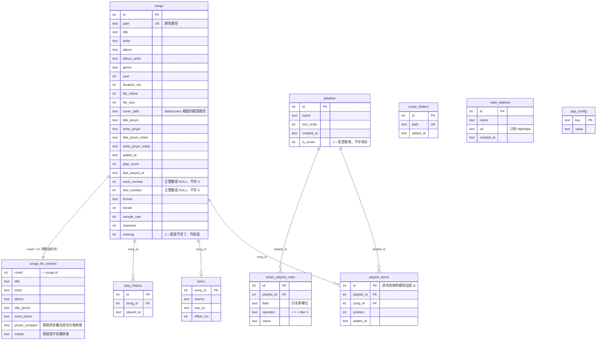

# 資料庫結構

單一檔案 `data/app.db`（執行檔旁）。連線設定（`open_connection`）：`journal_mode=DELETE`、`synchronous=FULL`、`foreign_keys=ON`。因為會放在隨身碟上，不要密集寫入。結構在 `src-tauri/src/db.rs` 的 `init_db`。

**升級規則**：既有的資料庫不能重建。缺欄時才 `ALTER TABLE`，作法見 `ensure_song_columns`（先讀 `PRAGMA table_info`）。衍生資料（搜尋索引）可以砍掉重建，作法見 `ensure_search_index`。

## 表的說明

- **songs**：一列一個實體檔案。`missing=1` 表示檔案不見了，列仍然保留（歌單、播放次數靠 `id`）。掃描某個資料夾時，只能標記那個資料夾底下的缺檔。
- **songs_fts_content**：獨立的 FTS5 trigram 表，不是 `content='songs'` 的外部內容表。由觸發器 `songs_fts_ai`、`songs_fts_au`、`songs_fts_ad` 跟 `songs` 同步。沒有 `id` 欄，用 `rowid`。
- **songs_fts**：舊版留下來的空表，沒有程式使用。
- **playlists / playlist_items**：「全部歌曲」「最近播放」是檢視，不是歌單。智慧歌單（`is_smart=1`）沒有項目，開啟時依規則重算。
- **play_history**：最近播放依 `played_at` 排序，不套用曲庫的排序鍵。
- **radio_stations**：電台書籤，不放進 `session`。

## 索引

`idx_songs_path`、`idx_songs_artist`、`idx_songs_album`、`idx_songs_added_at`、`idx_playlist_items_playlist`、`idx_playlist_items_position (playlist_id, position)`、`idx_play_history_song`。

## `app_config` 的 key

| key | 值 | 寫入時機 |
|---|---|---|
| `session` | JSON：volume、muted、mode、eq（18 段）、eqEnabled、fx、preamp、normalize、crossfade、songId、positionMs、queueIds | 暫停、切歌、關閉時；位置最多每 5 秒寫一次。不在 250ms 輪詢時寫 |
| `eq_presets` | JSON 陣列 `{ name, bands(18), preamp?, bind? }` | 儲存或刪除預設時 |
| `eq_presets_seed` | 種子版本（目前是 `"2"`） | 補種子時 |
| `eq_auto` | `{ enabled, fallback }` | 切換自動套用時 |
| `playlist_tabs` | 開著的歌單頁籤 id | 開、關頁籤時 |
| `lyrics_open` | `"0"` 或 `"1"` | 切換歌詞欄時 |

舊資料的相容處理：`session.eq` 與預設如果是 10 段，依對數頻率換算成 18 段（`eq.ts` 的 `migrateBands`）。
