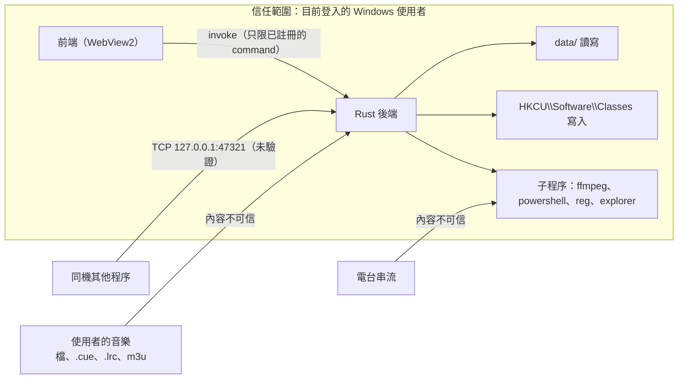

# 使用者權限

SonicLedger 是單機、單一使用者的桌面程式：**沒有帳號、角色、登入**。這份「權限」寫的是程式本身用到哪些系統權限、Tauri 允許前端做什麼，以及哪些輸入來自信任範圍之外。

## 程式需要的權限

| 項目 | 權限層級 | 說明 |
|---|---|---|
| 讀寫 `data/` | 一般使用者 | 位置是執行檔旁邊。放在唯讀的位置（例如 Program Files）會失敗，這是可攜式設計本來的限制 |
| 讀音樂資料夾 | 一般使用者 | 只讀，不刪改音樂檔；標籤編輯除外 |
| 寫標籤 | 一般使用者 | 只在使用者按下儲存時才寫，失敗的檔案逐一列出 |
| 檔案關聯 | 一般使用者（HKCU） | 每次啟動都寫，不寫 HKLM，不需要系統管理員 |
| 本機連接埠 47321 | 一般使用者 | 只綁 127.0.0.1，用來轉交右鍵開啟的路徑 |
| 子程序 | 一般使用者 | 都用 `Command::new` 加參數陣列，不經過 shell 字串 |
| 網路 | 一般使用者 | 只有使用者貼的電台網址，而且交給 ffmpeg 連線 |

目前**沒有任何功能需要系統管理員權限**。之後的規劃裡，可能需要提升權限或額外授權的項目（CD 抓軌、讓電腦從睡眠中被叫醒的工作排程器、獨佔輸出），在動手前都要先做小實驗，並寫進那個任務的 Design.md 與 Review.md（Security 節）。

## Tauri capability

- `src-tauri/capabilities/default.json`：`core:default` 加上視窗相關的權限（大小、最小化、最大化、隱藏、顯示、關閉、`allow-destroy`、置頂、全螢幕）。少了 `core:window:allow-destroy`，叉叉與系統匣的「結束」都會沒反應。
- 自訂 command：只要 `src-tauri/build.rs` 沒有用 `AppManifest::commands` 宣告，`invoke_handler` 註冊的 command 預設所有視窗都能呼叫（[Tauri 官方文件](https://v2.tauri.app/security/capabilities/)）。**一旦用 `AppManifest::commands` 宣告**，就要在 capability 裡列出每一個自訂 command，否則沒列到的會被拒絕（曲庫會變成空的）。單純加 plugin 不會擋掉自訂 command，但 plugin 本身的 API 要在 capability 裡加上對應的權限，並在 `main.rs` 用 `.plugin(...)` 註冊。
- `tauri.conf.json` 列了 dialog、fs、shell、notification，但 `Cargo.toml` 與 `package.json` 都沒有對應的 plugin，不能呼叫。選檔案和資料夾都走 PowerShell 對話框。
- CSP 是 `null`（沒有限制）。前端只載入打包好的資源，不載入遠端內容。

## 不可信的輸入與現有防護

| 來源 | 風險 | 現有防護 | 尚未處理 |
|---|---|---|---|
| 47321 埠收到的路徑 | 同機的任何程序都能叫播放器開一個路徑；`read_to_string` 沒有長度上限；每次連線的內容都寫進 `data/open-with.log`（實測已經 7 MB，而且沒有輪替） | 只綁 127.0.0.1；讀取逾時 3 秒 | **不檢查副檔名**（`open_with.rs` `start_listener` 收到非空的一行就轉交）；沒有驗證來源；沒有長度上限；log 沒有輪替 |
| 電台網址 | 被當成 ffmpeg 參數 | 只收 `http://`、`https://` | ffmpeg 自己支援的協定很多，網址重導向後的協定沒有限制 |
| m3u、.lrc、標籤文字 | 路徑穿越、超長字串 | m3u 路徑只用來比對曲庫，不直接開檔 | — |
| 轉檔輸出路徑 | 覆蓋既有檔案 | 由使用者指定資料夾 | 批次轉檔（P3-2）要檢查撞名與覆蓋 |
| 搜尋字串 | SQL 注入 | 參數化查詢；`LIKE` 跳脫 `% _ \`；`MATCH` 的詞加引號 | — |
| 智慧歌單規則 | SQL 注入 | 欄位與運算子白名單 | — |
