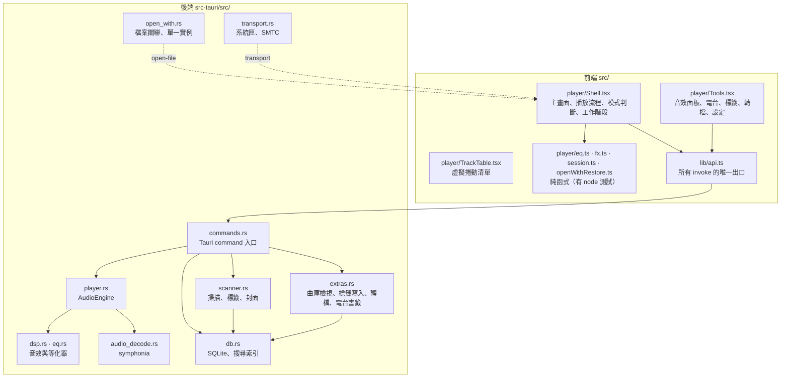

# 服務架構與前後端歸屬

沒有伺服器；「服務」指 exe 內的模組。原則：**畫面狀態與流程決策在前端，資料、檔案、音訊與外部程序在後端**。前端不直接碰檔案系統，一律透過 command。

## 功能歸屬

| 功能 | 前端負責 | 後端負責 |
|---|---|---|
| 播放控制 | 依播放模式決定下一首、要不要預載；手動上一首／下一首；畫面時鐘（讀 `player_status`） | 解碼、輸出、seek、音量、交叉淡化、結束偵測（`ended`）。`player_next` 與 `player_prev` 是空操作 |
| 工作階段 | 組出 `session` JSON、決定寫入時機（暫停、切歌、關閉、每 5 秒一次位置） | `save_config_cmd` 存進 `app_config` |
| 等化器與音效 | 面板、預設、情境、自動套用的比對（`fx.ts` `pickAutoPreset`）、曲風建議 | `EqShared` 參數、濾波器設計（`design_gains`）、`DspSource`、頻率響應曲線（`eq_response_cmd`） |
| 曲庫 | 檢視切換、排序鍵、搜尋框、虛擬捲動 | 掃描、標籤與封面縮圖、缺檔標記、搜尋（FTS5）、facet 統計 |
| 歌單 | 頁籤、拖曳排序、多選、右鍵選單 | CRUD、排序寫入（用 `playlist_items.id`）、智慧歌單規則與查詢、m3u 匯入匯出 |
| 歌詞 | 目前句計算（加上偏移）、貼上 LRC | 讀資料庫、同資料夾的 `.lrc`、解析、偏移儲存 |
| 標籤／轉檔 | 表單、批次欄位限制的畫面 | lofty 寫入、批次結果逐一回報、ffmpeg 轉檔 |
| 電台 | 書籤畫面、貼上網址 | `radio_stations` CRUD、ffmpeg 串流、ICY 標題 |
| 檔案關聯與拖放 | 收到 `open-file` 事件或輪詢 `take_opened_file_cmd` 後播放；拖放後依分類處理 | HKCU 關聯、argv 解析、單一實例轉交、`classify_drop_cmd` |
| 系統整合 | 收到 `transport` 事件後執行動作；`smtc_update_cmd` 更新曲名 | 系統匣選單、SMTC |
| 迷你模式、睡眠計時 | 全在前端（視窗 API、計時器），只在視窗開著時有效 | — |

## 介面約定

- 前端只透過 `src/lib/api.ts` 呼叫 command，不在元件裡直接 `invoke`。
- command 參數用 camelCase；`FxParams` 這類巢狀結構在 Rust 端加 `#[serde(rename_all = "camelCase")]`，並在 `fx.ts` 寫一份相同的型別與範圍。
- 前端要同步維護一份資料的地方：`eq.ts` 的 `EQ_HZ` ↔ `eq.rs` 的 `EQ_HZ`；`fx.ts` 的 `Fx` ↔ `dsp.rs` 的 `FxParams`。改一邊就要改另一邊。
- 事件：`open-file`（路徑）、`transport`（toggle / prev / next）、掃描進度（`onScanProgress`）。

## 已知的死碼

`src/components/`（LyricsPanel、PlayerBar、PlaylistPanel、SearchBar、Settings、SongList、SongRow）是舊版介面，`App.tsx` 只匯出 `player/Shell`，沒有任何地方引用它們。新功能不要接到這裡；要清掉時另開任務。
