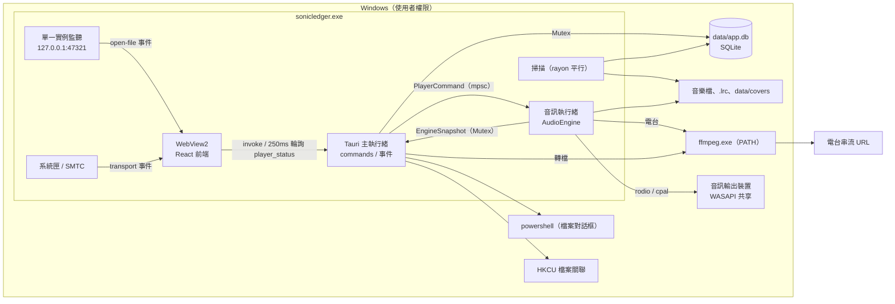
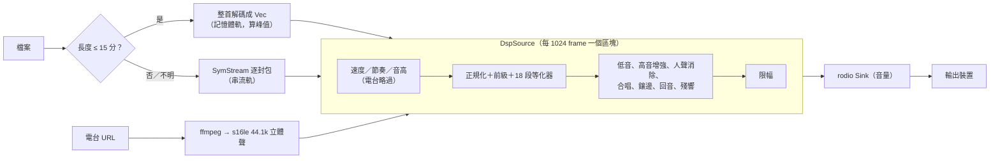

# 系統架構

## 啟動順序（`src-tauri/src/main.rs`）

1. 寫入 HKCU 檔案關聯（`open_with::register_windows_association`，每次啟動都寫，exe 搬家後會自己更新）。
2. 解析 argv 裡的音訊路徑。如果已經有一個實例在跑，就把路徑透過 `127.0.0.1:47321` 轉交給它，然後自己結束。
3. 建立 `data/`、開啟 `data/app.db`，執行 `init_db`（缺欄才 `ALTER`，搜尋索引不符就重建）。
4. 啟動音訊執行緒 `start_player_thread`。
5. 建立 Tauri app，掛上 `DbState`、`PlayerState`、`OpenedFile`，在 `setup` 啟動單一實例監聽、系統匣與 SMTC。
6. 關閉視窗時，前端 `onCloseRequested` 先寫入工作階段，再呼叫 `destroy()`。Rust 端有 3 秒的看門狗，視窗還在就強制 `exit(0)`。

## 執行緒與溝通

| 元件 | 執行緒 | 溝通方式 |
|---|---|---|
| React UI | WebView2 | `invoke`、`listen` |
| commands | Tauri 執行緒池 | `DbState.conn: Mutex<Connection>` 一條連線 |
| AudioEngine | 專屬執行緒，以 80ms `recv_timeout` 輪詢 | `PlayerCommand`（mpsc）進；`EngineSnapshot`（`Arc<Mutex>`）出 |
| DspSource | cpal 輸出回呼（rodio 拉取） | 讀 `EqShared` 的版本號；寫 `played` 計數器（AtomicU64） |
| 電台解碼 | 每台一條執行緒，跑 ffmpeg 子程序 | mpsc 傳 PCM 區塊；`AtomicBool` 停止 |
| 單一實例監聽 | 背景執行緒 | TCP 收路徑 → 發 `open-file` 事件 |
| 系統匣 / SMTC | Tauri / souvlaki | 發 `transport` 事件（toggle / prev / next） |

`player_position` 固定回傳 0；播放位置只看 `player_status`。

## 音訊管線

- 解碼走 symphonia（`audio_decode.rs`），不用 rodio Decoder 開檔；rodio Decoder 只在 `catch_unwind` 裡當後備，而且 mp4 家族的格式不走這條。
- 參數變更透過 `EqShared` 的版本號即時套用，不重開音源。只有 seek 與換裝置會重建 Sink 裡的音源。
- 播放位置 = `seek_origin_ms + played`（已消耗的輸入 frame 扣掉緩衝），所以改速度時，進度仍然對應歌曲時間。

## 外部相依

| 相依 | 用途 | 找不到時 |
|---|---|---|
| ffmpeg（PATH） | 電台、轉檔 | 明確顯示需要 ffmpeg，不假裝在播或已轉完 |
| PowerShell | 資料夾與檔案對話框（`FolderBrowserDialog`、`OpenFileDialog`） | 回傳錯誤 |
| `reg` | HKCU 檔案關聯 | 寫入失敗只記 log |
| WebView2 | 介面 | Windows 10 1803 以上內建 |
