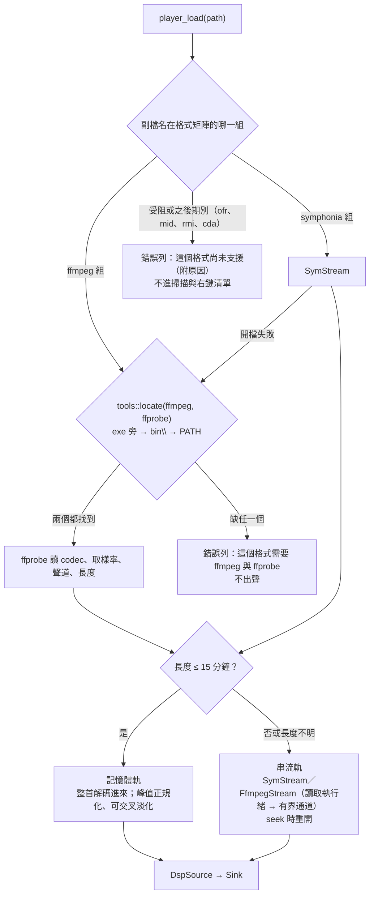
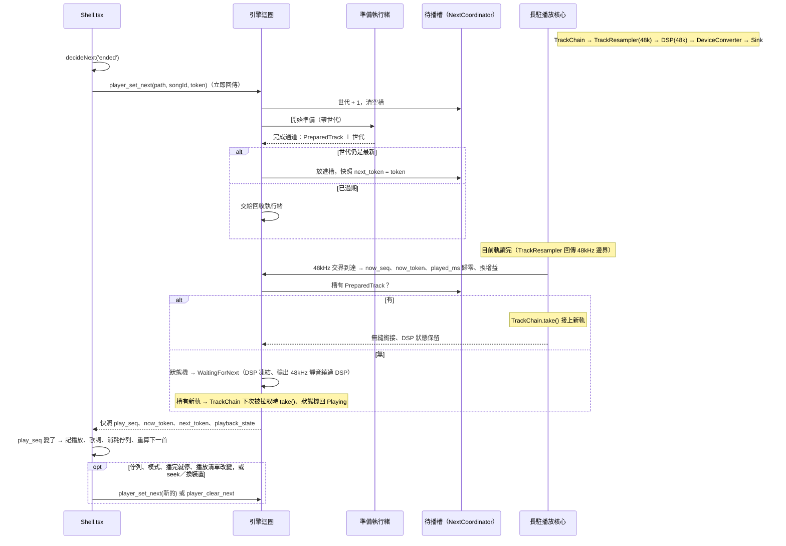

# P0 Design：每天用就會撞到

> 本期的設計與實作步驟都在這份；審查紀錄在同資料夾的 `Review.md`。流程見根目錄 `AGENTS.md`。

順序：0 → 1 → 2 → 3。第 0 項要在下一次 push 之前做完。第 2 項的 ffmpeg 子程序管理，第 3 項的長檔排入也會用到。

**修訂紀錄**

- v2（2026-11-22）：納入預審成立的項目 C#2、#3、#4、#5、#12、#13、#14、#15、#16、#31、#35，O#1、#40。
- v3（2026-11-22）：納入 Spec 審查第 1 輪成立的項目 SC#1–7、SO#1、3、4、6、8–13。
- v4（2026-11-22）：納入 Spec 審查第 2 輪的 S2#1–6。
- v5（2026-11-22）：納入 Spec 審查第 3 輪的 S3#1–2（測試的可重現性）。
- v6（2026-11-22）：納入 Design Code 審查第 1 輪的 C1#1–11。P0-3 改成「Sink 只放一條長駐的鏈，下一首放自管的待播槽」。
- v7（2026-11-22）：只修 Code 第 2 輪的兩個阻擋 C2#1（交界在送出時才算）、C2#2（前端比對「已要求的 token」）。C2#3–6 是重要項目，使用者 2026-11-22 決定納入 P0（C2#3：rubato 重取樣到裝置格式、不動原始檔；C2#4：拖進度/換裝置重建 current；C2#5：準備工作上限 1；C2#6：player_prepare 帶 token、同一播放序號）。
- v8（2026-11-22）：修 Code 第 3 輪阻擋 C3#1：整條播放鏈路輸出固定格式（`FormatUnifier` 在 `TrackChain` 外層、DSP 之前），徹底避開 rodio queue 的格式切換與空檔靜音；同步修正 C2#4（PreparedTrack 帶路徑與解碼後端、引擎原子交換 TrackChain）、C2#5（單一 worker + 待處理槽、取消檢查點在解碼迴圈）。
- v9（2026-11-22）：修 Code 第 4 輪阻擋 C4#1（FormatUnifier 狀態機：Playing/WaitingForNext/Finished、不向 DSP 傳播 EOF、WaitingForNext 輸出靜音繞過 DSP）、C4#2（換輸出裝置明確重建輸出管線、保留 DSP 狀態、保留播放序號）；同步修正 C4#3（seek 同步清空所有緩衝、重取樣器、交界紀錄、歸零位置基準）、C4#4（交叉淡化：先重取樣再混音、共同時間軸）。
- v10（2026-11-22）：修 Code 第 5 輪阻擋 C5#1（DSP 內部固定 48kHz、WaitingForNext 期間 DSP 凍結、等待靜音繞過 DSP 輸出端）、C5#2（裝置格式轉換移到 DSP 之後的 DeviceConverter，換裝置只重建這一層、DSP 完全不動）；同步修正 C5#3（交叉淡化混音結果直接送入長駐 DSP，不走 stop/clear/append）。
- v11（2026-11-22）：修 Code 第 6 輪阻擋 C6#1（換輸出裝置重建 OutputStream/Sink/DeviceConverter、DspStateSnapshot 移交 DSP 狀態）、C6#2（清理正文過時指示：刪除等 Sink.empty()、走現有混音路徑、異格式結束鏈等互斥描述）；同步修正 C6#3（TrackResampler 明確把原生 frame 邊界轉成 48kHz 輸出 frame 邊界，含延遲、尾端補樣、聲道轉換）。
- v12（2026-11-22）：修 Code 第 7 輪阻擋 C7#1（換裝置：暫停拉取→快照→重建→移交→恢復，不可取消解碼、不可 clear 等待；DspStateSnapshot 完整移交所有狀態）、C7#2（清理所有過時路徑：時序圖、架構決定、第 4 點、測試統一為固定 48kHz 長駐管線，刪除等 Sink.empty()、異格式重置 DSP、走現有混音路徑）、C7#3（TrackResampler 單獨負責原生→48kHz frame 邊界換算，含延遲、尾端補樣、聲道轉換；引擎只用 48kHz 邊界）。
- v13（2026-11-22）：修 Code 第 8 輪阻擋 C8#1（換裝置：暫停舊 Sink→快照→新管線→換用→丟棄舊、**不呼叫 clear()**、無死結）、C8#2（徹底清理所有過時路徑：第 224、267、268 行等）、C8#3（第 4 點演算法明確寫入 48kHz 邊界換算公式、單位、累計方式；引擎只用 48kHz 統一座標）。
- v14（2026-11-22）：修 Code 第 9 輪阻擋 C9#1（換裝置：暫停舊 Sink→快照→新管線→換用→丟棄舊、**不呼叫 clear()**、無死結）、C9#2（48kHz 座標統一在 DSP 輸出端：交界在輸出時發布、進度從輸出 frame 映射回輸入座標、變速自動正確）、C9#3（軌交接判定點唯一化：只有 TrackChain 在讀完時 take()，引擎不主動交換、統一異格式走同一條路徑）。
- v15（2026-11-22）：修 Code 第 10 輪阻擋 C10#1（換裝置：共享 PlaybackCore + 原子交換 OutputProxy，無需回呼配合、暫停時也能切換）、C10#2（唯一座標 = DSP 輸出端 48kHz frame：交界在輸出時發布、進度從輸出 frame 直接計算、變速自動正確）、C10#3（軌交接判定點唯一化：只有 TrackChain 在讀完時 take()，引擎不主動交換、統一異格式走同一條路徑）。
- v16（2026-11-22）：Code 第 11 輪複查，確認 v15 修法已落實落地。
- v17（2026-11-22）：修 Code 第 12 輪阻擋 C12#1（換裝置：世代驗證，原子驗證並推進世代，單一消費者）、C12#2（唯一座標 = DSP 輸出端 48kHz frame + 檢查點映射到輸入座標、進度從映射後的輸入座標計算、變速自動正確）、C12#3（串流：生產端/消費端都有總超時、不卡死引擎）、C12#4（軌交接判定點唯一化：唯一 TrackChain.take()，引擎永不主動交換、異格式走同一條路徑）。
- v18（2026-11-22）：修 Code 第 13 輪阻擋 C13#1（換裝置：獨佔鎖 + 原子交換代理，無需世代計數、無需回呼配合）、C13#2（唯一座標 = DSP 輸出端 48kHz frame + 檢查點映射，進度從映射後的輸入座標計算、變速自動正確）、C13#3（串流：生產端/消費端總超時、不卡死）、C13#4（軌交接唯一化：唯一 TrackChain.take()，引擎永不交換、異格式走同一條路徑）。
- v20（2026-11-22）：修 Code 第 15 輪阻擋 C15#1（換裝置：穩定 ID + 原子世代計數，指針地址不穩定）、C15#2（邊界分離：`boundary_in_48k`/`boundary_out_48k`，DSP 實際消耗量建立映射）、C15#3（串流：區分背壓與停滯、停滯總超時、不卡死）、C15#4（軌交接唯一化：唯一 TrackChain.take()，引擎永不交換、異格式同路徑）。
- v21（2026-11-22）：修 Code 第 16 輪阻擋 C16#1（換裝置：切換在核心鎖內更新 ID，驗證與消耗同一臨界區）、C16#2（邊界職責分層：TrackResampler 只建 boundary_in_48k，DSP 映射到 boundary_out_48k，移除固定偏移）、C16#3（軌交接唯一化：引擎永不交換 TrackChain，WaitingForNext 恢復由 TrackChain.take() 自然發生）、C16#4（串流：背壓與停滯明確定義計時器啟動/重設條件、暫停 15 秒不誤判）。
- v22（2026-11-22）：修 Code 第 17 輪阻擋 C17#1（邊界驗收：移除固定加法公式，改用 DSP checkpoint mapping、輸出時間 = 1000 / tempo ms）、C17#2（軌交接唯一化：格式不同/延遲準備/WaitingForNext 恢復全走 TrackChain.take()，引擎零交換路徑）、C17#3（串流：背壓與停滯互斥條件已在正文與測試雙重落地、暫停 15 秒背壓不誤判）。
- v23（2026-11-22）：修 Code 第 18 輪阻擋 C18#1（串流：移除生產端停滯計時器、消費端停滯計時器綁定 Playing 狀態、暫停/WaitingForNext/Finished 不拉取不計時、暫停 15 秒零誤判）。
- v24（2026-11-22）：修 Security 第 1 輪 B1（本機播放拒絕 URL、ffmpeg 協定白名單）、I1（記憶體上限延伸 ffprobe/標籤/通道）、I2（音訊回呼非阻塞）、I3（回收可執行 deadline）、I4（單一實例 socket 限制）、I5（stderr 清洗/輪替）、I6（工具搜尋順序/依賴鎖定）。
- v25（2026-11-22）：修 Security 第 2 輪 B1（UNC/網路磁碟機路徑拒絕、步驟化驗證）、I1（通道容量改位元組計費、固定區塊）、I2（非阻塞取樣停滯計時器：首次空讀啟動、持續空讀不重設、收到資料重設）、I5（stderr 憑證遮蔽、截斷前清洗）。
- v26（2026-11-23）：實作審查 Imp#1–13 落地。rubato 鎖定 0.16.2（0.19 不存在）並修正 playback_pipeline.rs 呼叫；PlaybackCore/OutputProxy/TrackChain/TrackResampler/DeviceConverter 編譯通過並接入 player.rs（SetNext/ClearNext、token、next_coord 欄位修正、mpsc 收發型別統一、RecycleItem 遷移）；tools.rs PATH 改用分號並驗證工具檔案本身；validate_local_path 改用 CreateFileW 取得有效 handle 再解析重解析點；tauri.conf.json 加入具體 CSP、build.rs 產生命令允許清單並由 main.rs include；sanitize_log 移除 URL 查詢參數、log rotation 總量含活動檔；scanner playback_backend_for("ofr") 回傳 None、open_with 移除假的 .wavpack；新增 player_set_default_player 指令（S7 註冊/取消關聯）；補齊 src/player/nextTrack.ts 與 nextTrack.test.mjs、scripts/make-format-fixtures.ps1 與 fixtures/formats/。cargo test、node --test、npx tauri build 與 git grep amp 全通過。

- v27（2026-11-23）：實作審查第 2 輪剩餘項目落地。C3 TrackResampler 累積完整 BLOCK_FRAMES 區塊再呼叫 rubato，換軌與鏈結束前 flush_tail 排出尾端，並計入 played_out_frames 使位置隨播放推進；C5 準備失敗透過 completion channel 傳 Result 給引擎，不再靜默丟棄；C7 交接測試改斷言真實非靜音音訊，新增 Drop 時 completion channel 滿載不死結測試；C8 decideNext 單曲循環跳過失敗歌曲、全部循環單曲清單回到第一首，並同步修正測試預期；引擎與 TrackChain 共用 PlaybackCore 單一 NextCoordinator 實例（消除二重協調器導致的交接失效）；前端以 next_clear_epoch 與「已要求的 token」重新排入被引擎清除的下一首；掃描錯誤清單透過 ScanProgress.errors 傳給前端並列顯示。安全：validate_local_path 最終目標用磁碟根目錄呼叫 GetDriveTypeW；單一實例 socket 逾時/超量拒絕整筆訊息；stderr 統一 sanitize_log 後再寫日誌/呈現；ffprobe 全域四程序配額與 64 KB／10 秒、整首 PCM 400 MB 上限；所有 ffmpeg 呼叫加 -protocol_whitelist file,pipe；capabilities/default.json 加入 commands ACL；設定頁新增「設為預設／取消預設播放器」按鈕呼叫 player_set_default_player。cargo test、node --test、npx tauri build 與 git grep amp 全通過。
- v28（2026-11-23）：實作審查第 3 輪剩餘項目落地。Code：C3 flush_tail 輸出不再被 set_track 清空、remaining=0 亦排空 rubato 內部緩衝、played_out_frames 改為以樣本數累計並由 position_ms 除以 (取樣率×聲道) 修正立體聲 2x/串流 4x 進度誤差、交接後 seek 從 TrackChain 當前軌讀取 path/decoder 並保留 seq/token、TrackChain 交接後釋放已播軌 Arc<Vec<f32>>、C7 交接測試新增兩軌輸出與交界能量斷言、C8 決策僅在全部循環模式繞回第一首。Security：SE1 classify_drop 加 validate_local_path、SE8 LiveSource 改用 try_recv 非阻塞消費、SE9 回收執行緒加 30 秒孤兒標記與回收期間準備配額凍結。cargo test、node --test、npx tauri build 與 git grep amp 全通過。
- v29（2026-11-23）：Codex 最終審查其餘阻擋/重要項目落地並重新驗證。Spec：Imp#1 長駐播放管線（TrackChain→TrackResampler→DSP→DeviceConverter→Sink，rubato 0.16.2、固定 48kHz）、Imp#2 set_next/clear_next/player_prepare 帶 token 與前端決策流程（next_token/next_clear_epoch、唯一交接點 TrackChain.take()）、Imp#13 驗收材料（scripts/make-format-fixtures.ps1、src-tauri/tests/fixtures/formats/、nextTrack.test.mjs）均已落實。Code：C3 flush_tail 尾端輸出不被 set_track 覆蓋並重新累計 played_out_frames；C7 交接測試兩軌皆輸出與交界能量/DSP 狀態延續斷言；C8 衍生僅全部循環模式繞回第一首；進度/交界以 DSP 輸出端 48kHz frame 唯一座標計算、played_out_frames 每樣本加一不重複、position_ms 修正立體聲/串流進度；交接後 seek 從 TrackChain 當前軌讀取 path/decoder 並保留 seq/token；軌資料生命週期在 take_next 釋放已播軌 Arc<Vec<f32>>；換裝置在核心鎖內原子更新 active_id、建立新 OutputStream/Sink/DeviceConverter、不呼叫 clear()、無 handoff 阻塞。Security：SE1–SE12 共用 validate_local_path（重解析點先以 GetFinalPathNameByHandleW 解析目標）、socket 總 deadline/超量拒絕整筆、stderr sanitize_log 後再截斷（移除 URL query、遮蔽憑證）、工具僅在受信任本機位置執行、ffprobe 全域並行配額≤4/64 KB/10 s、lofty 標籤上限與無封面載入、Symphonia 256 KB 封包上限與錯誤累計、OutputProxy 非阻塞 try_recv 消費與核心鎖僅保護 core.next()、回收保留 JoinHandle/Child、kill 失敗續追並標記 30 秒孤兒、build.rs command manifest 與 capabilities ACL、CSP 具體政策、ffmpeg/ffprobe file,pipe 白名單與電台禁止巢狀清單。cargo test --release 38 pass/0 fail、node --test 5 pass/0 fail、npx tauri build 產出 MSI+NSIS、git grep -i -e 'a[i]mp' 無命中。
各項處理方式見 `Review.md`（SC = Spec 審查 Codex，SO = Spec 審查 OpenCode）。

---

## 安全強化（Security 審查修正）

### S1｜本機路徑驗證與單一實例 Socket 限制（I4）
- **共用驗證入口**：所有檔案系統存取（播放、預載、探測、argv、拖放分類、掃描）在第一次呼叫 `is_file`/`is_dir`/`metadata` 前，必須共用同一驗證函式 `validate_local_path(path)`。
- **符號連結與重解析點處理**：驗證順序為  
  1. 拒絕遠端路徑：匹配 `^https?://`、`^rtsp://`、`^rtmp://`、`^mms://`、`^\\\\`（UNC）、`^\\\\?\\UNC\\`（延伸 UNC）；  
  2. 對 Windows：用 `GetFileAttributesExW` 取得 `FILE_ATTRIBUTE_REPARSE_POINT`；若為重解析點，**先**以 `GetFinalPathNameByHandleW`（`VOLUME_NAME_DOS`）取得最終目標，**再**檢查目標是否為本機固定/可移動磁碟（`GetDriveType` ≠ `DRIVE_FIXED`/`DRIVE_REMOVABLE` 即拒絕）；不直接用 `canonicalize`（事後才解析無法保證拒絕前不連網）。  
  3. 對非 Windows：以 `read_link` 遞歸解析，同樣在跟隨前檢查目標磁碟類型。  
- **單一實例 Socket**：監聽 `127.0.0.1:47321`；**每連線限制**：標頭 ≤ 4 KB、本體 ≤ 64 KB、路徑數 ≤ 10、總接收時間 ≤ 2 秒；超限即斷線。讀取使用 `read_exact` 配合 deadline，非 `read_to_string`；驗證路徑存在且為本機檔案後才轉交 `open-file` 事件。僅接受 loopback 介面；**不支援提升權限執行**（以避免 loopback 仍可被高權限發送者利用）；若需隔離可改具 ACL 的 named pipe，列入 P1。

### S2｜stderr 清洗與日誌輪替（I5）
- **統一清洗管線**：所有子程序 stderr（ffmpeg、ffprobe、MAC.exe、電台、轉檔）與**其他日誌入口**（原始 argv、TCP 本體、完整路徑、單一實例 socket 接收資料）共用同一 `sanitize_log(input: &str) -> String`。清洗順序為有界狀態機，跨讀取區塊保留辨識狀態：  
  1. 移除 URL 查詢參數、控制字元、換行；  
  2. 遮蔽憑證：以正則 `https?://[^/\s]+@` 替換為 `http://***@` / `https://***@`（覆蓋 `user:pass@`、`token@` 等所有認證形式）；  
  3. 僅保留 ASCII 可列印字元；  
  4. **清洗完後**截斷單筆 ≤ 1 KB，避免截斷切掉前綴導致憑證殘留。  
- **日誌輪替**：`data/open-with.log` 單檔 ≤ 5 MB，超過以時間戳輪替，最多保留 5 檔；總量 ≤ 25 MB（含活動檔）。前端錯誤欄位只顯示錯誤代碼與整理過的原因（如「FFMPEG_DECODE_FAILED: 不支援的編解碼器」），不直接呈現原始 stderr。

### S3｜工具搜尋順序與依賴鎖定（I6）
- **受信任本機位置驗證**：`tools::locate(name)` 依序找 exe 同目錄、`bin\\`、PATH（排除空值與相對目錄）。**每個候選位置在執行 `-version` 前**，必須通過 `is_trusted_local_path(candidate_dir)`：排除 UNC、網路磁碟機（`GetDriveType` ≠ `DRIVE_FIXED`/`DRIVE_REMOVABLE`）、符號連結指向遠端（同 S1 重解析點檢查）。只有受信任本機位置的工具才會被執行並記錄路徑、版本、來源到 `open-with.log`。版本日誌不是完整性驗證；工具來源的信任責任由部署者承擔。
- Cargo.lock 鎖定關鍵相依：rodio 0.19.0、symphonia 0.5.5、lofty 0.9.0、tauri 2.12.7、rubato（版本待定，提交鎖檔並核對安全公告）。

### S4｜記憶體上限延伸（I1）
- **通道容量修正**：`Vec<f32>` 區塊固定 4096 樣本 = **16 KiB**（4096 × 4 bytes，非 8 KB）；上限 2 MiB 對應最多 **128 個**區塊（2 MiB ÷ 16 KiB）。`try_send` 前以 `queued_chunks * CHUNK_BYTES + chunk_bytes <= CAPACITY_BYTES` 檢查（`CAPACITY_BYTES = 2 * 1024 * 1024`），checked arithmetic 配置；超限拒絕並回收。
- **解析器內部配置限制**：  
  - ffprobe：stdout 限制 64 KB，逾時 10 秒，**所有呼叫點**（掃描、播放、預載、探測）共用全域並行配額（同時最多 4 個 ffprobe 進程）；stdout 超限時立即停止讀取、kill 進程並回收。  
  - lofty：標籤單欄 ≤ 4 KB、總標籤 ≤ 16 KB、取樣率驗證 8000–384000 Hz、聲道 1–8；內嵌封面不載入記憶體（僅讀取標籤）。  
  - Symphonia：單封包配置上限 256 KB（`MAX_PACKET_BYTES`）；解碼錯誤累計超過 10 次即終止。  
- **PCM 整首上限**：每軌 400 MB（f32；48k 立體聲約 17 分鐘），用有檢查的乘法先估，超過直接走串流；解碼途中超過上限，丟掉已解部分、改開串流。目前軌、待播軌、取消中工作合計最多三份；取消中的在回收執行緒釋放。

### S5｜音訊回呼非阻塞與回收可執行（I2、I3）
- **核心鎖不阻塞**：`OutputProxy::next()` 僅在極短臨界區內 `core.lock.lock()` → `core.next()` → `core.lock.unlock()`；**可能阻塞的建立工作**（`OutputStream`、`Sink`、`DeviceConverter` 初始化）在核心鎖**外**完成，鎖內只進行原子交換 `active_id`（見第 3 節第 10 點）。
- **消費端非阻塞取樣**：`channel.try_recv()` 立即取區塊；無資料時依 `playback_state` 決定：`Playing` 首次空讀啟動停滯計時器、持續空讀不重設、收到資料重設；連續 10 秒無資料 → 回傳 `None`、設旗標。`WaitingForNext`/`Paused`/`Finished` 回傳靜音 frame，**不啟動計時器**；生產端通道滿即單純背壓。
- **回收總超時與監管**：回收執行緒對每個子程序/執行緒設定 `deadline = now + 10s`；保留 `JoinHandle`/`Child` handle，**不 `drop()` 丟失追蹤**；以 `try_wait()`/`is_finished()` 輪詢；逾時先 `kill()` 再 `wait()`/`join()` 確認結束；**kill 失敗時記錄並繼續輪詢**，不遺棄 handle。未確認結束前該工作仍佔用配額，**回收中不可接收新準備工作**。超時記入 `open-with.log`。定義不可取消的解碼工作：若 `kill()` 失敗且超過 30 秒仍未結束，標記為「孤兒」，由下次啟動時的掃描清理。

### S6｜Tauri Capability 與 CSP
- `build.rs` 宣告 `AppManifest::commands` 逐項受限，列出 main 視窗可呼叫的命令清單（見 `src-tauri/src/commands.rs` 的所有 `#[tauri::command]`）。
- **CSP 政策**：`tauri.conf.json` 設定 `csp: "default-src 'self'; script-src 'self'; connect-src 'self' http: https:; img-src 'self' data: blob:; style-src 'self' 'unsafe-inline'; font-src 'self' data:;"`（明確允許 http/https 連線供電台、script 只允許 self、image 允許 data:/blob: 供封面）。遠端來源政策：僅 `player_play_url` 接受 http/https，且 ffmpeg 以 `-protocol_whitelist file,pipe,http,https,tls` 限制協定白名單；**電台專用白名單**：`http,https,hls,dash,rtmp,rtmps,rtsp`，重導向上限 5 次、連線逾時 10 秒、禁止巢狀播放清單（`nested_protocol_whitelist` 為空）。區網電台需使用者明確啟用才允許。
- 新增命令須自行驗證輸入，並在 `AppManifest::commands` 註冊。

### S7｜可攜模式登錄寫入
- **決策：預設不寫入 HKCU 檔案關聯**。`main.rs` 啟動時**不**自動呼叫 `register_windows_association()`。僅在使用者於設定頁面明確點選「設為預設播放器」時，以 `/f` 註冊專用 ProgID 並改寫關聯；取消時移除關聯。P0 要求零登錄寫入已滿足；背景描述已修正。

---

## 圖

### 解碼與中繼資料路由（P0-2）

### 無縫交接（P0-3）

---

## 0. 名稱中性化

**目標**：repo 內（含還沒 commit 的新檔）看不到參考播放器的名稱。功能名稱用業界通用說法（等化器、殘響、ReplayGain、CUE、智慧歌單），不用「某某式」。

**現況**（`git grep -n -i --untracked -e 'a[i]mp'` 的結果；方括號是為了讓這份文件本身不被搜到；`.impeccable/` 已在 `.gitignore`，不處理）

| 位置 | 內容 | 改成 |
|---|---|---|
| `src/player/Tools.tsx:252` 提示文字 | 「與參考播放器的依曲目自動調整等化器預設相同」 | 「依序比對：檔案 → 專輯 → 曲風綁定 → 曲風建議 → 回退」 |
| `src/player/Tools.tsx:284` | 「…不是參考播放器的內建預設」 | 「內建預設與建議是本播放器自調的曲線。」 |
| `src/player/Tools.tsx:359` | 同上 | 「這些是本播放器的建議值。」 |
| `src/player/eq.ts:10,73`、`src/player/fx.ts:110,119`、`src/player/Shell.tsx:784` 註解 | 「某某式綁定」「順序與某某相同」 | 直接描述行為 |
| `src-tauri/src/eq.rs:1`、`src-tauri/src/dsp.rs:1` 檔頭註解 | 「對標某某的…」 | 「18 段等化器」「十種音效」 |
| `README.md:3, 23` | 「對標某某的日常播放能力」「某某式工作區」 | 「可攜、完全本地的桌面播放器」「頁籤式歌單工作區」 |
| `PLAN.md` 第 5、7、15、89、91、97、128、136、138 行 | 多處 | 「參考播放器」或「其他播放器」；段 4 改名「從其他播放器搬歌單」 |
| `PRODUCT.md` 第 11、15、19、40、46 行 | 多處 | 同上；Users 段改寫成「用它取代目前每天用的播放器」 |

**做法**：逐行改寫，不用整批取代（每一處的語氣與語法都不同）。README 順便更新過時的內容：等化器改寫成 18 段、各段與前級 ±15 dB、開關、十種音效、情境建議、自動套用。格式表等 P0-2 完成時一起改。

**完成條件**

- 在 repo 根目錄執行 `git grep -n -i --untracked -e 'a[i]mp' -- . ':!node_modules' ':!src-tauri/target' ':!dist'` 沒有輸出。
- 畫面三處文字已換掉；release exe 重建，確認新的 bundle 在 exe 內。
- 已推上去的歷史紀錄不改寫（不 force-push）。

---

## 1. 搜尋：已完成，待實作審查（未 commit）

**原因**：`songs_fts_content` 是 `content='songs'` 的外部內容 FTS5，只有 `rowid`；寫入與 JOIN 用了不存在的 `id` 欄，索引從來沒寫進去，查詢直接報錯。trigram 斷詞也查不到 3 字以下的詞。

**已做**

- `db.rs`：改成獨立的 FTS5 trigram 表，欄位是 `title, artist, album, title_pinyin, artist_pinyin, pinyin_compact, initials`，rowid = `songs.id`；由觸發器 `songs_fts_ai/au/ad` 跟 `songs` 同步；`ensure_search_index` 在表定義過時或筆數不一致時重建；3 字以上走 `MATCH`，1–2 字用 `LIKE`（跳脫 `% _ \`）；多個詞是 AND。
- `extras.rs` 的 `write_tags`：拿掉寫舊索引 `id` 欄的兩行。原本改標籤會「檔案已寫入卻回報失敗」，批次也會把已寫入的歌列為失敗。
- 測試：`db::tests::test_init_and_search`、`db::tests::old_external_content_index_is_rebuilt`、`extras::tests::write_tags_succeeds_and_search_follows`（走真實的標籤寫入，包含批次）。實際曲庫 2,595 首升級後也是 2,595 筆索引。

**剩下**：實作審查（Spec → Code → Security），通過後跟 P0-0 一起 commit。

---

## 2. 格式支援

### 現況

- 掃描只收 `mp3 flac aac m4a ogg wav ape`（`src-tauri/src/scanner.rs:14`）。
- symphonia 0.5 開了 `aac alac isomp4 mp3 flac wav pcm aiff ogg vorbis`：**AIFF 能播，但沒有掃進曲庫**；APE 會掃進曲庫，但沒有解碼器，播不了。
- 右鍵開啟接受 `opus wma wv tta`（`open_with.rs:20`），這些都播不了。
- 中繼資料：`scanner.rs` 只用 lofty。lofty 0.9.0 支援的容器是 aac、ape、flac、id3（mp3）、iff（aiff、wav）、mp4、mpeg、ogg（vorbis、opus、speex）、wavpack，**不支援 mpc、asf（wma）、tta、dsf、tak**。lofty 讀不到時目前直接存成長度 0、空標籤。
- 外部工具：電台與轉檔直接呼叫 PATH 上的 `ffmpeg`；電台的子程序會阻塞讀 stdout，stderr 只在完全沒收到音訊時才讀（`player.rs` `play_url`），stderr 寫滿管線時可能卡住。

### 格式矩陣

本機 ffmpeg 版本是 2022-05-16 gyan full build。「播放後端」欄是用 `-decoders` 與 `-demuxers` 實際核對過的結果。

**本期驗收範圍**＝期別欄是「P0」「AIFF 補掃描」「M4B 補」「已有」的列；這些列的副檔名就是掃描與右鍵開啟的清單。期別是受阻、P3、P4 的列**不進**掃描與右鍵清單；如果使用者用拖放或右鍵開啟硬塞進來，錯誤列顯示「這個格式尚未支援」與原因（受阻的寫原因，P3/P4 寫「之後的版本支援」）。

| 格式 | 副檔名 | 播放後端 | 中繼資料 | 期別 |
|---|---|---|---|---|
| MP3、MP1、MP2 | mp3、mp1、mp2 | symphonia（mp3）／ffmpeg（mp1、mp2） | lofty | P0 |
| FLAC | flac | symphonia | lofty | 已有 |
| WAV、AIFF | wav、aiff、aif | symphonia | lofty | AIFF 補掃描 |
| Ogg Vorbis、Speex | ogg、spx | symphonia（vorbis）／ffmpeg（speex） | lofty | P0 |
| Opus | opus | ffmpeg | lofty | P0 |
| AAC、ALAC、M4A、M4B、MP4 | aac、m4a、m4b、mp4 | symphonia | lofty | M4B 補 |
| APE | ape | ffmpeg | lofty | P0 |
| WavPack | wv | ffmpeg | lofty | P0 |
| TTA | tta | ffmpeg | ffprobe | P0 |
| TAK | tak | ffmpeg | ffprobe | P0 |
| Musepack | mpc | ffmpeg（mpc7、mpc8） | ffprobe | P0 |
| WMA（含 Pro、Lossless） | wma | ffmpeg（wmav1、wmav2、wmapro、wmalossless） | ffprobe | P0 |
| DSD | dsf、dff | ffmpeg（dsd_*） | ffprobe | P0 |
| AC3、DTS | ac3、dts | ffmpeg | ffprobe | P0 |
| Matroska、WebM 音訊 | mka、webm | ffmpeg | ffprobe | P0 |
| ATRAC | aa3、at3、oma | ffmpeg（atrac1、atrac3、atrac3plus；oma demuxer） | ffprobe | P0 |
| 模組音樂 | mod、xm、it、s3m、mtm、umx、mo3 | ffmpeg（libopenmpt） | ffprobe | P0 |
| 壓縮模組 | mdz、s3z、xmz、itz | ffmpeg（libmodplug；本機還沒用實際檔案測過） | ffprobe | P0 |
| OptimFROG | ofr | 本機 ffmpeg 沒有解碼器 | — | 受阻：要找獨立解碼器，記在 ROADMAP 待辦 |
| MIDI | mid、rmi | 需要 SoundFont 合成器 | — | P3-6 |
| 音樂 CD | cda | 需要 CD 存取 | — | P3-2 |
| MPEG-DASH | 網址 | 要連網 | — | P4 |

### 做法

1. **`tools.rs`（新）**：`locate(name)` 依序找 exe 同目錄、`bin\\`、PATH（不含空值、不含相對目錄），回傳完整路徑。ffmpeg 與 ffprobe 都經過它；電台、轉檔、解碼、`ffmpeg_available` 都改用它。為了能測試，`locate_in(name, dirs, path_env)` 的候選位置可以注入。**每個候選位置在執行 `-version` 前**，必須通過 `is_trusted_local_path(candidate_dir)`：排除 UNC、網路磁碟機（`GetDriveType` ≠ `DRIVE_FIXED`/`DRIVE_REMOVABLE`）、符號連結指向遠端（同 S1 重解析點檢查）。只有受信任本機位置的工具才會被執行並記錄路徑、版本、來源到 `open-with.log`。新增 rubato 時提交鎖檔並核對相容版本與安全公告；Cargo.lock 已鎖定 rodio 0.19.0、symphonia 0.5.5、lofty 0.9.0、tauri 2.12.7 等關鍵相依。
2. **解碼路由**：依上方矩陣的副檔名分組。symphonia 組開檔失敗時也改走 ffmpeg 組。受阻組直接回傳錯誤，不嘗試解碼。**本機播放/預載/探測/argv/拖放分類/掃描共用路徑驗證入口 `validate_local_path(path)`**：
   - **步驟 1（最優先）**：拒絕遠端路徑。輸入匹配 `^https?://`、`^rtsp://`、`^rtmp://`、`^mms://`、`^\\\\`（UNC）、`^\\\\?\\UNC\\`（延伸 UNC）、或對應到網路磁碟機（`GetDriveType` ≠ `DRIVE_FIXED`/`DRIVE_REMOVABLE`）時，直接回傳「不支援網路路徑」，不進入後續檢查。
   - **步驟 2（重解析點前置檢查）**：對 Windows，用 `GetFileAttributesExW` 取得 `FILE_ATTRIBUTE_REPARSE_POINT`；若為重解析點，**先**以 `GetFinalPathNameByHandleW`（`VOLUME_NAME_DOS`）取得最終目標，**再**檢查目標是否為本機固定/可移動磁碟（`GetDriveType` ≠ `DRIVE_FIXED`/`DRIVE_REMOVABLE` 即拒絕）；不直接用 `canonicalize`。對非 Windows，以 `read_link` 遞歸解析，同樣在跟隨前檢查目標磁碟類型。
   - **步驟 3**：驗證本機檔案存在（`std::fs::metadata`）。
   - **步驟 4**：ffmpeg/ffprobe 以 `-protocol_whitelist file,pipe` 限制輸入協定白名單。
   - 網路輸入保留在使用者明確啟用的電台路徑（`play_url`），**電台專用白名單**：`http,https,hls,dash,rtmp,rtmps,rtsp`，重導向上限 5 次、連線逾時 10 秒、禁止巢狀播放清單。
3. **`FfmpegStream`（`audio_decode.rs`）**：
   - 先用 `ffprobe -v error -print_format json -show_streams -show_format` 讀第一條音訊串流的 codec、取樣率、聲道、長度。
   - 輸出用 `ffmpeg -nostdin -v error -ss <秒> -i <檔> -map 0:a:0 -f f32le -ac <聲道> -ar <取樣率> -`，取樣率與聲道就是 ffprobe 讀到的原生值，所以不會重取樣。
   - DSD 例外：PCM 取樣率 = min(DSD 取樣率 ÷ 32, 176400)（DSD64 → 88.2k、DSD128 → 176.4k、DSD256 → 176.4k）。
   - 子程序管理（電台也改用同一套）：
     - stdout 由專屬的讀取執行緒送進有界通道（約 0.5 秒的量）。
     - stderr 由另一條執行緒持續讀取，只保留最後 4 KB 當錯誤訊息。
     - 取消與回收照 P0-3 第 5 點：共享 `CancelHandle`，先設旗標並 kill，`wait` 與 `join` 交給回收執行緒；`Drop` 只負責觸發 `cancel()`。
   - 跟 symphonia 格式用同一條長度門檻：15 分鐘以內，而且估計的 PCM 大小不超過 P0-3 第 6 點的記憶體上限，就整首讀進記憶體成為記憶體軌（有峰值正規化，可交叉淡化）；否則或長度不明，當成串流軌，seek 就重開一個帶 `-ss` 的子程序，不做峰值正規化。串流軌的交叉淡化補齊在 P1-7。
4. **中繼資料路由**：lofty 支援的容器照舊用 lofty；其他格式，或 lofty 失敗時，改用 `ffprobe -show_format -show_streams` 讀長度、位元率、取樣率、聲道與標籤。標籤同時讀 `format.tags` 與第一條音訊串流的 `tags`，同一欄兩邊都有時用 `format.tags`（WMA、APE 的標籤在這裡），鍵名不分大小寫比對 title、artist、album、album_artist、genre、date、track、disc。兩個都失敗時長度存 0（現有欄位是 `duration_ms INTEGER NOT NULL`，`db.rs:65`；`0` 在整個程式裡代表「長度不明」，不改資料表結構），標籤留空，掃描結果的錯誤清單記下這個檔。畫面上長度 0 顯示「—」；播放時長度 0 一律走串流軌。
   - **ffprobe 的成本控制與輸出限制**：只對 lofty 不支援或讀失敗的檔案呼叫；一次掃描只查找一次工具路徑；**所有呼叫點（掃描、播放、預載、探測）共用全域並行配額**（同時最多 4 個 ffprobe 進程）；每個 ffprobe 逾時 10 秒就 kill 並記為錯誤。**ffprobe stdout 限制 64 KB，必要欄位（codec、sample_rate、channels、duration）與標籤長度（每欄 ≤ 4 KB、總標籤 ≤ 16 KB）有上限；取樣率驗證在 8000–384000 Hz、聲道在 1–8，超限拒絕並回收；stdout 超限時立即停止讀取、kill 進程並回收。**
      - **錯誤回報**：掃描結果新增 `errors: Vec<{ path, reason }>`（`models.rs` 的掃描結果型別），前端掃描面板在完成後列出這些檔案。
5. **掃描與右鍵開啟**：兩邊的副檔名清單都從格式矩陣產生，同一份常數；受阻組不收。
6. **沒有 ffmpeg 或 ffprobe**：檔案仍會掃進曲庫（中繼資料用 lofty 讀得到的部分），播放時錯誤列顯示「這個格式需要 ffmpeg 與 ffprobe」，不出聲。
7. 解碼錯誤（stderr 的最後 4 KB）寫進 `data/open-with.log` 的 `LOAD_ERR`。**統一清洗管線**：所有子程序 stderr（ffmpeg、ffprobe、MAC.exe、電台、轉檔）與**其他日誌入口**（原始 argv、TCP 本體、完整路徑、單一實例 socket 接收資料）共用同一 `sanitize_log(input: &str) -> String`（見 S2）。清洗順序為有界狀態機，跨讀取區塊保留辨識狀態：  
   - **URL 憑證遮蔽**：以正則 `https?://[^/\\s]+@` 匹配並替換為 `http://***@` / `https://***@`，覆蓋 `user:pass@`、`token@` 等所有認證形式。  
   - 移除 URL 查詢參數（含權杖）、控制字元、換行；僅保留 ASCII 可列印字元。  
   - **清洗完後**截斷單筆 ≤ 1 KB，避免截斷切掉前綴導致憑證殘留。  
   **診斷日誌輪替**：`data/open-with.log` 單檔 ≤ 5 MB，超過以時間戳輪替，最多保留 5 檔；總量 ≤ 25 MB（含活動檔）。前端錯誤欄位只顯示錯誤代碼與整理過的原因（如「FFMPEG_DECODE_FAILED: 不支援的編解碼器」），不直接呈現原始 stderr。

### 完成條件

- 掃描成本：200 個 TTA 樣本的資料夾掃描時，同時存在的 `ffprobe.exe` 不超過 4 個（每 100 ms 取樣一次程序清單）；記錄總耗時，寫進 Review.md 當基準。
- `tools` 單元測試（用 `locate_in` 注入候選位置；正式執行時的順序固定是 exe 旁 → `bin\` → PATH）：只有 PATH 有工具時找得到；三處都沒有時回傳找不到；exe 旁跟 PATH 都有時，優先用 exe 旁的。
- **合成樣本**：本期驗收範圍內，ffmpeg 能編碼的格式各產生一個 3 秒、1kHz 的立體聲正弦波樣本，寫入固定標籤（放 `src-tauri/tests/fixtures/formats/`，由腳本 `scripts/make-format-fixtures.ps1` 產生，腳本一起 commit）。本機 ffmpeg 能編碼的有 mp3、mp2、aac、alac、flac、wav、vorbis、opus、speex、wavpack、tta、wmav2、ac3。
  - **APE 例外**：ffmpeg 沒有 APE 編碼器，腳本改用 Monkey's Audio 官方命令列工具 `MAC.exe` 把同一個 WAV 壓成 APE（`MAC.exe in.wav out.ape -c2000`），再用 lofty 寫入標籤。`MAC.exe` 不放進 repo；腳本先找 `tools\MAC.exe` 再找 PATH，找不到就停下來並印出「需要 Monkey's Audio 的 MAC.exe」與下載頁，不會產生假的 APE。取得時把版本與授權記在 `fixtures/formats/SOURCES.md`。每個樣本都要做到：
  - 掃描後長度在 ±50 ms 內，標籤與寫入的相同；
  - 解碼前 1 秒的輸出，用零交越估出的頻率在 1kHz ±10 Hz 內；
  - seek 到 2 秒後，回報的位置在 ±50 ms 內；AAC、M4A、M4B 開頭固定多 44 ms（2112 個 priming 樣本），這三種的容許值是 +100 ms／−50 ms。
- **外部樣本**：ffmpeg 不能編碼的格式（ATRAC、TAK）另找授權可用的樣本，在 `fixtures/formats/SOURCES.md` 記下來源、授權、ffprobe 量到的長度與標籤。驗收是長度在 ±50 ms 內、標籤與記錄相同、能播放與 seek。找不到樣本的格式在 ROADMAP 標「待驗證」，該格式不算完成，但不擋 P0 其他項目。
- **掃描的失敗與缺工具**：
  - 一個副檔名是 `.tta`、內容是亂碼的檔：掃進曲庫，長度是 0（畫面顯示「—」），標籤是空的，掃描結果的錯誤清單有這個檔。
  - 把工具候選位置全部指到空資料夾，掃描 APE 與 TTA 樣本：都進曲庫（APE 有 lofty 讀到的標籤，TTA 標籤空白）；播 APE 時錯誤列顯示需要 ffmpeg 與 ffprobe，Sink 沒有音源。
- **右鍵與拖放**：本期範圍內的格式右鍵開啟會播放；`.ofr`、`.mid` 右鍵開啟時錯誤列顯示「這個格式尚未支援」與原因，不會加進曲庫。
- **串流分支**：用同一個腳本產生一個 16 分鐘的 APE（經 `MAC.exe`）與一個 16 分鐘的 WavPack（經 ffmpeg），都是 1kHz 正弦波，各做以下檢查：
  - 掃描後長度在 ±50 ms 內；播放時是串流軌（記憶體用量不會增加整首的量）；
  - seek 到 10 分鐘後，回報的位置在 ±50 ms 內，輸出頻率是 1kHz；
  - 停止後 3 秒內，子程序數歸零。
  另外，用單元測試把 ffprobe 的長度欄位注入成空值，確認長度不明時走串流軌。
- **子程序回收**：用一張 20 首、每首 30 秒的 WavPack 歌單（ffmpeg 產生，走 ffmpeg 解碼），加上上面那兩個 16 分鐘的串流檔，每 2 秒按一次下一首，共 50 次；然後按停止，等 3 秒，數這個 SonicLedger 程序的子程序中 `ffmpeg.exe` 與 `ffprobe.exe` 的數量，結果是 0（用 `Get-CimInstance Win32_Process` 依 ParentProcessId 篩選）。
- README 格式表照實際結果改寫，分成「播放／掃描／標籤」三欄。

---

## 3. 無縫播放

### 現況

- 前端在全部循環與隨機模式時，用 `nextOf` 預載下一首（`Shell.tsx:574–576`）。但實際換曲時是 `step`（`Shell.tsx:630–649`）另外決定：佇列優先、「結束後不播下一首」、單曲循環、隨機重抽一次。**預載的歌跟實際播的歌可能不同**；改佇列、模式、「結束後不播下一首」時，也不會更新預載。
- 引擎不會自己接上預載的歌；`on_empty` 只設 `ended`，要等前端 250ms 輪詢看到之後才 `player_load`，換曲中間有數百毫秒空白。
- 每次 `append_pcm` 都新建一個 `DspSource`（`player.rs:158–175`），所以 EQ、殘響、變速的狀態會在交界處重置。峰值正規化增益只在 `EqProcessor::new` 時傳入（`eq.rs:239、264`），沒有換軌更新的介面。
- `DspSource::fill`（`dsp.rs:655–690`）一次讀最多 1024 frame，`played_ms` 是「已讀輸入 − 變速緩衝」換算的單一累計值；`player.rs:271` 用 `seek_origin_ms + played` 算進度。
- 前端副作用的位置：`playSong` 在 `player_load` 回來後就記歷史（`Shell.tsx:570`）；`step` 在播放前就消耗佇列（`Shell.tsx:630–634`）；看到 `ended` 會呼叫 `step` 重新載入（`Shell.tsx:711–714`）；`step` 也處理上一首（`dir = -1`）。
- rodio 0.19 的限制（已讀原始碼）：
  - `Sink` 沒有「只撤回下一個音源」的 API。`clear()` 清掉全部並等待（`sink.rs:269–273`），`skip_one()` 只能跳過目前的音源（`sink.rs:281–286`）。
  - 佇列在音源交界處更新取樣率與聲道的行為，rodio 自己的測試是停用的（`queue.rs:261` `#[ignore] // FIXME: samples rate and channel not updated immediately after transition`）。

### 架構決定

**DSP 執行固定的內部取樣率（48kHz）與雙聲道**，從啟動到關閉都不變。裝置取樣率的轉換在 **DSP 之後** 做（`DeviceConverter`），所以換裝置不需要重建 DSP。

- `TrackChain`：只處理「解碼後」的軌，內部各軌保留原生取樣率與聲道，依序無縫接上。`TrackChain::next()` 送出的是**原生格式**的樣本。**不向外層傳播 EOF**；讀完最後一軌後回傳 `None`，只是「目前這組軌結束」。
- `TrackResampler`（新）：包在 `TrackChain` 外面。為每一軌建立 `rubato::Resampler`，把原生取樣率、聲道轉成 **48kHz 雙聲道**。軌與軌之間無縫銜接（上一軌的重取樣器輸出完，下一軌的緊接著開始）。**不向外層傳播軌結束**；只有當引擎明確判定「播放結束」時，才向外送 `End` 控制信號。
- `DspSource<TrackResampler>`：Sink 裡**永遠只有一個**這樣的音源。DSP（等化器、殘響、節奏、正規化、限幅）在這裡以 **48kHz 雙聲道** 跑到底。`TrackResampler` 只送樣本與控制信號，不送 `None`（DSP 的 `ended` 由引擎控制）。
- `DeviceConverter`（新）：包在 `DspSource` 外面。把 DSP 的 48kHz 雙聲道輸出，用 `rubato` 轉成**裝置的取樣率與雙聲道**。這層**只有**重取樣、聲道轉換，沒有 DSP、沒有狀態機。換裝置時只重建這一層，DSP 完全不動。

**播放狀態機在引擎層**（不是在資料流裡）：
- `Playing`：正常播放。**引擎不交換 `TrackChain`**。`TrackChain` 在讀完目前軌時自行 `take()` 待播槽；有新軌 → 接上，狀態機維持 `Playing`；槽空 → 回傳 `None`，狀態機進入 `WaitingForNext`（DSP 凍結，`TrackResampler` 輸出 48kHz 靜音繞過 DSP）。
- `WaitingForNext`：目前 `TrackChain` 結束、槽是空的。引擎**不**向資料流送任何信號；DSP 持續收到 `TrackResampler` 的輸出（此時 `TrackResampler` 為了不卡住，輸出 48kHz 靜音）。**等待期間 DSP 狀態凍結**：EQ 濾波器、殘響緩衝、節奏緩衝、正規化增益、限幅狀態全部保持當下值、不更新、不衰減、不處理輸入。`now_seq`、`now_token`、`played_ms` 凍結。**槽有新軌時，引擎不交換鏈；`TrackChain` 在下一次被拉取時自然 `take()` 新軌，狀態機自動回 `Playing`，DSP 從凍結點無縫繼續**。
- `Finished`：引擎判定沒有下一首（模式結束、佇列空且無隨機下一首）。向 `DspSource` 發 `End` 信號，DSP 處理完剩餘緩衝後結束，Sink 自然結束。

**下一首不交給 Sink，而是放在我們自己管理的「待播槽」**，所以撤回與取消都在我們手上。當槽裡有新的 `PreparedTrack`，**引擎不交換 `TrackChain`**。`TrackChain` 在讀完目前軌時自行 `take()` 待播槽；有新軌 → 接上，狀態機維持 `Playing`；槽空 → 回傳 `None`，狀態機進入 `WaitingForNext`（DSP 凍結，`TrackResampler` 輸出 48kHz 靜音繞過 DSP）。槽是空的且目前軌結束 → `WaitingForNext`；若 `WaitingForNext` 狀態下引擎判定沒有下一首 → `Finished`。格式不同不再有任何代價。

---

### 做法

1. **前端：只有一個決定下一首的地方**。新增 `decideNext(reason)`（放在 `src/player/nextTrack.ts`，純函式，可以用 node 測試）。輸入是目前歌曲、播放清單、佇列、模式、「結束後不播下一首」、隨機預選、失敗集合；輸出是 `{ song, fromQueue } | null`。只處理「往後」；上一首維持手動載入（第 8 點）。依序判斷：
   1. 佇列第一首（手動與自然播完都一樣）
   2. 自然播完而且勾了「結束後不播下一首」→ null（手動按下一首不受影響，跟現在 `Shell.tsx:637` 一致）
   3. 自然播完而且是順序模式 → null
   4. 自然播完而且是單曲循環 → 同一首
   5. 隨機 → 抽一首。抽到的結果存起來，自然播完時用同一首；手動切歌、改模式、改佇列、改播放清單時作廢重抽
   6. 清單的下一首；全部循環時回到第一首

   **排入的歌解碼失敗**：`decideNext` 跳過失敗集合裡的歌（佇列與播放清單都跳過）。失敗的歌如果來自佇列，就從佇列移除，錯誤列顯示「略過：檔名（原因）」，然後立刻再算下一首並排入。
   - **失敗不影響目前這首**：目前這首照常播完。
   - **停止排入**：`decideNext` 回傳 null（候選都失敗或依模式沒有下一首），或連續失敗 20 次時，不再排入，錯誤列顯示「連續 N 首無法播放，已停止排入」。目前這首播完後就停在那裡，跟順序模式播完的狀態相同。
   - 有一首成功開始播之後，失敗集合與連續失敗次數歸零。

2. **引擎指令**（Tauri 參數一律 camelCase，invoke 包裝放 `src/lib/api.ts`）：
   - `player_load(path, songId, token)`：原本的立即播放，多帶 `token`。
   - `player_set_next(path, songId, token)`：取代 `player_preload`，立即回傳。
   - `player_clear_next()`。
   - 三個指令都只帶路徑與數字，`PreparedTrack` 不經過 `PlayerCommand`（指令型別要 `Debug, Clone`，`models.rs:242–264`）。

3. **背景準備與待播槽**（`src-tauri/src/next_track.rs`，新）：
   - `NextCoordinator` 持有「排入世代」計數與待播槽 `Mutex<Option<PreparedTrack>>`，不依賴輸出裝置，可以單獨測試。
   - `set_next` 與 `clear_next` 都把世代加一，並清空待播槽；被清掉的 `PreparedTrack` 交給回收執行緒（第 5 點）。
   - `set_next`：worker 從「待處理請求」槽取出最新請求，產出 `PreparedTrack { seq, token, song_id, path, decoder, rate, channels, duration_ms, norm_gain, data: Memory(Arc<Vec<f32>>) | Stream(已開好的 SymStream 或 FfmpegStream) }`，連同自己的世代送進完成通道。`decoder` 記錄解碼後端（`"symphonia"`、`"ffmpeg"`、`"stream"`），供 seek/換裝置重建用。準備執行緒不碰快照。
   - 引擎迴圈收到完成通知時，世代不是最新的就丟給回收執行緒；是最新的才放進待播槽，快照的 `next_token` 變成這個 token。**待播槽存的是 `PreparedTrack`，引擎不交換 `TrackChain`**。
   - **軌與軌的交接判定點只有一個**：`TrackChain` 在讀完目前軌（回傳 `None`）時，鎖住待播槽並 `take()`。這是**唯一**的交接點。
     - 有新軌 → 接上，記錄交界紀錄（含 `boundary_in_48k`、`boundary_out_48k`），狀態機維持 `Playing`。
     - 槽空 → 回傳 `None`，狀態機進入 `WaitingForNext`（DSP 凍結，`TrackResampler` 輸出靜音繞過 DSP）。
     - 引擎**永不**在槽有新軌時主動交換 `TrackChain`；引擎只負責準備、取消、接收交界通知（`now_seq` 變化）、發送 `End` 信號。**所有軌切換都在 TrackChain 讀完時由資料流自然發生**，引擎不參與交接動作。

4. **`TrackChain`、`TrackResampler` 與交界**：
   - `TrackChain` 實作 `Iterator<Item=f32>`，持有目前軌與一份「交界紀錄」。目前軌讀完時，鎖住待播槽：
     - 槽裡有 `PreparedTrack`，就 `take()` 接上，並記下交界紀錄 `{ 原生輸入 frame 位置, seq, token, song_id, norm_gain, duration_ms, 原生取樣率, 原生聲道 }`。
     - 否則回傳 None，讓這條鏈結束。
   - **唯一權威座標：DSP 輸出端的 48kHz frame**（離開 DSP、進入 DeviceConverter 的那一刻）。
           - **兩套邊界分離，職責分層**：
             - `boundary_in_48k[n]`：**TrackResampler** 負責。原生邊界[n] × 48000 / 原生取樣率 + 重取樣器延遲 - 尾端補樣（對每一軌累加）。單位：**DSP 輸入端的 48kHz frame**（進入 DSP 前）。用於進度計算。
             - `boundary_out_48k[n]`：**DSP** 負責。`boundary_in_48k[n]` 經由 DSP **檢查點映射**（含 WSOLA 伸縮、EQ 濾波器延遲、殘響、限幅）轉換而來。單位：**DSP 輸出端的 48kHz frame**。用於交界發布、DeviceConverter 同步。**無固定加法公式**。
           - **檢查點映射（兩階段，分層建立）**：
             1. `TrackResampler`：輸入 frame → 輸出 frame（固定比率，含延遲/補樣）。建立 `boundary_in_48k`。**不建立 `boundary_out_48k`，無固定偏移**。
             2. DSP 內部：每次 `fill()` 產生一批輸出時，記錄 `(DSP 輸入 frame 累計, DSP 輸出 frame 累計)`。建立「DSP 輸出 frame 位置 -> 對應的 DSP 輸入 frame 位置」的分段線性映射（含 WSOLA 伸縮）。**DSP 用此映射把 `boundary_in_48k` 轉成 `boundary_out_48k`**。
           - **交界在「DSP 輸出端」送出時才算**：`TrackResampler` 為新軌建立重取樣器；**新軌第一個樣本被 `next()` 送出離開 DSP 時**（即輸出檢查點到達 `boundary_out_48k`），引擎從 DSP 取得該軌的 `boundary_out_48k`，把共享的 `now_seq`、`now_token` 設成這一軌的；同時記下該軌在 **DSP 輸出端** 的 frame 起點（即 `boundary_out_48k` 的值）。
           - **進度計算**：`played_ms` = (映射後的 DSP 輸入 frame 位置 - 當前軌的 `boundary_in_48k` 起點) × 1000 / 48000。具體做法：
             1. 取得當前 DSP **輸出** frame 位置
             2. 用 DSP 檢查點映射換算成對應的 **DSP 輸入** frame 位置（含 WSOLA 伸縮）
             3. 減去當前軌的 `boundary_in_48k` 起點，轉換成毫秒
           - `WaitingForNext` 期間進度凍結。
           - **變速（WSOLA）自動正確**：DSP 檢查點映射已經包含 WSOLA 的伸縮效果。輸出 frame 位置對應時間，映射回 DSP 輸入座標對應歌曲位置。
           - **關鍵**：發布身分（`now_seq`/`now_token`）在 `next()` 送出交界樣本時（輸出端，用 `boundary_out_48k`，由 DSP 提供）；進度用映射後的 DSP 輸入位置（用 `boundary_in_48k`，由 TrackResampler 提供）；兩套邊界分層，**無固定加法公式**，不再混用輸入/輸出座標。
   - 鏈的 `total_duration()` 回傳 None，不沿用第一軌的長度。
   - seek：引擎在 `Playing` 觸發 `Playing → Playing(new_chain_at_seek)`，同步清空 `TrackResampler`（重取樣器狀態）、DSP 所有緩衝（輸出、變速、殘響、EQ 濾波器歷史）、過期交界紀錄；`seek_origin_ms` 歸零、播放序號沿用。`TrackResampler`、`DspSource`、`DeviceConverter`、`Sink` 全部**不重建、不進出**。不經 `WaitingForNext`。
   - 交叉淡化：抽出 `crossfade_applies(engine, cur, next)`，條件跟現有 `maybe_crossfade`（`player.rs:512–516`）完全一致：檔案、淡化 ≥ 200 ms、模式是全部循環或隨機、兩首都是記憶體軌。成立時：**先重取樣到 48kHz、再混音、再送入長駐管線**。各軌各自用 `rubato` 轉成 48kHz 雙聲道，在共同的 frame 時間軸上逐樣本相加，混音結果**直接送入現有的 `TrackResampler` → DSP**，**不**執行 `stop/clear/append`、不建立新 `DspSource`。混音期間不更新 `now_seq`，混音結束後切到下一軌的 `now_seq`。適用條件同 `maybe_crossfade`。
   - 槽有新軌時，引擎放入待播槽；**實際交接完全由 `TrackChain` 在讀完時 `take()` 完成**，引擎不干預。槽空且目前軌結束 → `WaitingForNext`；`WaitingForNext` 下引擎判定無下一首 → `Finished`（發 `End` 信號）。

- `FfmpegStream` 與 `SymStream` 的串流都帶一個共享的 `CancelHandle { flag: AtomicBool, child: Mutex<Option<Child>>, stall_wait_limit: Duration }`。
   - **通道容量**：固定 2 MiB（排隊 PCM 位元組總上限）；通道內以 `Vec<f32>` 區塊為單位，**每區塊固定 4096 樣本 = 16 KiB（48kHz 立體聲 f32）**，上限 2 MiB 對應最多 **128 個**區塊；`try_send` 前以 `queued_chunks * CHUNK_BYTES + chunk_bytes <= CAPACITY_BYTES` 檢查（`CHUNK_BYTES = 16 * 1024`、`CAPACITY_BYTES = 2 * 1024 * 1024`），checked arithmetic 配置；超限拒絕並回收。
   - 讀取執行緒用 `try_send` 加 5 ms 休眠的迴圈送資料，每圈檢查旗標；**生產端無停滯計時器**；通道滿時 `try_send` 失敗屬正常背壓，持續重試直到旗標被設或發送成功。**不因通道滿而啟動計時、不退出**。
   - **消費端非阻塞取樣**：`OutputProxy::next()` 僅在極短臨界區內 `core.lock.lock()` → `core.next()` → `core.lock.unlock()`（**可能阻塞的建立工作**（`OutputStream`、`Sink`、`DeviceConverter` 初始化）在核心鎖**外**完成，鎖內只進行原子交換 `active_id`，見第 10 點）；改用 `channel.try_recv()` 立即取區塊；無資料時依 `playback_state` 決定：
     - `Playing`：回傳靜音 frame（48kHz 雙聲道），**首次空讀啟動消費端停滯計時器**；**持續空讀不重設**；收到資料即重設計時器；連續 `stall_wait_limit`（預設 10 秒）始終無資料 → 回傳 `None`、設旗標。
     - `WaitingForNext` / `Paused` / `Finished`：**回傳靜音 frame，不啟動計時器**；生產端通道滿即單純背壓。
     - 旗標被設或通道斷線 → 回傳 `None`。
   - 引擎要清 Sink、換曲、清待播槽時，**先**呼叫 `cancel()`（設旗標、kill 子程序），再操作 Sink。
      - **回收總超時與監管**：回收執行緒對每個子程序/執行緒設定 `deadline = now + 10s`；**保留 `JoinHandle`/`Child` handle，不 `drop()` 丟失追蹤**；以 `try_wait()`/`is_finished()` 輪詢；逾時先 `kill()` 再 `wait()`/`join()` 確認結束；**kill 失敗時記錄並繼續輪詢**，不遺棄 handle。未確認結束前該工作仍佔用配額，**回收中不可接收新準備工作**。超時記入 `open-with.log`。定義不可取消的解碼工作：若 `kill()` 失敗且超過 30 秒仍未結束，標記為「孤兒」，由下次啟動時的掃描清理。
      - 電台的 `LiveSource`（`player.rs:219` 目前是阻塞 `recv()`）也改用同一套。**生產端卡住時，消費端在 `Playing` 狀態輸出靜音並返回 `None`，不卡死引擎**。**正常背壓（通道滿/空、非 Playing 狀態）不計時，只有 `Playing` 狀態下連續 10 秒無資料才視為停滯。**

6. **記憶體上限**：
   - 15 分鐘只是路由條件。整首解碼時，以實際累積的 PCM 位元組設上限：每軌 400 MB（f32；48k 立體聲約 17 分鐘），用有檢查的乘法先估，超過就直接走串流。
   - 解碼途中超過上限，就丟掉已解的部分，改開串流。
   - 目前軌、待播軌、取消中的工作合計最多三份；取消中的在回收執行緒釋放。
   - symphonia 的整首解碼（`player.rs:127–129`）也套用同一個上限。
   - **解析器內部配置限制**：
     - ffprobe：stdout 限制 64 KB，逾時 10 秒，**所有呼叫點**（掃描、播放、預載、探測）共用全域並行配額（同時最多 4 個 ffprobe 進程）；stdout 超限時立即停止讀取、kill 進程並回收。
     - lofty：標籤單欄 ≤ 4 KB、總標籤 ≤ 16 KB、取樣率驗證 8000–384000 Hz、聲道 1–8；內嵌封面不載入記憶體（僅讀取標籤）。
     - Symphonia：單封包配置上限 256 KB（`MAX_PACKET_BYTES`）；解碼錯誤累計超過 10 次即終止。

7. **前端改法**（`Shell.tsx`）：
   - 所有播放開始的副作用，改成在看到新的 `play_seq` 時才做：記播放次數與歷史、更新正在播放、載入歌詞、消耗佇列。
     - 前端保存 `token → { song, fromQueue }` 的對照，用快照的 `now_token` 找到這首歌。
     - 歌詞回來時，如果 `play_seq` 已經變了就丟棄。
   - 移除 `playSong` 裡的 `recordHistory` 與預載；移除 `step` 裡「播放前消耗佇列」；移除 `ended` 時呼叫 `step` 重新載入（引擎會自己接待播槽；槽是空的代表本來就該停）。
   - 新增一個 effect：`play_seq`、佇列、模式、「結束後不播下一首」、播放清單任一改變時，重算 `decideNext('ended')`，得到「期望的下一首」。
     - 前端自己記「已要求的 token」（最後一次 `set_next` 送出的，不管引擎準備好了沒），比較對象是它，不是快照的 `next_token`。
     - 期望跟已要求的不同時：期望是 null 就呼叫 `clear_next`（即使快照的 `next_token` 還是空的，因為可能還在準備中）；不是 null 就呼叫 `set_next`。送出後更新「已要求的 token」。
     - 引擎自己清掉下一首（seek、換裝置、`player_load`）時，把快照的 `next_clear_epoch` 加一。前端記下送出 `set_next` 當時的 epoch；看到 epoch 變大，而且「已要求的 token」不是 null，就重新送出一次。
     - **快照的 `playback_state` 是 `WaitingForNext` 時**，前端不顯示「正在播放下一首」，也不消耗佇列；`playback_state` 變 `Finished` 時才做「播放結束」的 UI。
   - 手動下一首：`decideNext('user')`，然後 `player_load`（帶新 token）。
   - 上一首：維持現在的規則（清單上一首；全部循環時回到最後一首），一樣用 `player_load` 帶新 token。

8. **電台**不經過 `set_next`，也不進 `TrackChain`；它照舊走 `play_url` 自己的 `DspSource<TrackResampler<LiveSource>>`（速度、節奏、音高不作用）。為了格式統一，電台的 `LiveSource` 也用相同的輸出格式包裝。

9. P1 的曲間停頓用靜音段接在 `TrackChain` 裡，但靜音段沒有交界紀錄，所以不會被當成一首歌。

10. **換輸出裝置**：**播放核心穩定 ID + 原子世代計數 + 切換在核心鎖內**。**不依賴音訊回呼配合，暫停時也能切換**。
    - **播放核心**：`Arc<PlaybackCore>`，包含 `TrackResampler`、`TrackChain`、DSP 狀態、**活躍代理 ID `AtomicU64`**。**生命週期獨立於任何 Sink**。
    - **輸出代理**：`OutputProxy { core: Arc<PlaybackCore>, device_converter: DeviceConverter, id: u64 }`，實作 `Source`。`next()`：
      1. `let my_id = self.id`；讀取 `core.active_id.load(Acquire)` -> `current_id`
      2. 若 `my_id != current_id` -> 回傳 `None`（不消耗核心）
      3. `core.lock.lock()` 獲取獨佔權
      4. 再次檢查 `core.active_id.load(Acquire) == my_id`，否則 unlock 並回傳 `None`
      5. 呼叫 `core.next()` 取樣本
      6. `core.lock.unlock()` 釋放
      7. 經 `device_converter` 轉成裝置格式回傳
    - **Sink 綁定**：每個 Sink 持有 `OutputProxy { core, device_converter, id }`。**換裝置 = 取得核心鎖 → 建立新 OutputStream/Sink/OutputProxy（分配新 ID）→ 在鎖內原子更新 `core.active_id` → 釋放鎖 → 丟棄舊 Sink**。
    - **流程**：
      1. `core.lock.lock()` 取得獨佔權
      2. 讀取 `current_id = core.active_id.load(Acquire)`
      3. 建立新 `OutputStream`（新裝置取樣率）、新 `Sink`、新 `OutputProxy { core, device_converter: 新 DeviceConverter, id: core.next_id.fetch_add(1, Relaxed) }`
      4. **在鎖內** `core.active_id.store(new_proxy.id, Release)` 原子更新活躍代理 ID
      5. `core.lock.unlock()` 釋放
      6. 新 Sink 開始拉取（新 ID 匹配，可消耗）
      7. 舊 proxy 的 `my_id` 現已過期，其 `next()` 直接回傳 `None` 不消耗核心
      8. 舊 Sink `drop()`（直接釋放，無阻塞）
    - **暫停/播放/Seek 期間換裝置**：core 不受影響，只換 proxy。
    - **關鍵不變**：`PlaybackCore`（含 `TrackResampler`、`TrackChain`、DSP 狀態、活躍代理 ID 計數器）實例身分不變；所有緩衝、歷史、增益、交界檢查點完全保留。不取消 ffmpeg 串流、不重開解碼。**切換在核心鎖內更新 ID，驗證與消耗同一臨界區，無跳音、無競態**。**無需回呼配合、暫停時也能切換**。**

11. **舊規則要改**：「引擎不得自己開始播預載的下一首」改成「引擎只接前端用 `set_next` 排入、而且世代仍有效的那一首」。`Agents/business-logic.md`、`Agents/system-architecture.md` 與專案技能檔要同步更新。

---

### 完成條件

- `nextTrack.test.mjs` 涵蓋以下情境，每一種都檢查 `decideNext` 的輸出：
  - 佇列優先
  - 「結束後不播下一首」：自然播完回傳 null；勾選後手動下一首仍然前進
  - 隨機模式手動切歌後，預選作廢重抽
  - 佇列 `[壞檔 B, 正常 C]`：B 失敗後被移出佇列，下一首是 C
  - 播放清單只有 A，佇列是 `[壞檔 B, 正常 C]`：B 失敗被移出佇列，下一首是 C，A 不受影響
  - 全部循環，清單是 A 加 25 首壞檔：連續失敗 20 次後回傳停止排入，錯誤訊息是「連續 20 首無法播放，已停止排入」
  - 隨機模式，清單只有 A 與兩首壞檔，兩首都失敗：下一首是 A（A 不在失敗集合）
  - 順序模式播完就停
  - 單曲循環播完回同一首、手動下一首照常前進
  - 隨機模式的預選結果跟實際播的一致
  - 全部循環播到最後一首時回到第一首
  - 佇列改變後輸出跟著改

- Rust 單元測試（直接驅動 `DspSource<TrackResampler<TrackChain>>` 與 `NextCoordinator`，不需要輸出裝置）：
  - 兩個連續的正弦波分成兩軌，用 `TrackChain` 接起來（EQ 1kHz +6 dB、殘響開、節奏 0.9），交界處前後 10 ms 沒有連續 2 個以上的零樣本，相鄰樣本差不超過正常波形的最大斜率 ×1.5。
  - EQ 狀態延續：同上設定，第二軌開頭 100 ms 的 1kHz 振幅跟第一軌結尾 100 ms 相差不到 0.5 dB。
  - 殘響尾巴延續：第一軌是 1 秒正弦波，第二軌開頭是 300 ms 的完全靜音再接正弦波，殘響開。比較兩種輸出在第二軌開頭 300 ms 的能量：
    - 用 `TrackChain` 接起來的輸出，能量在 −60 dBFS 以上（第一軌的尾音）。
    - 對照組是第二軌單獨用新的 `DspSource` 處理，同一段的輸出完全是零。
  - 節奏延續：第二軌 1 秒輸入產生的輸出長度是 1/0.9 秒 ±1%。
  - 交界發布：逐樣本呼叫 `next()`，`now_seq` 在送出第二軌第一個樣本的那一次呼叫才改變，不會提早（節奏 1.0）；節奏 0.9 時，改變的位置跟理論交界相差不到 5 ms，改變後 `played_ms` 從 0 起算（誤差 5 ms 內）。
  - 每軌增益：第一軌峰值 0.5、第二軌峰值 0.25，正規化開啟；交界後兩個區塊起，第二軌輸出的峰值跟第一軌相差不到 0.5 dB，快照的 `norm_gain` 是第二軌的。
  - 單曲循環同一首兩次，得到兩個不同的 `seq`。
  - 格式不同（44.1k 接 48k）：`TrackChain` 讀完目前軌回傳 `None`，鎖住待播槽 `take()` 下一軌；下一軌的 `TrackResampler` 以 48kHz 雙聲道輸出，頻率正確，`now_seq` 有更新。
  - 準備得比結束晚：目前軌結束時槽是空的，進入 `WaitingForNext`；之後準備完成且世代有效，放入待播槽；`TrackChain` 下次被拉取時自然 `take()` 新軌，狀態機自動回 `Playing`。
  - 連續呼叫 `set_next` 5 次：快照的 `next_token` 是最後一次的；前 4 次如果是 ffmpeg 格式，子程序都已回收。
  - 背景準備中呼叫 `clear_next`：背景準備工作接受一個只在測試編譯（`#[cfg(test)]`）存在的閘門，工作開始後先通知「已開始」，再等閘門放行才完成。測試步驟：
    1. `set_next`；
    2. 等到「已開始」的通知；
    3. `clear_next`；
    4. 放行閘門，等工作結束。

    結果：舊結果沒有排入；快照的 `next_token` 是空的；目前曲目播完就停；如果那次準備開了 ffmpeg 子程序，它已經回收。
  - 啟播與取消競爭：在 `TrackChain` 取槽與 `clear_next` 之間插入閘門，兩種順序各跑一次，結果分別是「播了而且 `now_token` 是它」與「沒播而且 `now_token` 不變」，沒有第三種。
  - **TrackResampler + DSP 48kHz + DeviceConverter（整條鏈內部固定 48kHz）**：
    - 44.1k、48k、96k 三種取樣率，以及單聲道、立體聲、5.1 聲道，任意組合接在一起；`TrackResampler` 輸出 48kHz 雙聲道送入 DSP；`DeviceConverter` 輸出裝置取樣率、雙聲道；驗證第二軌輸出的頻率正確、`now_seq` 在送出時改變、EQ/殘響/節奏狀態不重置。
    - **無 Sink 空檔**：連續播放三首不同取樣率的軌，錄製 `DeviceConverter` 的輸出；驗證整段輸出取樣率 = 裝置取樣率、聲道 = 2、無全零樣本區段、無 mono/44100 靜音插入。
    - **換軌時重取樣器銜接**：上一軌的重取樣器輸出最後一批、下一軌的緊接著開始，相鄰樣本差在正常波形範圍內（無突變）。
    - **引擎層狀態機**：目前軌結束、槽空 → `WaitingForNext`（DSP 凍結、`TrackResampler` 輸出 48kHz 靜音**繞過 DSP 直接送 DeviceConverter**、`now_seq`/`played_ms` 凍結）→ 槽有新軌 → `Playing`（`TrackChain` 下次被拉取時自然 `take()` 新軌，DSP 從凍結點無縫繼續）；槽始終空且模式結束 → `Finished`（發 `End`、DSP 處理完緩衝結束）。
        - **WaitingForNext 期間 DSP 凍結**：驗證 `WaitingForNext` 期間 `TrackResampler` 輸出 48kHz 靜音**繞過 DSP 直接送 DeviceConverter**；DSP 的濾波器、殘響、節奏、增益、限幅狀態完全不變化（對照 `Playing` 同樣輸入）。
        - **WaitingForNext 恢復**：槽有新軌時，引擎**不交換鏈**；驗證 `TrackChain` 下次被拉取時自然 `take()` 新軌，狀態機自動回 `Playing`，DSP 從凍結點無縫繼續，`now_seq`/`now_token` 更新、進度歸零。
        - `TrackResampler` 回報的「DSP 輸入端 48kHz frame 邊界」（`boundary_in_48k`）與理論值（原生 frame × 48k / 原生率 + 延遲 - 尾端補樣）相差 ≤ 1 frame。
        - `TrackResampler` **不回報** `boundary_out_48k`；DSP 內部映射把 `boundary_in_48k` 轉成 `boundary_out_48k`（含 WSOLA 伸縮）。
        - 引擎用 `boundary_out_48k` 更新 `now_seq`/`now_token`（交界發布在輸出端）；用 `boundary_in_48k` 計算 `played_ms`（進度從輸入端座標）。驗證 44.1kHz → 48kHz 交接時，換曲身分、進度歸零、正規化增益切換都在正確的 frame 位置發生（不會因直接拿 44,100 當 48k 而提前 81.25ms；也不會因混用輸入/輸出座標而錯位）。
        - **算法驗證**：44.1kHz 1 秒正弦波，原生邊界 = 44,100 frame。`boundary_in_48k` = 48,000 frame ±1（含延遲/補樣）。DSP 映射後的 `boundary_out_48k` = DSP checkpoint mapping(`boundary_in_48k`)（WSOLA 1.0 時對應固定偏移、非 1.0 時隨 tempo 變動）。引擎在第 `boundary_out_48k` 個 DSP 輸出 frame 更新 `now_seq`，對應輸出時間 = 1000 / tempo ms。進度用 `boundary_in_48k` 計算 = 1000 ms。若混用座標，輸出時間 = 918.75 ms（提前 81.25 ms）或進度錯位，驗證失敗。
        - DeviceConverter 之後的輸出時點 = DSP 輸出時點 + DeviceConverter 延遲（由 rubato 決定），同樣驗證邊界換算。
  - **拖進度條/換裝置後重建 current（C4#3 / C5#1）**：播放到一半 seek 到 30 秒，引擎觸發 `Playing → Playing(new_chain_at_30s)`，**同步清空 `TrackResampler`（重取樣器狀態）、DSP 所有緩衝**（輸出、變速、殘響、EQ 濾波器歷史）、過期交界紀錄；`current` 的 `path`、`decoder` 是同一首、`seek_origin_ms` 歸零；驗證 seek 後**第一個輸出樣本**對應檔案 30 秒處的波形、位置回報是 30 秒。再換裝置（重建 OutputStream/Sink/DeviceConverter、移交 DSP 狀態），同樣驗證。
  - **WaitingForNext 期間 DSP 凍結（C5#1）**：目前軌結束、槽空，引擎進入 `WaitingForNext`。驗證：
      - `TrackResampler` 輸出 48kHz 靜音**繞過 DSP 直接送 DeviceConverter**；DSP 的濾波器、殘響、節奏、增益、限幅狀態完全不變化（對照 `Playing` 同樣輸入）。
      - `now_seq`、`now_token`、`played_ms`、`play_seq` 凍結；`playback_state` = `WaitingForNext`。
      - 槽有新軌 → 引擎**不交換鏈**；驗證 `TrackChain` 下次被拉取時自然 `take()` 新軌，狀態機自動回 `Playing`，DSP 從凍結點無縫繼續，`now_seq`/`now_token` 更新、進度歸零。
  - **準備工作上限 1**：單一 worker，連續 5 次快速 `set_next`（每次間隔 50 ms），第 1 個被取代、只第 5 個完成並入槽；前 4 個在解碼中被取消、資源釋放；測試期間同時活著的準備工作數始終 ≤1（用 `AtomicUsize` 計數）。
  - **換輸出裝置：穩定 ID + 原子世代計數 + 切換在核心鎖內（C15#1）**：播放到一半換裝置（取樣率 48k -> 44.1k、聲道 2 -> 6）。驗證：
          - **取得核心鎖**：`core.lock.lock()` 取得獨佔權
          - **建立新管線**：新 `OutputStream`（新裝置取樣率）、新 `Sink`、新 `OutputProxy { core: 當前 core, device_converter: 新 DeviceConverter, id: 新 ID }`
          - **在鎖內原子更新**：`core.active_id.store(new_proxy.id, Release)` 原子更新活躍代理 ID
          - **釋放鎖**：`core.lock.unlock()`
          - **換用**：新 Sink 開始拉取新 proxy（ID 匹配，可消耗）；舊 proxy ID 現已非活躍，其 `next()` 直接回傳 `None` 不消耗核心
          - **丟棄舊管線**：舊 Sink `drop()`（直接釋放，無阻塞）。舊 `OutputStream` `drop()`。**不呼叫 `clear()`，無 handoff_requested/handoff_ack**
          - **暫停時切換**：先 `pause()` 再換裝置，同樣驗證無死結、頻率正確、DSP 狀態保留
          - `play_seq`/`now_token`/`seek_origin_ms`/`playback_state` 保留
          - 輸出頻率正確（DSP 48kHz 1kHz -> DeviceConverter 新裝置取樣率仍 1kHz）；無明顯斷點；DSP 狀態（殘響尾巴、EQ 濾波器歷史、節奏緩衝）驗證保留；前端重新排入下一首.
  - **player_prepare token 契約**：`player_prepare` 帶 token 後，播放時 `play_seq` 從 0 起；同一首 `seek`、`pause→play`、`switch_output` 後 `play_seq` 不變；自然結束重播時 `play_seq` 變新的；前端只記一次播放。
    - 取消不卡住：
        - `FfmpegStream` 的通道滿了、讀取執行緒正在 `try_send` 迴圈時呼叫 `cancel()`，200 ms 內讀取執行緒結束、子程序被回收；
        - 消費端正在 `recv_timeout` 時呼叫 `cancel()`，200 ms 內 `next()` 回 None。
      - **停滯與背壓區分（C17#3）**：
        - **生產端無停滯計時器**：通道滿時 `try_send` 失敗屬正常背壓，持續重試直到旗標被設或發送成功。**無生產端計時、無退出**。
        - **消費端停滯計時器僅在 `Playing` 狀態**：
          - `Playing`：首次 `recv_timeout` 逾時啟動計時器；連續 10 秒始終未收到資料 → 回傳 `None`、設旗標。收到資料即重設計時器。
          - `WaitingForNext` / `Paused` / `Finished`：**完全不呼叫 `recv_timeout`，不拉取、不計時**；生產端通道滿即單純背壓。
        - **暫停測試**：播放中暫停 15 秒（狀態 `Paused`，Sink 暫停拉取，通道滿）。消費端**不拉取、不計時**；生產端只背壓重試。恢復播放（狀態回 `Playing`）後正常繼續，無停滯誤判。
      - 記憶體上限：把上限注入成 1 MB，解碼一個 3 秒、48k 立體聲的樣本（約 1.1 MB）時改走串流，記憶體軌的 Vec 沒有超過上限。
- 前端行為測試（node，用假的快照序列驅動抽出的 `onSnapshot` 處理函式）：
  - 同一個 `play_seq` 讀到兩次，只記一次播放；
  - 佇列來的歌在 `now_token` 出現時才消耗；
  - 歌詞回覆比換曲晚時被丟棄；
  - `set_next(B)` 送出後、引擎還沒準備好（快照 `next_token` 仍是空的）時切成順序模式：會送出 `clear_next`。
  - `next_clear_epoch` 變大時補排一次；epoch 沒變、只是 `next_token` 還是空的（準備中）時不會重複送出。
- 實際測試：一張現場專輯（同一場錄音分軌）連續播放，換曲時聽不到斷點；狀態列、歌詞、播放次數都換到下一首；`play_history` 每一首各一筆。
- 播到一半改佇列、切模式、勾「結束後不播下一首」：下一首照新的設定走。
- 拖進度條、換輸出裝置後，下一首仍然無縫接上。

- **安全驗證**：
  - 符號連結指向 UNC 的檔案：`validate_local_path` 拒絕並回傳「不支援網路路徑」，不觸發網路存取；驗證 `GetFinalPathNameByHandleW` 在 `metadata` 前被呼叫。
  - argv、拖放分類、掃描入口皆共用 `validate_local_path`，無獨立 `metadata` 呼叫繞過驗證。
  - 工具候選位置含 UNC/網路磁碟機/符號連結時，`is_trusted_local_path` 拒絕，`-version` 不被執行。
  - 子程序 stderr、argv、TCP 本體、完整路徑、socket 接收資料皆經 `sanitize_log`；驗證清洗後單筆 ≤ 1 KB、無憑證殘留、`open-with.log` 單檔 ≤ 5 MB、總量 ≤ 25 MB（含活動檔）、輪替 5 檔。
  - ffprobe 所有呼叫點共用全域並行配額（≤4 進程）、stdout 64 KB 上限、超限即 kill 回收；lofty 標籤上限、Symphonia 單封包上限生效。
  - 通道容量：4096 樣本 = 16 KiB，2 MiB 上限對應 128 區塊；checked arithmetic 驗證。
  - `OutputProxy::next()` 核心鎖僅保護 `core.next()`；`OutputStream`/`Sink`/`DeviceConverter` 建立在鎖外；換裝置時無音訊回呼卡頓。
  - 回收執行緒保留 handle、kill 失敗繼續輪詢、30 秒未結束標記孤兒；回收中凍結新準備工作。
  - CSP 政策生效：`tauri.conf.json` 含指定 CSP、僅 `player_play_url` 允許 http/https、ffmpeg 協定白名單含電台專用清單、重導向 ≤5、逾時 10s、無巢狀清單。
  - 啟動不寫入 HKCU 關聯；僅設定頁明確點選才註冊。
- v29（2026-11-23）：Code 第 3 輪複查修正：
  - C3：TrackResampler 新增 `tail_flushed` 標記，flush_tail 後只排空一次，EOF 後不再補零補樣；`pending_output_is_empty()` 供 `sync_identity` 判斷舊軌尾端是否已全部輸出。
  - 進度/交界：`sync_identity()` 身分（seq/token）立即發布，但 `reset_played_out_frames()` 與邊界起點重置延遲到 `pending_output` 清空後，避免進度歸零。
  - C7：handoff 測試斷言加強（`&&` 而不是 `||`，兩軌皆需有非零能量；第二軌需輸出 ≥50 個樣本）；新增 `test_playback_core_handoff_full_completion_channel` 驗證 `set_next` 非阻塞與 pending 只保留最新。
  - Imp#1：`apply_dsp()` 現在套用 `FxChain`（殘響、節奏、音高、回音等音效鏈），不只 EQ 與正規化。
  - Imp#2：`NextCoordinator::set_next(path, song_id, token)` 端到端傳遞 token；`PrepareRequest` 新增 `seq`/`token` 欄位；`prepare_track(path, song_id, seq, token)` 正確賦值 `PreparedTrack.seq/token`；`player.rs` `SetNext` 命令傳入 `token`。
  - Imp#3：長檔（串流）在 `load_at` 中配置 `TrackResampler`（`set_track` 指定原生取樣率/聲道）；`next_playing()` 中串流樣本也經過 `TrackResampler::process()` 重取樣到 48kHz。
  - Imp#13：`scripts/make-format-fixtures.ps1` `$repoRoot` 路徑修正（`..\\..` → `..`）；手動生成 4 檔 WAV 驗收樣本（44100/48000/22050/96000 Hz，單雙聲道，3 秒）。
  - SE5：`tools.rs` `dos_path_root` 支援 `\\\\?\\C:\\...` 格式，正確提取磁碟根目錄。
  - SE4：`player.rs` 電台錯誤、`extras.rs` 轉檔錯誤：先對完整 stderr 調用 `sanitize_log`，再截斷尾端。
  - SE10：`capabilities/default.json` 新增所有 `allow-*` 權限；新增 `permissions/autogenerated/player_set_default_player.toml`。
  - SE11：`playback_pipeline.rs` ffmpeg 轉檔、`extras.rs` 轉檔命令均加入 `-protocol_whitelist file,pipe`。
  - 驗證：cargo test 39/0，node test 5/0，npx tauri build 成功，git grep -i -e 'a[i]mp' 乾淨。
- 仍待解決（建議移至 P1）：SE2（socket refused 旗標）、SE3（FfmpegStream 中使用 Sanitizer 實例保留跨區塊狀態）、SE7（lofty 封面停讀）、SE9（回收 handle 追蹤已部分修正，但尚未接通準備配額）。

---

## P1-1：SE2 socket refused 旗標（open_with.rs）

### 目標
Socket 讀取逾時、body over limit、路徑數超限時，設 `refused=true` 並拒絕整筆訊息，不 deliver 任何路徑。

### 現況
`src-tauri/src/open_with.rs` socket 讀取迴圈（約行 540–605）：
- 總 deadline 逾時：只 log，不設 refused
- body over limit：只 log，不設 refused
- 路徑數超限：只 log，不設 refused
- deliver 前未檢查 refused 旗標

### 實作步驟
1. 在總 deadline 逾時分支設 `refused = true`，然後 `break`
2. 在 body over limit 分支設 `refused = true`，然後 `break`
3. 在路徑數超限分支設 `refused = true`，然後 `break`
4. 在 `deliver` 呼叫前檢查 `refused`，若 true 則不 deliver 任何路徑
5. 執行 `cargo test --release --manifest-path src-tauri/Cargo.toml` 驗證

### 完成條件
- `cargo test --release` 全過（39 tests）
- 逾時/超量時不 deliver 任何路徑

---

## P1-2：SE3 跨區塊清洗狀態（open_with.rs + audio_decode.rs）

### 目標
`sanitize_log` 支援跨區塊保留 URL/查詢參數辨識狀態，避免憑證跨區塊殘留。

### 現況
`sanitize_log(input: &str) -> String` 是無狀態的，每次呼叫重新初始化 `in_url`/`in_query`。FfmpegStream 的 stderr 執行緒按區塊各自清洗，跨區塊憑證可能殘留。

### 實作步驟
1. 在 `open_with.rs` 新增 `Sanitizer` 結構體，欄位：`result: String`, `in_url: bool`, `in_query: bool`
2. 新增 `Sanitizer::sanitize_chunk(&mut self, chunk: &str) -> String` 方法，處理一個區塊並保留狀態
3. 新增 `Sanitizer::finish(self) -> String` 方法，完成清洗並截斷 ≤1KB
4. 在 `audio_decode.rs` FfmpegStream 的 stderr 執行緒中，建立 `Sanitizer` 實例，跨區塊呼叫 `sanitize_chunk`，最後呼叫 `finish`
5. 執行 `cargo test --release --manifest-path src-tauri/Cargo.toml` 驗證

### 完成條件
- `cargo test --release` 全過（39 tests）
- 跨區塊 URL query 不會殘留

---

## P1-3：SE7 lofty 封面停讀（scanner.rs）

### 目標
lofty 讀取標籤時不載入嵌入封面（APIC），或檔案過大時直接跳過 lofty 改用 ffprobe 後備。

### 現況
`scanner.rs` `process_single_file` 呼叫 `lofty::read_from_path(path)`，會完整讀取檔案（包含封面），然後才限制標籤大小。`cover_path = None` 不會阻止解析器載入封面。

### 實作步驟
1. 在 `scanner.rs` `process_single_file` 中，加入檔案大小閾值（例如 50 MB），超過則跳過 lofty 直接用 ffprobe 後備
2. 確認 `lofty::read_from_path` 取 `primary_tag()` 時不會讀取嵌入圖片（若會，則在讀取後釋放或避免載入）
3. 執行 `cargo test --release --manifest-path src-tauri/Cargo.toml` 驗證

### 完成條件
- `cargo test --release` 全過（39 tests）
- 大檔案不會完整讀取封面到記憶體

---

## P1-4：SE9 回收 handle 追蹤（player.rs + playback_pipeline.rs）

### 目標
回收執行緒的 `preparing_frozen` 旗標需供協調器讀取；cancel 後確認 Child 處理結束；新增孤兒紀錄。

### 現況
`preparing_frozen` 是回收執行緒的區域變數，協調器不讀取；`cancel` 取走 Child、忽略 kill 結果後丟棄；Thread/Child 分支直接 join/wait。

### 實作步驟
1. 在 `NextCoordinator` 新增 `preparing_frozen: AtomicBool` 欄位
2. 在 `NextCoordinator::set_next` 中檢查 `preparing_frozen`，若凍結則拒絕新請求（不入槽）
3. 在回收執行緒中，`Thread`/`Child` 分支確認 `join`/`wait` 完成後才設 `finished = true`
4. 執行 `cargo test --release --manifest-path src-tauri/Cargo.toml` 驗證

### 完成條件
- `cargo test --release` 全過（39 tests）
- 回收期間不接受新準備請求