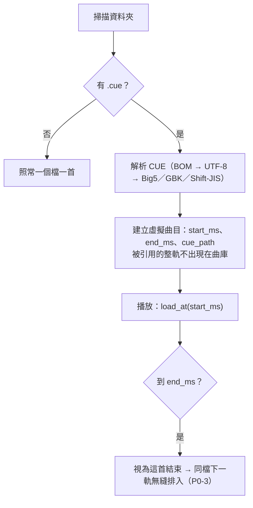
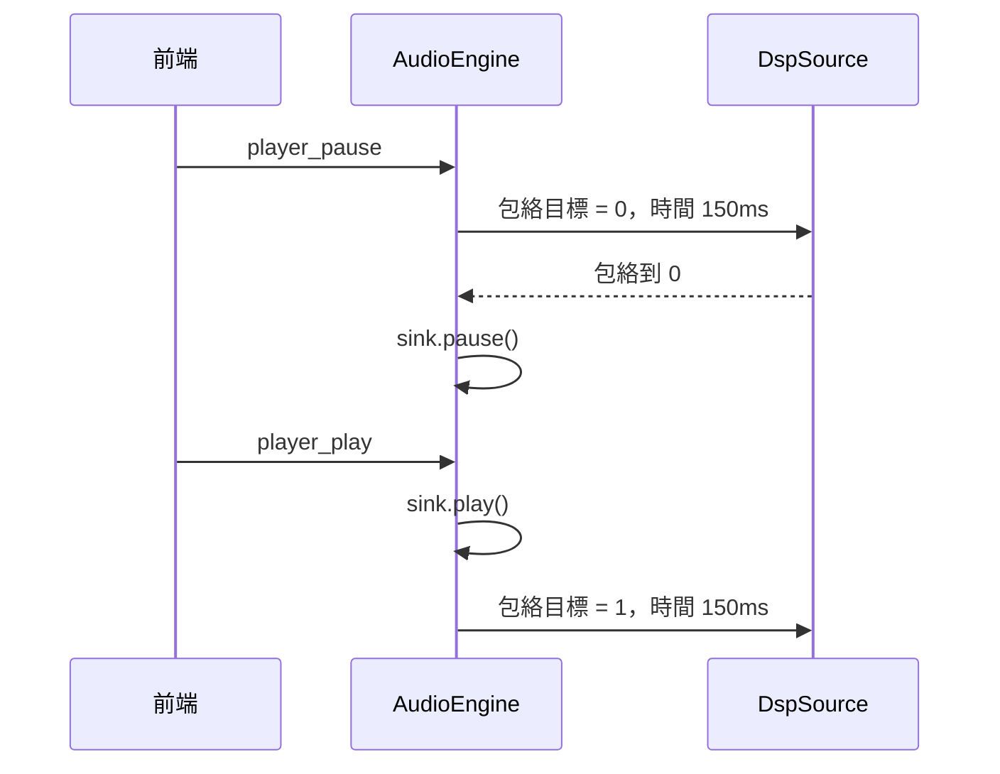

# P1 Design：播放品質

> 本期的設計與實作步驟都在這份；審查紀錄在同資料夾的 `Review.md`。流程見根目錄 `AGENTS.md`。

依賴 P0：P0-2 的 ffmpeg 解碼與 P0-3 的無縫排入。CUE（第 4 項）要靠無縫排入，同一個檔案的分軌之間才不會斷。

順序：1 → 2 → 3 → 4 → 6 → 5。獨佔輸出要換音訊後端，風險最高，排最後。

## 圖

### 增益與處理順序（P1-1、P1-2、P1-3）

### CUE 從掃描到播放（P1-4）

### 暫停淡出（P1-3）

---

## 1. ReplayGain

**現況**：只有峰值正規化（`player.rs` 的 `memory_track` 算 `norm_gain`），長檔串流不套用。

**做法**

1. **讀標籤**：掃描時讀 `REPLAYGAIN_TRACK_GAIN / _PEAK`、`REPLAYGAIN_ALBUM_GAIN / _PEAK`（ID3 TXXX、Vorbis、APE、MP4 freeform），也讀 Opus 的 `R128_TRACK_GAIN`。`songs` 加 4 欄（`ensure_song_columns` 的作法：缺欄才 ALTER）。
2. **模式**：關閉／曲目／專輯／依播放方式自動選（播整張專輯或依專輯排序時用專輯增益，否則用曲目增益）。
3. **前級**：有 ReplayGain 的檔案一個前級（預設 0 dB），沒有 ReplayGain 的檔案另一個前級（預設 −6 dB）。
4. **防削波**：用峰值限制增益，避免增益乘上去超過 1.0。
5. **跟峰值正規化的關係**：兩者互斥，設定裡二選一。ReplayGain 不需要先掃整首，所以長檔串流也能套用。
6. 增益接進 `EqProcessor` 現有的 `gain_target`（已有平滑），不另外開一條路。
7. **計算**（沒有標籤時）：歸 P3-1 標籤工具。這裡只做讀取與套用。

**完成條件**：有 ReplayGain 標籤的兩首歌音量明顯不同；切到曲目模式後聽起來接近。狀態列顯示目前套用的增益。沒有標籤的檔案套用「無 ReplayGain 前級」。

---

## 2. 音量曲線與響度補償

**現況**：`sink.set_volume(volume)` 是線性（`player.rs`），滑桿下半段幾乎聽不出差別，上半段一動就很大聲。

**做法**

1. **對數曲線**：滑桿 0–100% 對應 −60 dB 到 0 dB（0% 就是靜音），換算在引擎內做，前端滑桿值不變。設定裡可以切回線性。
2. **響度補償**（預設關）：音量越小，自動在 `DspSource` 加低頻與高頻的擱架增益（最多約 +10 dB 與 +6 dB），補回小音量時耳朵聽不到的兩端。
3. 狀態列的音量顯示加上 dB 值。

**完成條件**：滑桿 25%、50%、75% 聽起來音量差距平均；響度補償開關在小音量時聽得出差別，在 100% 時不作用。

---

## 3. 淡入淡出、曲間停頓、去除靜音

**現況**：暫停、停止、拖進度條都是直接切斷（`sink.pause()`、`sink.stop()`）。

**做法**

1. **淡入淡出**：`DspSource` 加一個淡入淡出包絡，引擎指令改成「先淡出 N ms 再暫停」。各情境分開設定時間，0 為關：
   - 開始播放、暫停、繼續播放、停止：預設 150 ms
   - 拖進度條：預設 30 ms，只是為了去掉爆音
   - 手動切歌：預設 300 ms
2. **曲間停頓**：0–10 秒。在無縫排入（P0-3）之前插入指定長度的靜音；跟交叉淡化互斥。
3. **去除靜音**：記憶體軌在解碼後找出開頭與結尾低於 −60 dBFS 的段落，播放時跳過；長檔串流只處理開頭。預設關，對 DJ mix 與現場錄音要能關掉。
4. 睡眠計時暫停時也走淡出。

**完成條件**：暫停與繼續沒有爆音；拖進度條沒有喀聲；開了去除靜音後，開頭有 3 秒空白的檔案會直接從聲音開始播，進度條從 0:03 起跳（時間仍然對應原檔）。

---

## 4. CUE 整軌

**現況**：完全不支援。整軌 rip（一個 flac／ape 加一個 .cue）只會顯示成一首很長的歌。

**做法**

1. **解析**：`FILE`、`TRACK`、`INDEX 01`、`TITLE`、`PERFORMER`、`REM GENRE/DATE`。編碼依序試 UTF-8（含 BOM）、Big5、GBK、Shift-JIS，中文與日文的 CUE 很多不是 UTF-8。
2. **資料庫**：`songs` 加 `cue_path`、`start_ms`、`end_ms`。一個實體檔對應多首虛擬曲目：path 用 `實體檔#曲號` 才能維持 `UNIQUE`，另存 `file_path` 指向實體檔。被 CUE 引用的整軌本身不出現在曲庫。
3. **掃描**：資料夾裡有 .cue 就先解析；實體檔不見時，那幾首標成 `missing=1`。CUE 改了要能重新掃描，但不能讓曲目 id 換掉（歌單、播放次數都靠 id）。
4. **播放**：`load_at` 從 `start_ms` 開始，播到 `end_ms` 就算這首結束；同一個檔案的下一軌用無縫排入（P0-3）接上，聽起來是連續的。進度條與歌詞以分軌內的時間顯示。
5. **轉檔與標籤**：P3 會用到（多首合併成一檔並產生 CUE、章節編輯）。

**完成條件**：一張整軌 flac＋Big5 編碼的 CUE，掃描後出現 N 首、曲名正確；依序播放沒有斷點；拖進度條與歌詞正常；加進歌單、重新掃描後，歌單內容還在。

---

## 5. 輸出模式：WASAPI 獨佔、ASIO、DirectSound

**現況**：rodio/cpal，WASAPI 共享模式。cpal 不支援獨佔模式；ASIO 要在建置時有 ASIO SDK。

**做法**（每一步都先做小實驗，做不到就不畫選項）

1. 輸出後端抽象化：`OutputBackend` trait，現有 rodio 成為「WASAPI 共享」實作。
2. **WASAPI 獨佔**：用 `wasapi` crate 直接開裝置，依來源取樣率切換裝置格式；裝置不支援時退回最接近的格式並顯示原因。
3. **位元完美**：音量 100%、等化器與音效全關、沒有 ReplayGain 時跳過所有處理，狀態列顯示「位元完美」。
4. **ASIO**：cpal 的 `asio` feature，需要 ASIO SDK 與使用者自己裝的驅動。可攜版預設不包含，另出一個建置版本。
5. **DirectSound**：價值低，最後評估；沒有實際需求就寫明不做。
6. 換後端時位置不能跳，比照現有的切換輸出裝置。

**完成條件**：選了獨佔後，其他程式的聲音被擋掉（這就是獨佔的意思）；48k／96k 的檔案能各自讓裝置切換格式；切回共享後一切照常。

---

## 6. 20 段等化器

**現況**：18 段半八度（`src-tauri/src/eq.rs` `EQ_HZ`、`src/player/eq.ts`）。參考播放器的新版官方寫 20 段。

**做法**

1. 開工前先確認參考播放器新版的 20 個頻率點。公開資料推測是 31.25 × 2^(n/2)，也就是 31、44、63、88、125、177、250、354、500、707、1k、1.4k、2k、2.8k、4k、5.7k、8k、11.3k、16k、22.6k。
2. 超過 0.48 × 取樣率的頻段（44.1k／48k 下的 22.6k）在引擎裡停用，推桿標成「此取樣率不適用」，不能畫一根推了沒反應的推桿。
3. 18 段存檔（session、預設、情境）依對數頻率換算成 20 段，沿用 `migrateBands` 的作法；`design_gains` 的干擾補償矩陣改成 20×20。
4. `eq.rs` 與 `eq.ts` 的頻率表一起改，測試同步更新（每段中心頻率的誤差要在 0.6 dB 內）。

**完成條件**：舊的 18 段預設載入後曲線形狀一樣；20 段在 44.1k／48k／96k 都通過中心頻率測試；22.6k 那段在 44.1k 下顯示停用。

---

## 7. 交叉淡化補齊（從 P0-2、P0-3 移過來）

**現況**：`maybe_crossfade`（`player.rs:511`）只在兩首都是記憶體軌時才混音；`mix_crossfade`（`player.rs:182`）直接依樣本索引混合，沒有處理取樣率或聲道不同的情況。P0 之後，15 分鐘以內的檔案（symphonia 與 ffmpeg 格式都一樣）是記憶體軌；15 分鐘以上或長度不明的是串流軌，串流軌不會交叉淡化，取樣率或聲道不同的兩首記憶體軌也會混錯。

**做法**

1. 交叉淡化改在 P0-3 的 `TrackChain` 裡做：下一首開始時，前後兩軌在淡化時間內各自乘上增益曲線後相加。這樣記憶體軌與串流軌都適用，也不用先把整首混成一個新軌。
2. 取樣率或聲道不同時，下一首先轉成目前這一軌的格式（線性插值重取樣，聲道照「單聲道複製成兩聲道、多聲道降混成兩聲道」），淡化結束後再切回原生格式並重新開始 DSP 狀態；切換點選在淡化結束的那一刻，不是在兩首重疊的時候。
3. 淡化期間 `now_seq` 在下一首第一個樣本進入混音時更新（跟 P0-3 一致）。
4. 跟曲間停頓互斥；任一首是電台時不淡化。

**完成條件**

- 單元測試：記憶體軌接串流軌、串流軌接串流軌、44.1k 接 48k、單聲道接立體聲，四種情況淡化 3 秒，輸出長度正確、中間沒有零值空白，淡化後的頻率是下一首的頻率。
- 實際測試：APE 接 FLAC、長檔接短檔，各聽一次淡化過程。
