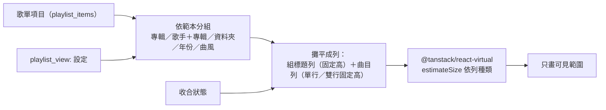
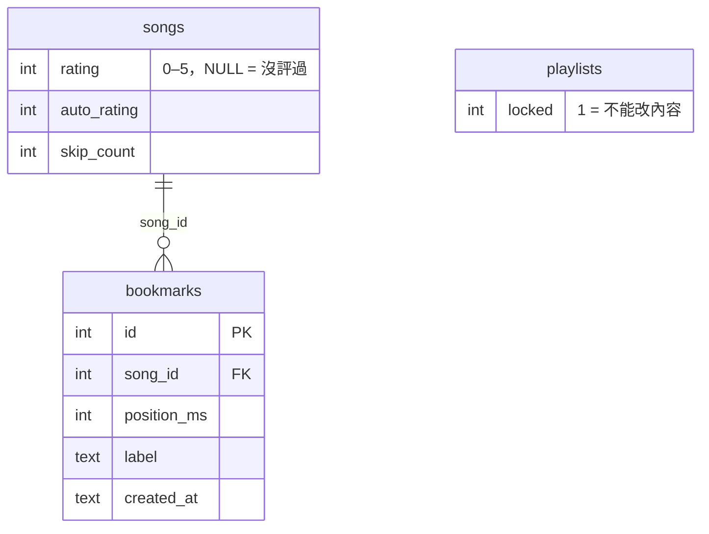
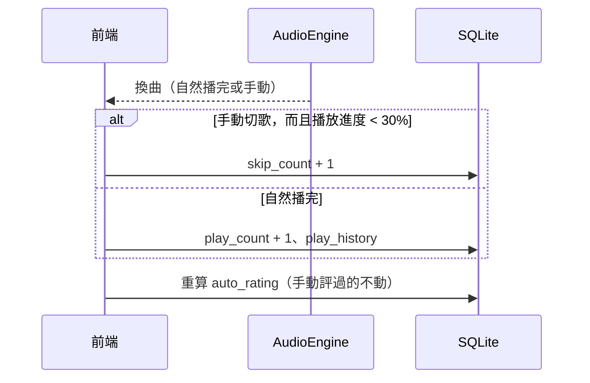

# P2 Design：曲庫與歌單工作流

> 本期的設計與實作步驟都在這份；審查紀錄在同資料夾的 `Review.md`。流程見根目錄 `AGENTS.md`。

依賴：第 4 項評分的「略過次數」靠 P0-3 無縫播放裡的換曲事件；第 1 項分組要先確認 `TrackTable` 虛擬捲動能放兩種高度的列。

順序：1 → 2 → 6 → 5 → 3 → 4 → 7。

## 圖

### 分組清單的列（P2-1）

### 新增的資料（P2-3、P2-4）

### 略過與自動評分（P2-4）

---

## 1. 歌單分組與顯示設定

**現況**：`TrackTable.tsx` 是平面清單，固定欄位，依量到的寬度自動藏欄（日期、軌／次數、專輯）。

**做法**

1. **分組範本**：無／專輯／專輯歌手＋專輯／資料夾／年份／曲風。組標題列顯示封面縮圖、專輯、歌手、年份、首數、總長度，可以收合。
2. **虛擬捲動**：列分成「組標題」與「曲目」兩種，各有固定高度，`@tanstack/react-virtual` 用 `estimateSize` 依種類回傳。10 萬首照樣不能一次畫完。
3. **單行／雙行**：雙行模式第二行顯示歌手 · 專輯 · 格式。
4. **欄位**：可選欄位（曲名、歌手、專輯、專輯歌手、曲風、年份、時間、格式、位元率、取樣率、播放次數、評分、最後播放、檔名），可拖曳欄寬；表頭與列共用同一個 `gridTemplateColumns`，沿用現有規則。
5. **各歌單獨立設定**：存在 `app_config` 的 `playlist_view:<id>`；沒有設定的用全域預設。
6. 多選、拖曳排序、右鍵選單在分組模式下照常可用；拖曳排序只在不分組、或依專輯分組的組內可用。

**完成條件**：1 萬首的歌單依專輯分組後捲動順暢；收合一組之後其他組位置正確；欄位設定關掉重開還在；900px 寬時不會出現水平捲軸。

---

## 2. 歌單工具

**做法**（右鍵選單與歌單頁籤選單）

1. **移除重複**：同路徑直接移除；「同曲名＋歌手＋長度相差 ±2 秒」先列出來讓使用者確認，不能自動刪。
2. **移除缺檔**：只從這個歌單移除 `missing=1` 的項目，曲庫不動。
3. **鎖定歌單**：`playlists` 加 `locked`。鎖定後不能加入、移除、拖曳排序、匯入，頁籤顯示鎖頭。
4. **整單排序**：依任一欄排序後寫回 `update_playlist_order_cmd`（傳 `playlist_items.id`）；另外有打亂、反轉。
5. **在歌單中尋找**：現有 Ctrl+F 篩選要能只作用於目前歌單（目前是不是已經這樣要先確認）。

**完成條件**：每個動作執行完、關掉重開，結果都還在；鎖定的歌單從任何入口都改不動；智慧歌單沒有這些選項（規則決定內容）。

---

## 3. 書籤

**做法**

1. 新表 `bookmarks(id, song_id, position_ms, label, created_at)`。
2. 快捷鍵與右鍵選單「在目前位置加書籤」；標籤預設是 `曲名 mm:ss`，可以改名。
3. 側欄「書籤」檢視：點一下就播放並跳到那個位置（用 `player_load` 加 seek，或 `player_prepare` 再播放）。
4. 歌曲標成缺檔時書籤保留；歌曲真的刪除時一起刪掉。

**完成條件**：在一首 2 小時錄音的 1:23:45 加書籤，關掉重開後點書籤，會從 1:23:45 開始播。

---

## 4. 評分與自動評分

**做法**

1. `songs` 加 `rating`（0–5，NULL 表示沒評過）、`skip_count`。
2. 清單評分欄與正在播放區都可以直接點星星。
3. **自動評分**（預設開）：依播放次數、播完率與略過次數計算。略過的定義是播不到 30% 就換下一首。手動評分永遠優先，自動值另存在 `auto_rating`。
4. 智慧歌單可以用 `rating`、`skip_count` 當條件（加進欄位白名單）。
5. **寫回檔案標籤**（選用，預設關）：ID3 POPM、Vorbis `RATING`。寫失敗的檔案逐一列出。

**完成條件**：評分關掉重開還在；常常聽完的歌自動評分會上升，常被略過的會下降；手動評過的不被自動值蓋掉。

---

## 5. 智慧歌單規則編輯器

**現況**：後端 `query_smart_playlist_songs`（`db.rs`）已經支援欄位白名單（播放次數、加入時間、年份、長度、位元率、取樣率、聲道、曲名、歌手、專輯、曲風）與運算子（`> < = like !=`）。畫面只給四個固定規則。

**做法**

1. 規則編輯畫面：多條規則，AND／OR，欄位只能從白名單選，運算子依欄位型別給（文字：包含／等於／不等於；數字與日期：大於／小於／介於）。
2. 結果的上限筆數與排序方式（例如播放次數前 100 首）。
3. **以資料夾為來源**：路徑前綴規則（一個或多個資料夾）。
4. 結果可以套用第 1 項的分組。
5. 仍然不能寫自由 SQL，只能用白名單組合。

**完成條件**：建一個「曲風包含 Rock、而且年份大於 2000、依播放次數取前 50 首」的規則，結果正確，關掉重開後重算結果一致。

---

## 6. 快捷鍵

**現況**：寫死在 `Shell.tsx`（空白、Enter、Delete、Alt+←/→、Ctrl+F），不能自訂。

**做法**

1. **按鍵表**：動作 → 按鍵，存在 `app_config` 的 `hotkeys`。設定頁提供「按下要設定的組合鍵」與衝突提示。
2. **本機快捷鍵**：視窗在前景時生效。
3. **全域快捷鍵**：要加 `tauri-plugin-global-shortcut`（crate、npm 套件、capability 都要加，而且不能只放 `core:default`，否則其他指令會被擋）。預設全部不綁。
4. **不綁** `MediaPlayPause` 等媒體鍵：已經由 SMTC 處理，搶走會跟其他播放器衝突（沿用現有規則）。
5. 可以設定的動作：播放／暫停、停止、上一首、下一首、音量加減、靜音、快轉與倒退 N 秒、切換播放模式、加書籤、評分 1–5、開關等化器、開關迷你模式、顯示或隱藏視窗。

**完成條件**：改一個本機快捷鍵後立刻生效，關掉重開還在；全域快捷鍵在視窗縮到系統匣時也能用；設定成跟已有的快捷鍵相同時會提示衝突。

---

## 7. 曲庫統計

**做法**：一個統計檢視，顯示總曲數、總長度、總容量、格式分布、最常播的歌手與專輯、每月播放量（從 `play_history` 統計）。只讀，不新增資料表。

**完成條件**：統計數字跟用 SQL 直接查的結果一致。
