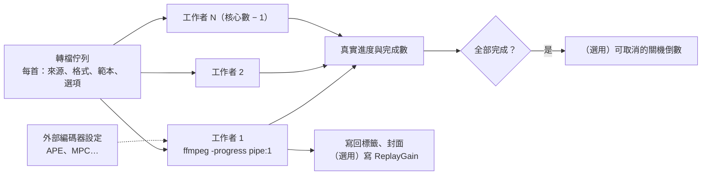
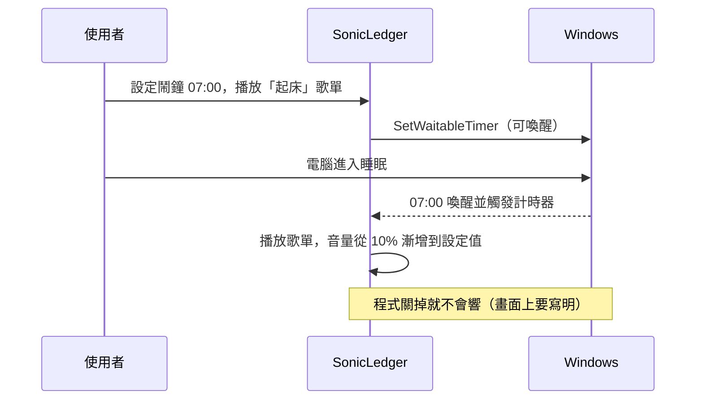
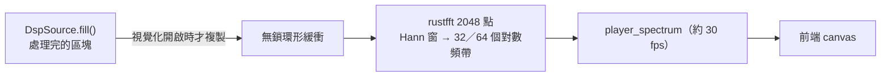

# P3 Design：工具

> 本期的設計與實作步驟都在這份；審查紀錄在同資料夾的 `Review.md`。流程見根目錄 `AGENTS.md`。

依賴：第 1 項的 ReplayGain 計算與第 2 項的轉檔正規化都用 P1-1 的讀寫格式；第 2 項的「合併成一檔並產生 CUE」與第 1 項的章節編輯用 P1-4 的 CUE 解析；第 6 項延伸格式用 P0-2 的 ffmpeg 解碼路由。

順序：1 → 2 → 3 → 4 → 5 → 6。

## 圖

### 批次轉檔佇列（P3-2）

### 鬧鐘喚醒（P3-4）

### 頻譜取樣點（P3-5）

---

## 1. 標籤編輯補齊

**現況**：單首可改曲名、歌手、專輯、曲風、年份、音軌、碟號（`models.rs` `TagEdit`）；批次只改歌手、專輯、曲風、年份。沒有封面。

**做法**

1. **欄位**：專輯歌手、作曲、註解、總音軌數、總碟數、內嵌歌詞（ID3 USLT、Vorbis `LYRICS`）、BPM。
2. **封面**：加入、取代、移除、匯出成圖檔（lofty `Picture`）。改完要更新 `data/covers` 的縮圖與 `cover_path`。
3. **標籤格式**：ID3v1、ID3v2、APE、Vorbis、MP4 用 lofty 讀寫。WMA（ASF）lofty 不支援：先做成唯讀，並寫明原因；之後再評估能不能用 ffmpeg remux（`-metadata`，不重新編碼）。
4. **批次工具**（每個都要先預覽、再執行，失敗的檔案逐一列出，沿用現有規則）：
   - 依範本改檔名或搬資料夾，例如 `%albumartist%\%album%\%track% - %title%`。不合法的字元要替換，檔名撞到時要列出來，不能覆蓋。改完同步更新 `songs.path`，歌單、播放次數、書籤都不能斷。
   - 自動編號：依目前順序填音軌號與總音軌數。
   - 從檔名填標籤，例如 `%artist% - %title%`。
   - 大小寫轉換、簡繁轉換（參考播放器是「轉寫」，中文使用者最需要的是簡繁轉換）。
5. **ReplayGain 計算**：EBU R128（`ebur128` crate），可以算單首、整張專輯、多張專輯，寫入 P1-1 讀取的那組標籤。解碼走跟播放相同的路由（symphonia／ffmpeg）。
6. **BPM 偵測**：onset 包絡加自相關，範圍 60–200，寫入 BPM 欄。準確度測試要附樣本與誤差。
7. **章節與 CUE 編輯**：長檔可以在目前播放位置加分軌點，存成 .cue（P1-4 的格式），存完重新掃描就會出現分軌。

**完成條件**：換一張封面，清單與正在播放區的封面立刻更新；用範本改 20 個檔名，歌單與播放次數仍然對得上；算出的 ReplayGain 值跟其他通用的 ReplayGain 計算工具相差 0.1 dB 以內。

---

## 2. 批次轉檔與 CD 抓軌

**現況**：一次一首，`mp3 flac wav ogg` 四種，`ConvertRequest` 只有 `song_id / format / output_dir / bitrate_kbps`。本機 ffmpeg 能編碼 mp3、aac、alac、flac、vorbis、opus、wavpack、wma，**不能**編碼 APE、MPC。

**做法**

1. **轉檔佇列**：多首一起丟進去，平行處理（預設為 CPU 核心數減 1），每首用 ffmpeg `-progress pipe:1` 回報真實進度。不能用假進度條（沿用現有規則）。可以取消；失敗的逐一列出。
2. **格式**：mp3、m4a（AAC）、ALAC、flac、wav、ogg、opus、WavPack、wma。位元率或品質選項依格式顯示：無損格式不顯示位元率，flac 顯示壓縮等級。
3. **APE、MPC 等**：用「外部命令列編碼器」設定（使用者自己指定 `mac.exe`、`mpcenc.exe` 的路徑與參數範本）。沒設定時這些格式不出現在選單。
4. **輸出模式**：一對一；同一個資料夾合併成一個檔案並產生 CUE；全部合併成一個檔案並產生 CUE。
5. **輸出檔名範本**：同第 1 項的變數，撞名時列出來，不能覆蓋。
6. **保留標籤與封面**：`-map_metadata 0`，封面另外處理（各容器寫法不同）。
7. **轉換時正規化**：寫入 ReplayGain 標籤，或用 `loudnorm` 直接改音量。兩者分開選，預設是寫標籤。
8. **改變格式**：取樣率、位元深度、聲道（例如轉成 44.1k／16bit／立體聲）。
9. **完成後關機**：用 `shutdown /s /t 60`，畫面上可以取消；預設關。
10. **CD 抓軌**：先做小實驗。Windows 上讀 CDDA 要用 `IOCTL_CDROM_RAW_READ`，ffmpeg 在 Windows 不能直接讀 CD。CD 資料查詢（MusicBrainz）要連網，預設關，屬於 P4 的連網原則。做不到就寫明不做，不能畫一個抓不了的按鈕。

**完成條件**：50 首 flac 轉 opus，進度與完成數正確，CPU 有吃滿；結果的標籤與封面都在；整張專輯合併成一個 flac 加 CUE，掃描後跟原本的分軌一致。

---

## 3. 電台錄音與播放清單網址

**現況**：電台只能播（ffmpeg 轉成 PCM 給 `LiveSource`），不能錄；貼 .pls／.m3u 網址會失敗。

**做法**

1. **錄音**：同一個 ffmpeg 程序用 `tee` 輸出，或另開一個程序：
   - 原樣保存：mp3、aac 串流用 `-c copy`，不重新編碼。
   - 轉存：flac、ogg、mp3、wav、WavPack。
2. **依曲目分檔**（選用）：ICY 標題換了就切一個新檔，檔名用標題；沒有標題就照時間切。
3. 錄音中狀態列顯示檔名與已錄時間。停止播放、切台、關閉程式時都要把檔案正確收尾。
4. **播放清單網址**：貼 `.pls`、`.m3u`、`.m3u8`、`.asx` 時先下載、解析出真正的串流網址。HLS（m3u8）交給 ffmpeg 處理。
5. 錄音可以由排程（第 4 項）開始或停止。

**完成條件**：錄一個 mp3 電台 5 分鐘，原樣保存的檔案能直接播，長度大約 5 分鐘；貼一個 .pls 網址能播出聲音。

---

## 4. 鬧鐘與排程

**現況**：只有睡眠計時（N 分鐘後暫停，或這首播完就停），只在視窗開著時有效。

**做法**

1. 新表 `scheduled_tasks(id, name, enabled, trigger_json, action_json, last_run)`。
2. **觸發**：一次性；每天、每週、每月、每年；一天內每隔 N 分鐘；事件（例如目前歌單再播 N 首後）。
3. **動作**：
   - 下一首
   - 播放指定曲目或歌單
   - 暫停、繼續
   - 開始或停止電台錄音
   - 調整音量（可以漸變）
   - 播完 N 首後回到前一個歌單
   - 讓電腦休眠或睡眠
   - 關機
   - 關閉程式
4. **鬧鐘**：播放指定歌單，音量由小漸大。要從睡眠中喚醒電腦，就用 `SetWaitableTimer` 的喚醒旗標；程式關掉時就不會響，畫面上要寫清楚。要做到「程式關掉也會響」就要用工作排程器，那可能需要權限，先做小實驗。
5. 睡眠計時併進排程，成為一種一次性任務。
6. 關機、休眠前先寫入工作階段（沿用關閉時的寫入流程）。

**完成條件**：設一個 2 分鐘後的鬧鐘，讓電腦睡眠，時間到電腦被喚醒，音樂由小聲漸大；設定關掉重開後還在；關機任務執行前有 60 秒可以取消。

---

## 5. 頻譜視覺化

**做法**

1. **取樣點**：在 `DspSource` 處理完、限幅之後，把樣本複製到一個無鎖環形緩衝區（只在視覺化開啟時寫入）。
2. **FFT**：`rustfft`，2048 點、Hann 窗，合併成 32／64 個對數頻帶加峰值保持。由指令 `player_spectrum` 以約 30 fps 取得，或用 Tauri 事件推送，選比較省的那個。
3. **前端**：canvas 繪製，放在右側面板與迷你模式；顏色用現有變數（`#e23b2f` 等），不另外造一套。
4. 預設關閉；暫停時停止計算與繪製；電台也有效，因為電台同樣經過 `DspSource`。
5. 資源預算：開啟時 CPU 增加不超過約 2%；視窗縮到系統匣時停止繪製。

**完成條件**：播 1kHz 正弦波時，峰值出現在 1k 附近的頻帶；暫停後頻譜歸零、CPU 回到原本的水準。

---

## 6. 延伸格式

**做法**（都依 P0-2 的 ffmpeg 路由；每一種先確認本機 ffmpeg 支不支援，不支援就不列進格式表）

1. **模組音樂**：mod、xm、it、s3m、mo3、umx 等。ffmpeg 編譯時要有 libopenmpt，先確認目前用的版本有沒有。
2. **MIDI**：需要 SoundFont。設定頁可以指定 `.sf2`；沒有 SoundFont 就明說無法播放。
3. **音樂 CD 直接播放（.cda）**：跟第 2 項 CD 抓軌一起做小實驗。
4. **串流網址**（MPEG-DASH 等）：需要連網，歸 P4，預設關。

**完成條件**：支援的格式能播能拖進度條；不支援的不會出現在掃描副檔名與格式表裡。
