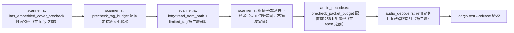

# [#2]P0-SE7-lofty解析器限制 Design.md

> 本期的設計與實作步驟都在這份；審查紀錄在同資料夾的 `Review.md`。流程見根目錄 `AGENTS.md`。

## 文件資訊表

| 項目 | 內容 |
|---|---|
| 版本 | v8 |
| 對應 Planning | `planning/[#2]P0-SE7-lofty解析器限制/planning.md` |
| 設計依據 | Planning Expected behavior / Acceptance Criteria；Review.md Sec#7（Security 第 3 輪，阻擋）；`planning/P0-daily-blockers/design.md` S4 記憶體上限延伸（I1）；Codex 設計審查 v1–v7 發現 S1–S3、C1–C3、SE1–SE2 的修正 |
| 程式基準 | `src-tauri/src/scanner.rs`、`src-tauri/src/audio_decode.rs` |
| 建立 | 2026-11-24 |
| 更新 | 2026-11-24（設計審查修正 v8） |

## 需求對照表（R1…R7）

| 編號 | Planning 原文 | 現況 (`path:line`) | 設計決策 |
|---|---|---|---|
| R1 | lofty 讀取標籤前設定單欄 ≤ 4 KB 上限，超長則拒絕該欄位 | `scanner.rs:387` `TAG_FIELD_MAX = 4 * 1024`；`scanner.rs:394-404` `limited_tag()` | **雙層防護**：(1) 新增「前置標籤大小預檢 `precheck_tag_budget(path)`」：在 `lofty::read_from_path()` 之前，先讀取檔案標頭，根據容器格式解析標籤宣告總大小（外層）；若外層總大小超過 `TAG_TOTAL_MAX`（16 KB），拒絕整個檔案入庫（`Rejected`），不走 lofty 也不走 ffprobe 後備。另做配置前結構邊界檢查：frame 宣告長度若超出外層剩餘範圍，拒絕整檔，不放行 lofty。（2) `limited_tag()` 保留為已解析欄位的第二層裁切（單欄 ≤ 4 KB），超長欄位記為 `ScanError` 但不中斷整首檔案。lofty 0.9.0 沒有配置前單欄限制 API，`src/id3/v2/read.rs:13–14` 配置外層標籤、`src/id3/v2/frame/read.rs:18–28` 另依 frame 宣告大小配置，後者未以外層剩餘長度限制配置，無法在每個 frame 配置前攔截單欄超長，此為現有套件的技術邊界；不宣稱對原檔呼叫 `read_from_path()` 能選擇跳過單一欄位，單欄限制僅由第二層裁切生效。 |
| R2 | 總標籤 ≤ 16 KB 上限 | `scanner.rs:388` `TAG_TOTAL_MAX = 16 * 1024`；`scanner.rs:394-404` `limited_tag()` | 前置預檢以容器宣告的標籤總大小判斷；超過即拒絕整個檔案入庫（`Rejected`），不走 lofty 也不走 ffprobe 後備。`limited_tag()` 以 `total: &mut usize` 累計已解析欄位，超過即捨棄後續欄位（第二層）。 |
|| R3 | 不載入嵌入封面進記憶體（僅讀取標籤欄位） | `scanner.rs:515` `cover_path: None`；`scanner.rs:428` `LOFTY_MAX_FILE_SIZE = 50 MB` | Q1 已確認：`lofty::read_from_path()` 對 ≤ 50 MB 檔案會將嵌入封面讀入記憶體（lofty `src/id3/v2/frame/content.rs:23–26` 解析 APIC，`src/picture.rs:674–682` 將圖片讀入 `Vec`；`src/flac/read.rs:77–91` 讀取 FLAC 圖片區塊）。`cover_path: None` 只是不把路徑存進資料庫，不代表記憶體中沒有封面暫存。
- 新增「封面預檢 `has_embedded_cover_precheck(path)`」：**必須在所有 `lofty::read_from_path()` 呼叫之前執行**，先讀取檔案標頭偵測嵌入圖片標記（ID3v2 APIC frame、MP4 `covr` box、FLAC 圖片區塊等）；偵測到嵌入封面則**直接拒絕該檔案入庫**，推 `ScanError`，不走 lofty 也**不走 ffprobe 後備**（ffprobe 開檔解析同可能先配置封面，無法保證不載入，故不視為安全後備）。無法辨識的格式或預檢失敗時，不得直接放行 lofty，採 Planning 允許的拒絕路徑。|
| R4 | 取樣率驗證 8000–384000 Hz，超出視為無效 | `scanner.rs:389-390` `SAMPLE_RATE_MIN/MAX`；`scanner.rs:472-479` 驗證區段 | Q2 已決策：取樣率或聲道超出範圍（含讀到 0 值）時，**拒絕該檔案入庫**，推 `ScanError`，不入庫。驗證順序：先檢查是否為 0（非法，推 `ScanError`），再檢查範圍。**不要使用 `.filter(|v| *v > 0)` 將零值悄悄過濾為 `None`**，保留原始值以便驗證。ffprobe 後備路徑讀到非法值，同樣拒絕入庫。 |
| R5 | 聲道 1–8，超出視為無效 | `scanner.rs:391-392` `CHANNELS_MIN/MAX`；`scanner.rs:481-489` 驗證區段 | 同上：聲道為 0 或超出 1–8 時，拒絕入庫，推 `ScanError`。 |
| R6 | Symphonia 單封包上限 256 KB | `audio_decode.rs:29` `MAX_PACKET_BYTES = 256 * 1024`；`audio_decode.rs:267-271` `refill()` 檢查 | SE1 已修正：新增「配置前封包上限預檢 `precheck_packet_budget(path)`」：在 `SymStream::open()` **之前**執行，使用 `std::fs::File` 讀取檔案標頭，根據容器格式（MP4/MKV 等）判斷宣告的單一封包大小；若超過 `MAX_PACKET_BYTES`，不呼叫 `open()`，回傳錯誤。保留 `SymStream::refill()` 中的 `packet.buf().len() > MAX_PACKET_BYTES` 作為第二層防護（`open()` 內部已呼叫 `refill()`，故「open 之後 refill 之前」不符合現有呼叫順序，不可作為唯一防線）。 |
| R7 | 解碼錯誤累計超過 10 次即終止 | `audio_decode.rs:28` `MAX_DECODE_ERRORS = 10`；`audio_decode.rs:165` `decode_errors` 欄位；`audio_decode.rs:300-305` 累計與終止 | `decode_errors` 欄位跨封包累計（`refill()` 迴圈內），> 10 即 `finished = true` 回傳 `false`。錯誤與成功封包交錯時仍繼續累計，不歸零。 |

## 架構變更圖

```mermaid
flowchart TD
    A[process_single_file(path)] --> B[validate_local_path(path)]
    B -- 驗證失敗 --> Z[Skipped，路徑驗證失敗，不攜帶業務錯誤]
    B -- 驗證通過 --> G[has_embedded_cover_precheck(path)<br/>偵測嵌入圖片？]
    G -- 偵測到 --> K[ScanError，拒絕入庫]
    G -- 無圖片 --> E[precheck_tag_budget(path)<br/>標籤宣告總大小 ≤ 16 KB？]
    E -- 超標 --> K[拒絕入庫，Rejected，ScanError]
    E -- 通過 --> C{metadata.len() ≤ 50 MB？}
    C -- 否 --> D[ffprobe_meta() 後援，僅文字中繼資料]
    C -- 是 --> F[lofty::read_from_path(path)]
    F -- 失敗 --> D
    F -- 成功 --> H[limited_tag()：單欄≤4 KB、總≤16 KB<br/>超長欄位拒絕該欄位，記 ScanError]
    D --> M[ffprobe 標籤套用相同 4 KB/16 KB 預算]
    H --> M
    M --> Kq{取樣率 8000-384000 且 ≠ 0，<br/>聲道 1-8 且 ≠ 0？<br/>兩項皆通過？}
    Kq -- 否 --> K[ScanError，拒絕入庫]
    Kq -- 是 --> L[建立 NewSong，cover_path=None]
    K --> N[ScanProgress.errors 攜帶逐檔錯誤]
    L --> N
```

## 詳細設計

### 4.1 標籤大小上限（R1、R2）

`scanner.rs:387-404` 的 `limited_tag()`：
- 單欄上限 `TAG_FIELD_MAX = 4 * 1024` 位元組（UTF-8 字串位元組長度）
- 總上限 `TAG_TOTAL_MAX = 16 * 1024` 位元組，以 `total: &mut usize` 累計
- **新增前置預檢 `precheck_tag_budget(path)`**：在 `lofty::read_from_path()` 之前執行，先讀取檔案標頭，根據容器格式解析標籤宣告總大小（外層）；若外層總大小超過 `TAG_TOTAL_MAX`（16 KB），拒絕整個檔案入庫（`Rejected`），不走 lofty 也不走 ffprobe 後備。另做配置前結構邊界檢查：frame 宣告長度若超出外層剩餘範圍，拒絕整檔，不放行 lofty。單欄 frame 宣告大小 `≤ TAG_FIELD_MAX`（4 KB）的檢查不由前置預檢攔截（lofty 0.9.0 仍會按原始 frame 長度配置），而是由 `limited_tag()` 第二層在讀取後裁切：單欄超過 4 KB 則拒絕該欄位（不寫入 `tags` HashMap，記為 `ScanError`，繼續處理下一欄，不中斷整首檔案）；累計超過 `TAG_TOTAL_MAX` 則捨棄後續欄位。這使總量限制「位於配置前」；單欄限制為配置後裁切（lofty 0.9.0 技術邊界）。
- **技術邊界說明**：lofty 0.9.0 沒有配置前單欄限制 API，`src/id3/v2/read.rs:13–14` 配置外層標籤、`src/id3/v2/frame/read.rs:18–28` 另依 frame 宣告大小配置，後者未以外層剩餘長度限制配置，無法在每個 frame 配置前攔截單欄超長，此為現有套件的技術邊界；不宣稱對原檔呼叫 `read_from_path()` 能選擇跳過單一欄位，單欄限制僅由第二層裁切生效。
- `limited_tag()` 保留為第二層裁切：實際讀取後，若單欄長度超過 `TAG_FIELD_MAX`，拒絕該欄位（不寫入 `tags` HashMap，記為 `ScanError`，繼續處理下一欄，不中斷整首檔案）；若累計超過 `TAG_TOTAL_MAX`，捨棄後續欄位。單欄超長不導致整檔拒絕，只有外層總大小超標或結構邊界檢查失敗才拒絕整檔。
- 適用於 title、artist、album、album_artist、genre、date 欄位（`scanner.rs:436-448`）

### 4.2 不載入嵌入封面（R3）

- Q1 已確認：`lofty::read_from_path()` 對 ≤ 50 MB 檔案會將嵌入封面讀入記憶體。`cover_path: None` 只是不把路徑存進資料庫，不代表記憶體中沒有封面暫存。
- 新增「封面預檢 `has_embedded_cover_precheck(path)`」：**必須在所有 `lofty::read_from_path()` 呼叫之前執行**，先讀取檔案標頭偵測嵌入圖片標記（ID3v2 APIC frame、MP4 `covr` box、FLAC 圖片區塊等）；偵測到嵌入封面則**直接拒絕該檔案入庫**，推 `ScanError`，**不走 lofty，也不走 ffprobe 後備**（ffprobe 開檔解析同可能先配置封面，無法保證不載入，故不視為安全後備）。
- 無法辨識的格式或預檢失敗時，**不得直接放行 lofty，也不走 ffprobe 後備**，採 Planning 允許的拒絕路徑，直接拒絕該檔案入庫，推 `ScanError`。
- `cover_path: None` 固定寫入 `NewSong`（`scanner.rs:515`），掃描絕不產生封面縮圖路徑。
- `generate_cover_thumbnail()`（`scanner.rs:549-557`）不在本任務掃描路徑中被呼叫。
- `LOFTY_MAX_FILE_SIZE = 50 MB`（`scanner.rs:428`）：超過此大小**不直接繞過封面預檢與標籤預檢**；仍先執行 `has_embedded_cover_precheck(path)`，偵測到封面則拒絕入庫；未偵測到封面且無法用 lofty 讀取時，改用 `ffprobe_meta()` 後備，但前必須先通過 `precheck_tag_budget(path)` 的總標籤 ≤ 16 KB 檢查，超標則拒絕入庫（`Rejected`），不走 ffprobe。

### 4.3 取樣率與聲道驗證（R4、R5）

- Q2 已決策：取樣率或聲道超出範圍（含讀到 0 值）時，**拒絕該檔案入庫**，推 `ScanError`，不入庫。符合 Planning「異常檔案應拒絕或回退後備路由」的「拒絕」方向。
- `SAMPLE_RATE_MIN = 8000`、`SAMPLE_RATE_MAX = 384000`（`scanner.rs:389-390`）
- `CHANNELS_MIN = 1`、`CHANNELS_MAX = 8`（`scanner.rs:391-392`）
- **不使用 `.filter(|v| *v > 0)` 過濾零值**：`scanner.rs:432-433`（lofty 路徑）與 `scanner.rs:340-344`（ffprobe 路徑）都保留原始值（含 0），不提前丟棄。
- 驗證順序（`scanner.rs:472-489`）：
  1. 若讀到 `sample_rate == 0` 或 `channels == 0`，視為非法值，推 `ScanError`，設為 `None`，拒絕入庫。
  2. 若 `sample_rate < 8000` 或 `> 384000`，推 `ScanError`，拒絕入庫。
  3. 若 `channels < 1` 或 `> 8`，推 `ScanError`，拒絕入庫。
- ffprobe 後備路徑讀到非法值，同樣拒絕入庫。
- lofty 與 ffprobe 兩條來源匯入同一驗證流程，兩項皆通過才建立歌曲。
- 不再採「設為 None 仍入庫」的做法，避免異常中繼資料進入資料庫。

### 4.4 Symphonia 封包上限與錯誤累計（R6、R7）

`src-tauri/src/audio_decode.rs`：
- `MAX_PACKET_BYTES = 256 * 1024`（`audio_decode.rs:29`）
- **新增配置前預檢 `precheck_packet_budget(path)`**：在 `SymStream::open()` **之前**執行，使用 `std::fs::File` 讀取檔案標頭，根據容器格式（MP4/MKV 等）遍歷所有音軌與片段的宣告封包大小；若任何音軌的任一封包宣告大小超過 `MAX_PACKET_BYTES`，不呼叫 `open()`，回傳錯誤。無法可靠遍歷某種格式的封包索引時，採拒絕路徑，不呼叫 `open()`。
  - 說明：`audio_decode.rs:215` 在 `open()` 內部已呼叫 `refill()`，故「open 之後、refill 之前」不符合現有呼叫順序，不可作為唯一防線。預檢必須落在 `open()` 之前，對第一次封包配置前生效。
- **第二層防護位置**：實際 API 時序為 `next_packet()` 先取得完整 Packet（已配置緩衝）→ 對該 Packet 檢查 `packet.buf().len() > MAX_PACKET_BYTES`（超過即 `finished = true` 回傳 `false`，終止該軌）→ 若不超標，再篩音軌（`packet.track_id() != self.track_id`，`:264–265`，非目標音軌跳過）→ 進入 `decoder.decode()`（`:267–271`）。因此第二層防護順序為「大小檢查在音軌篩選之前」，覆蓋從 `next_packet()` 取得的所有音軌封包與後續片段，而非僅限目標音軌。配置前保護由第一層 `precheck_packet_budget` 提供；第二層屬配置後檢查，作為配置後的兜底，不宣稱「不配置直接跳過」。無法可靠遍歷某種格式的封包索引時，第一層採拒絕路徑，不呼叫 `open()`。
- `MAX_DECODE_ERRORS = 10`（`audio_decode.rs:28`）：`SymStream.decode_errors` 欄位（`audio_decode.rs:165`）在 `refill()` 迴圈內累計（`audio_decode.rs:300-305`），超過 10 次即 `finished = true` 回傳 `false`。
- 錯誤是跨封包累計，非每次 `refill` 歸零。錯誤與成功封包交錯時仍繼續累計。

### 4.5 錯誤處理與結果契約

- `scanner.rs:407` `process_single_file` 目前回傳 `Option<(NewSong, Vec<ScanError>)>`，回傳 `None`（如 `validate_local_path` 失敗、metadata 失敗）會**丟失錯誤**，無法彙整至前端。
- **新增結果契約**：引入 `ScanResult` 列舉，支援三種結果：
  - `Song(NewSong, Vec<ScanError>)`：正常入庫，攜帶非阻斷錯誤
  - `Rejected(Vec<ScanError>)`：拒絕入庫（封面預檢拒絕、取樣率/聲道非法、封包超標等），錯誤仍彙整
  - `Skipped`：檔案系統層級跳過（路徑驗證失敗、metadata 讀取失敗），不攜帶業務錯誤
- 掃描彙整時（`scanner.rs:286-290`），`Rejected` 的錯誤也被收錄到 `ScanProgress.errors` 傳給前端；該檔案不入庫。
- 掃描錯誤透過 `ScanError { path, reason }` 彙整，最後經 `scan_folders` 命令的 `ScanProgress.errors` 傳給前端。
- 單一檔案的錯誤不導致整個掃描失敗；其他正常檔案仍可入庫。

## IPC 指令契約變更

本任務不新增或修改 Tauri IPC 指令；所有變更皆在掃描與解碼模組內部。
- 公開 Tauri command：`scan_folders`（`src-tauri/src/commands.rs:160`）
- 內部函式：`scan_music_folders`（`scanner.rs:167`，v2 正文誤寫 `scan-music-folders`，現已校正）
- 事件：`scan-progress`（`src/lib/api.ts:135-136`），攜帶 `ScanProgress.errors` 逐檔錯誤清單
- 指令簽名不變，但 `ScanProgress.errors` 已含 SE7 相關錯誤（封面預檢拒絕、取樣率/聲道非法、封包超標等）。

## 前端狀態與 UI 變更

無前端變更。掃描錯誤清單由現有 `ScanProgress.errors` 欄位攜帶，前端掃描面板可直接列顯示。

## 設計待確認事項

| 編號 | 事項 | 決定 | 理由 |
|---|---|---|---|
| Q1 | `lofty::read_from_path()` 對 ≤ 50 MB 檔案是否會將嵌入封面讀入記憶體？ | **已確認：會**。lofty 0.9.0 會解析 APIC 並將圖片讀入 `Vec`；FLAC 也會讀取圖片區塊。 | lofty `src/id3/v2/frame/content.rs:23–26`、`src/picture.rs:674–682`、`src/flac/read.rs:77–91`。已採用封面預檢，在所有 lofty 呼叫之前偵測圖片並跳過。 |
| Q2 | 取樣率/聲道超出範圍時，是否應直接拒絕整首檔案（不入庫）？ | **已決定：拒絕入庫**。推 `ScanError`，不入庫。 | 符合 Planning「異常檔案應拒絕或回退後備路由」的「拒絕」方向；避免異常中繼資料進入資料庫。 |

## 驗收條件對照

| AC 編號 | Planning 條件 | 設計對應 | 測試方式 |
|---|---|---|---|
| AC1 | lofty 標籤單欄／總長度上限已實作 | R1、R2 → `scanner.rs:387-404` + 前置預檢 | 單元測試：建立超過 4 KB 的單欄與超過 16 KB 的總標籤，確認欄位被捨棄並記為 ScanError；前置預檢拒絕超過 16 KB 宣告大小的檔案 |
| AC2 | 嵌入封面不載入記憶體 | R3 → `scanner.rs:515`、`scanner.rs:428` + 封面預檢 | 掃描含大封面的音檔，確認封面預檢偵測到圖片後跳過 lofty；cover_path 為 None；記憶體不因封面異常增長 |
| AC3 | 取樣率與聲道範圍驗證已實作 | R4、R5 → `scanner.rs:389-392`、`scanner.rs:472-489` | 造檔取樣率 44100（合法）、8000／384000（邊界）、7999／384001（非法）、0（非法）；聲道 1、8（合法）、0、9（非法）。非法值推 `ScanError` 並拒絕入庫 |
| AC4 | Symphonia 256 KB 封包上限與跨封包錯誤累計已實作 | R6、R7 → `audio_decode.rs:28-29`、`audio_decode.rs:165`、`audio_decode.rs:267-305` + 配置前預檢 | 構造單封包 > 256 KB 的音檔，確認配置前預檢拒絕；構造錯誤與成功封包交錯的音檔，跨多次 `refill()` 累計第 11 次 `DecodeError` 終止 |
| AC5 | `cargo test --release --manifest-path src-tauri/Cargo.toml` 全過 | — | 執行測試命令，0 失敗 |

## 風險對策表

| 風險 | 可能性 | 影響 | 對策 |
|---|---|---|---|
| lofty 內部將封面讀入記憶體（≤ 50 MB 檔案） | 中 | 中 | 已採用封面預檢 `has_embedded_cover_precheck(path)`，在所有 lofty 呼叫之前偵測圖片並跳過；50 MB 以上已跳過 lofty |
| lofty 單欄 4 KB 無法在配置前攔截（套件 API 邊界） | 中 | 中 | 前置預檢限制外層總大小；`limited_tag()` 作為第二層裁切，超長欄位記為 ScanError；此為 lofty 0.9.0 技術邊界，非實作可完全消除 |
| 取樣率/聲道為異常值（含 0）導致後續播放元件異常 | 低 | 中 | 不使用 `.filter(|v| *v > 0)` 過濾零值；驗證順序先檢查 0 值再檢查範圍，非法值直接拒絕入庫，不進入資料庫 |
| 大量異常檔案掃描時 `ScanError` 清單過長 | 低 | 低 | 錯誤清單僅彙整，前端可分頁或截斷顯示 |
| Symphonia 封包上限導致合法但封包較大的檔案無法播放 | 極低 | 低 | 已新增配置前預檢 `precheck_packet_budget(path)`；256 KB 遠大於一般音訊封包；僅惡意建構檔案會觸發 |
| ffprobe 後備路徑繞過文字標籤限制 | 中 | 中 | ffprobe 讀取的標籤進入共同處理前，套用相同 `TAG_FIELD_MAX`（4 KB）／`TAG_TOTAL_MAX`（16 KB）預算 |

## 實作順序建議



## 測試案例表

| 測試案例 | 對應 AC | 類型 | 驗證重點 |
|---|---|---|---|
| 單欄超過 4 KB 的標籤 | AC1 | 單元測試 | 該欄位不出現在 `tags`，記為 ScanError，其他欄位正常 |
| 總標籤超過 16 KB（前置預檢拒絕） | AC1 | 單元測試 | `precheck_tag_budget` 在 `lofty::read_from_path` 前拒絕 |
| 總標籤超過 16 KB（第二層裁切） | AC1 | 單元測試 | `limited_tag()` 捨棄超標欄位，記為 ScanError，其他欄位保留 |
| 含大嵌入封面的音檔掃描 | AC2 | 整合測試 | 封面預檢在 lofty 之前偵測到圖片後跳過；cover_path 為 None；記憶體無異常增長 |
| 取樣率 7999 Hz | AC3 | 單元測試 | 推 `ScanError`，拒絕入庫 |
| 取樣率 0 Hz | AC3 | 單元測試 | 不被 `.filter` 過濾，視為非法值，推 `ScanError`，拒絕入庫 |
| 取樣率 8000 / 384000 Hz | AC3 | 單元測試 | 合法，通過驗證 |
| 聲道 0 / 9 | AC3 | 單元測試 | 不被 `.filter` 過濾，視為非法值，推 `ScanError`，拒絕入庫 |
| 聲道 1 / 8 | AC3 | 單元測試 | 合法，通過驗證 |
| 單封包 > 256 KB（配置前預檢拒絕） | AC4 | 單元測試 | 建立 MP4 音檔，其 stsz atom 的 sample_sizes 欄位宣告單一樣本大小 > 256 KB（`symphonia-format-isomp4-0.5.5/src/atoms/stsz.rs:25–28,39–47`）；驗證 `precheck_packet_budget` 在 `SymStream::open` 之前拒絕，未呼叫 `open()`，亦未進入 `refill` 配置 |
| 連續 11 次解碼錯誤（跨 refill 累計） | AC4 | 單元測試 | 建立 MP4 音檔，其 stsz atom 的 sample_sizes 宣告一系列樣本大小；搭配 Rust 測試替身（mock），使 `Decoder::decode` 依序回傳 `Ok`、`DecodeError`、`Ok`、`DecodeError`… 交錯序列，總計 11 次 `DecodeError` 與若干次 `Ok` 交錯；呼叫 `refill()` 觀測 `decode_errors` 實例欄位（`audio_decode.rs:165`）跨多次呼叫累計（不歸零）：第 10 次錯誤後 `finished` 仍為 false、第 11 次錯誤後所在的 `refill()` 回傳 `false` 且 `finished == true`；後續 iterator `next()` 回傳 `None`；斷言成功解碼不會歸零累計，錯誤與成功封包交錯時仍繼續累計。 |
| 封面預檢未呼叫 lofty | AC2 | 單元測試 | 建立含嵌入封面的音檔，驗證 `has_embedded_cover_precheck` 偵測到圖片後不呼叫 `lofty::read_from_path`（可透過偽造或記錄呼叫次數觀測）；該檔案被拒絕入庫，推 `ScanError` |
| `cargo test --release` | AC5 | 建置驗證 | 0 失敗 |

## 變更檔案清單

| 檔案 | 變更類型 | 說明 |
|---|---|---|
| `src-tauri/src/scanner.rs` | 需修正（文件化） | 新增 `precheck_tag_budget(path)` 配置前標籤大小預檢；新增 `has_embedded_cover_precheck(path)` 封面預檢（在 lofty 之前）；`limited_tag()` 降格為第二層裁切並記 ScanError；取樣率/聲道驗證不使用 `.filter(|v| *v > 0)` 過濾零值，先檢查 0 值再檢查範圍，非法值拒絕入庫；引入 `ScanResult` 列舉支援「拒絕入庫但保留錯誤」；`cover_path=None` 固定寫入 |
| `src-tauri/src/audio_decode.rs` | 需修正（文件化） | 新增 `precheck_packet_budget(path)` 配置前 256 KB 封包上限預檢（在 `SymStream::open` 之前）；保留 `MAX_PACKET_BYTES`/`MAX_DECODE_ERRORS`/`decode_errors` 欄位/`refill` 檢查作為第二層防護。四個直接呼叫 `SymStream::open` 的入口（`player.rs:405`、`playback_pipeline.rs:1586`、`next_track.rs:92,298`）均需先呼叫 `precheck_packet_budget(path)`，超標則拒絕，不呼叫 `open()`，確保播放、預載及串流重開均不可繞過預檢。 |

## 回寫 Agents/ 文件規劃

交付前需同步更新：
- `Agents/business-logic.md`：記錄標籤大小上限、封面不載入、取樣率/聲道驗證與拒絕入庫規則
- `Agents/system-architecture.md`：記錄 Symphonia 解碼錯誤累計與封包上限（含配置前預檢）
- `planning/ROADMAP.md`：將本項目標記為完成

## 審查記錄區

### 設計審查（實作前）

| 階段 | 結論 | 發現編號 | 修正狀態 |
|---|---|---|---|
| Spec | 通過（v1–v7 不通過，v8 通過；N1 摘要文字一致性已修正） | S1、S1-a、S1-b、S2-a、S2-b、S3 | 已修正正文，審查通過 |
| Code | 通過（v1–v7 有條件，v8 通過） | C1、C2-a、C2-b、C3 | 已修正正文，審查通過 |
| Security | 通過（v1–v7 不通過，v8 通過） | SE1、SE2 | 已修正正文，審查通過 |

### 實作審查（實作後）

| 階段 | 結論 | 發現編號 | 修正狀態 |
|---|---|---|---|
| Spec | — | — | — |
| Code | — | — | — |
| Security | — | — | — |

修正追蹤表：編號 / 來源 / 修正動作 / Design.md 對應位置

| 編號 | 來源 | 修正動作 | Design.md 對應位置 | 狀態 |
|---|---|---|---|---|
| S1 | 設計審查 Spec | 新增前置標籤大小預檢，補充 frame 結構邊界檢查，統一單欄超 4 KB 拒絕該欄位（由第二層 `limited_tag()` 裁切）、外層超 16 KB 拒絕整檔，limited_tag 降格為第二層並記 ScanError | `4.1`、`架構變更圖` | 已修正 |
| S1-a | 設計審查 Spec | 消除「不放行 lofty 解析該欄位」誤導；前置預檢只攔截外層總大小（超過 16 KB 拒絕整檔）；加入配置前結構邊界檢查（frame 宣告長度超出外層剩餘範圍時拒絕整檔）；單欄超 4 KB 由 `limited_tag()` 第二層在讀取後裁切（拒絕該欄位，不寫入 tags，記 ScanError，繼續其他欄位）；不宣稱對原檔呼叫 `read_from_path()` 能選擇跳過單一欄位 | `R1`、`4.1` | 已修正 |
| S1-b | 設計審查 Spec | 總量預檢 `precheck_tag_budget` 移到大小分流（50 MB）之前，所有檔案（含 >50 MB）都先經過 total size 檢查；超標統一拒絕入庫（`Rejected`），不走 lofty 也不走 ffprobe；消除需求對照表、流程圖、詳細設計的矛盾 | `R1/R2`、`架構變更圖`、`4.2` | 已修正 |
| S2-a | 設計審查 Spec | 封面預檢移到所有 lofty 呼叫之前；列明可辨識格式與圖片區塊；無法辨識/預檢失敗統一導向拒絕 | `4.2`、`架構變更圖` | 已修正 |
| S2-b | 設計審查 Spec | 封面預檢位於大小分流之前；偵測到嵌入封面直接拒絕入庫，不走 lofty 也不走 ffprobe；超過 50 MB 不繞過封面預檢 | `4.2`、`架構變更圖`、`風險對策表` | 已修正 |
| S3 | 設計審查 Spec | 流程圖驗證失敗節點改為 `Skipped`，與新的 `ScanResult` 回傳型別一致，不再寫「回傳 None，錯誤丟失」 | `架構變更圖` | 已修正 |
| N1 | 設計審查 Spec（低風險） | 第 62 行補上「或結構邊界檢查失敗」；第 215 行改稱「frame 結構邊界檢查」 | `4.1`、修正追蹤表 | 已修正 |
| C1 | 設計審查 Code | 不使用 `.filter(|v| *v > 0)` 過濾零值；先檢查 0 值再檢查範圍 | `4.3`、`測試案例表` | 已修正 |
| C2-a | 設計審查 Code | 變更清單補充四個直接呼叫 `SymStream::open` 的入口（`player.rs:405`、`playback_pipeline.rs:1586`、`next_track.rs:92,298`），均需先呼叫 `precheck_packet_budget(path)` | `變更檔案清單` | 已修正 |
| C2-b | 設計審查 Code | 測試案例斷言改為第 11 次錯誤所在的 `refill()` 回傳 `false` 且 `finished == true`，後續 iterator `next()` 回傳 `None` | `測試案例表` | 已修正 |
| C3 | 設計審查 Code | 架構圖取樣率與聲道合併為共同驗證，兩項皆通過才入庫；錯誤處理段指令名稱校正為 `scan_folders` | `架構變更圖`、`IPC 指令契約變更` | 已修正 |
| SE1 | 設計審查 Security | 配置前封包上限預檢在 `SymStream::open` 之前；第二層防護順序統一為 `next_packet()` → 封包大小檢查 → 音軌篩選 → decode；四個開檔入口均接入預檢（受 C2-a 影響） | `4.4`、`架構變更圖`、`變更檔案清單` | 已修正 |
| SE2 | 設計審查 Security | ffprobe 後備標籤套用相同文字預算 | `架構變更圖`、`風險對策表` | 已修正 |

## 下一步

設計審查三階段（Spec／Code／Security）於 v8 已全部回傳 `通過`（Codex v8 審查結論：通過）。實作階段已完成：

- `src-tauri/src/scanner.rs`：新增 `ScanResult` 列舉、`has_embedded_cover_precheck(path)` 封面預檢（在 lofty 之前）、`precheck_tag_budget(path)` 配置前標籤大小預檢；`limited_tag()` 降格為第二層裁切並記 `ScanError`；取樣率/聲道驗證不使用 `.filter(|v| *v > 0)` 過濾零值，先檢查 0 值再檢查範圍，非法值拒絕入庫；`process_single_file` 回傳 `ScanResult`（`Song`/`Rejected`/`Skipped`）；`cover_path=None` 固定寫入；`scan_music_folders` 彙整 `Rejected` 錯誤至 `ScanProgress.errors`。
- `src-tauri/src/audio_decode.rs`：新增 `precheck_packet_budget(path)` 配置前 256 KB 封包上限預檢（MP4 stsz box 解析）；`refill()` 第二層防護順序調整為封包大小檢查在音軌篩選之前；`MAX_DECODE_ERRORS`/`decode_errors` 跨封包累計已保留。
- `src-tauri/src/player.rs`、`src-tauri/src/playback_pipeline.rs`、`src-tauri/src/next_track.rs`：四個 `SymStream::open` 入口（`player.rs:405`、`playback_pipeline.rs:1586`、`next_track.rs:92,298`）均先呼叫 `precheck_packet_budget(path)`，超標則拒絕不呼叫 `open()`。
- 驗證：`cargo test --release --manifest-path src-tauri/Cargo.toml` 全過（49 passed, 0 failed）。

下一步：更新 `Agents/business-logic.md` 與 `Agents/system-architecture.md` 記錄 SE7 規則，並將 `planning/ROADMAP.md` 中 P0 `[#2]P0-SE7-lofty解析器限制` 標記為完成。