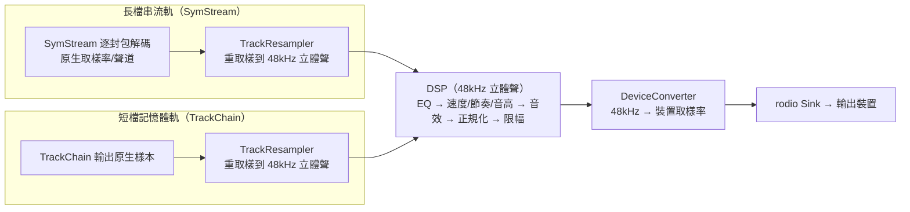

# [#3]P0-Imp1Imp3-長檔TrackResampler與DSP鏈 Design.md

> 本期的設計與實作步驟都在這份；審查紀錄在同資料夾的 `Review.md`。流程見根目錄 `AGENTS.md`。

## 文件資訊表

| 項目 | 內容 |
|---|---|
| 版本 | v10 |
| 對應 Planning | `planning/[#3]P0-Imp1Imp3-長檔TrackResampler與DSP鏈/planning.md` |
| 設計依據 | Planning Description / User Story / Expected behavior / Acceptance Criteria；`src-tauri/src/playback_pipeline.rs` PipeLine 註解（line 3-10）；`Agents/business-logic.md` 等化器與音效章節（line 99-108）；`Agents/system-architecture.md` 音訊管線圖（line 63-79） |
| 程式基準 | `src-tauri/src/playback_pipeline.rs`、`src-tauri/src/player.rs`、`src-tauri/src/dsp.rs` |
| 建立 | 2026-11-24 |
| 更新 | 2026-11-24（實作完成並通過實作審查：dsp.rs RateStage::new/run 開為 pub(crate)；playback_pipeline.rs 新增 rate_stage/track_out/dsp_out/dsp_params 欄位、apply_dsp_block()、next_playing() 統一 drain order、sync_identity() 軌切換前舊 RateStage 尾端排空；player.rs SetFx 同步 dsp_params、Symphonia 長檔建立 RateStage、load_at 清空佇列；cargo check 無錯誤，cargo test --release 54/54 全過） |

## 需求對照表（R1…R4）

| 編號 | Planning 原文 | 現況 (`path:line`) | 設計決策 |
|---|---|---|---|
| R1 | `TrackResampler` 在長檔串流路徑中被配置（`set_track` 指定原生取樣率/聲道） | `player.rs:420-433` 已為長檔建立 `TrackResampler` 並呼叫 `set_track(Some(...))`，指定 `sample_rate`/`channels`；但 `track_chain` 為空 `TrackChain::new()`（line 435），長檔不經 TrackChain；FFmpeg 長檔分支（line 539-549）僅 `TrackResampler::new()`，尚未 `set_track`，且無 `RateStage` 建立 | **修正**：`player.rs` 長檔載入入口需補齊 `set_track` 與 `RateStage` 建立，涵蓋初次載入、手動換軌、seek 與自然交接（見 4.2）。 |
| R2 | `next_playing()` 中串流樣本也經過 `TrackResampler::process()` 重取樣到 48kHz | `playback_pipeline.rs:328-338` `next_playing()` 呼叫 `next_stream()` 取得串流樣本；若 `track_resampler` 為 `None`（line 337-338），則**繞過重取樣直接 `apply_dsp(sample)`**；且 `next_stream()` 單次回傳單一 `f32`，與立體聲幀處理未對齊 | **修正**：移除 `resampler` 為 `None` 的繞過路徑；長檔串流樣本必須經 `TrackResampler::process()` 重取樣到 48kHz 後再進入 DSP；以立體聲幀（L,R）一次送入 `apply_dsp_block`。 |
| R3 | `apply_dsp()` 套用 `FxChain`（含殘響、節奏、音高、回音等），不只 EQ 與正規化 | `playback_pipeline.rs:484-508` `apply_dsp()` 已套用 EQ 處理器 + `FxChain::frame` + 正規化；但 `FxChain`（`dsp.rs:274`）僅含 bass/enhancer/voice_remover/chorus/flanger/echo/reverb，**缺少速度/節奏/音高**（這三者在 `dsp.rs:540` `RateStage`，但只供 `DspSource` 使用，未併入 `PlaybackCore**）；且 `apply_dsp` 以單聲道幀 `[s]` 單一樣本送入 `FxChain`，立體聲右聲道未經音效處理 | **修正**：在 `PlaybackCore` 管線中加入 `RateStage`（速度/節奏/音高）；`apply_dsp_block()` 改為以立體聲幀 `[L, R]` 一次送入 `FxChain`，兩聲道都經音效；電台串流略過速度/節奏/音高（`allow_rate=false`，與 `Agents/business-logic.md` 第 99 條一致）。 |
| R4 | 長檔與短檔走同一條處理路徑 | `playback_pipeline.rs:328-393` `next_playing()` 中串流軌（`next_stream`）與 TrackChain 軌（`track_chain.next()`）走不同分支，匯合點僅在 `apply_dsp` | **統一**：串流軌與記憶體軌在 `TrackResampler` 產出 48kHz 立體聲樣本後匯合，同樣經 `apply_dsp_block()`（EQ → 速度/節奏/音高 → 音效 → 正規化 → 限幅），再進 `DeviceConverter` → `Sink`。 |

## 架構變更圖



## 詳細設計

### 4.1 長檔串流必須經 TrackResampler 重取樣（R1、R2）

`playback_pipeline.rs` `next_playing()`：

- 現行 `next_stream()`（line 397-400）從 `stream_source` 取得單一 `f32` 原生樣本，線程安全地鎖定 `stream_source` Mutex。
- `TrackResampler::process(sample: f32) -> Option<f32>`：餵入單一原生樣本，累積至 BLOCK_FRAMES（2048）後經 rubato 重取樣到 48kHz；回傳 `Some(48kHz 聲道樣本)` 或 `None`（累積中，非靜音，非結束）。**保留現有單樣本介面，不改為區塊介面。**
- `TrackResampler::pop_output() -> Option<f32>`：取出重取樣器內部已產出但尚未消耗的剩餘樣本；回傳 `None` 表示內部緩衝已耗盡。
- `PlaybackCore` 新增兩個佇列：
  - `track_out: Mutex<VecDeque<f32>>`：TrackResampler 輸出的 48kHz 聲道樣本暫存，**尚未經 DSP**。
  - `dsp_out: Mutex<VecDeque<f32>>`：DSP 最終輸出佇列（立體聲交錯），供 `next_playing()` 逐樣本消耗並回傳，**一個樣本即可回傳，不以兩個為門檻**。
- 修改 `next_playing()` 的串流軌分支（line 328-338）：
  1. 先從 `dsp_out` 佇列取樣本回傳；若 `dsp_out` 不空，回傳一個樣本並結束此次調用。
  2. 若 `dsp_out` 空，先從 `track_resampler` 的 `pop_output()` 取出剩餘重取樣輸出，追加至 `track_out`，直到 `pop_output()` 回傳 `None`（內部緩衝耗盡）。
  3. 若 `track_out` 夠兩個樣本，取兩個組成 `[L, R]`，送入 `apply_dsp_block(&[L, R], &mut tmp_out)`，將 `tmp_out` 全部追加至 `dsp_out`，回到步驟 1。
  4. 若 `track_out` 不足兩個樣本，呼叫 `next_stream()` 取得原生樣本。
  5. 鎖定 `track_resampler`，**必須**存在（長檔載入時 `player.rs:420` 已建立）；若為 `None` 回傳錯誤記錄並輸出靜音，不得繞過。
  6. 呼叫 `track_resampler.process(sample)`；回傳 `Some(s)` 時將 `s` 追加至 `track_out`；`None` 表示累積中，繼續拉取上游。
- 上游結束（`next_stream()` 回傳 `None`）且 `track_out`、`dsp_out` 皆耗盡後，進入軌結束流程（見 4.3）。
- 移除 line 337-338 的繞過路徑（`resampler` 為 `None` 時直接 `apply_dsp(sample)`）。

### 4.2 apply_dsp_block 改為立體聲幀輸入、零到多幀輸出並併入 RateStage（R3）

`playback_pipeline.rs`：

- `PlaybackCore` 新增欄位：
  - `rate_stage: Mutex<Option<RateStage>>`（`RateStage` 在 `crate::dsp`，`dsp.rs:540`）；
  - `track_out: Mutex<VecDeque<f32>>`（TrackResampler 輸出暫存，未經 DSP）；
  - `dsp_out: Mutex<VecDeque<f32>>`（DSP 最終輸出佇列，立體聲交錯）；
  - `dsp_params: Mutex<Option<FxParams>>`（參數快照，命令執行緒更新，音訊執行緒讀取）。
- `PlaybackCore::new()`（line 135-162）中初始化 `rate_stage: Mutex::new(None)`、`track_out: Mutex::new(VecDeque::new())`、`dsp_out: Mutex::new(VecDeque::new())`、`dsp_params: Mutex::new(None)`。
- `dsp.rs` 需修正：`RateStage::new(channels: usize, sample_rate: u32)` 與 `RateStage::run(&mut self, input: &[f32], p: &FxParams, flush: bool, out: &mut Vec<f32>)` 目前為私有（line 547、550），須改為 `pub(crate)`，以便 `playback_pipeline.rs` 跨模組呼叫；`run` 保留 `&FxParams` 參數；`new()` 的 `channels` 參數為 `usize`，呼叫處傳入 `INTERNAL_CHANNELS as usize`。
- `FxParams` 沒有 `allow_rate` 欄位（`allow_rate` 是來源建構參數，見 `dsp.rs:617、630`）。以來源類型（本地長檔建立並啟用 RateStage、電台串流略過 RateStage，與 `Agents/business-logic.md` 第 99 條一致）決定是否建立／略過 RateStage。
- FxChain 必須經 `dsp.rs:311-324` 的 `set(&params)` 更新設定及配置效果狀態，再於每個立體聲幀上呼叫 `frame()`。
- 軌載入/切換時（初次載入、手動換軌、seek、自然交接），建立 `RateStage::new(INTERNAL_CHANNELS as usize, INTERNAL_SAMPLE_RATE)`，依來源類型設定是否啟用速度/節奏/音高。
- `apply_dsp_block(&self, frame: &[f32; 2], out: &mut Vec<f32>)`：餵入一立體聲幀 `[L, R]`，輸出零到多個處理後樣本追加至 `out`：
  1. 取得 `FxParams` 快照（`EqShared` 版本號，即時生效，參數不在區塊中途突變）；
  2. EQ（每聲道獨立，現有 `eq_processor`）；
  3. 速度/節奏/音高（`RateStage.run(input, &fx_params, flush, out)`，依 `FxParams`；電台略過 RateStage）；
  4. `FxChain` 音效（bass/enhancer/voice_remover/chorus/flanger/echo/reverb，立體聲幀 `&mut [f32; 2]`）；
  5. 正規化（`norm_gain`）；
  6. 限幅 `clamp(-1.0, 1.0)`。
- `next_playing()` 從 `dsp_out` 佇列取樣本回傳；若 `dsp_out` 空且 `track_out` 空，繼續拉取上游 `next_stream()` → `TrackResampler::process()` → 組成立體聲幀 → `apply_dsp_block()` 直到 `dsp_out` 有樣本或上游結束；上游結束且兩佇列皆耗盡則進入軌結束流程（見 4.3）。
- `FxChain::frame(f: &mut [f32])` 已依聲道索引處理（`dsp.rs:332-386`），傳入長度為 2 的切片即可正確處理左右聲道。

### 4.3 軌切換與身分/邊界發布

- `TrackResampler.flush_tail()` / `commit_boundary()` / `set_track()` 在軌切換時已由 `sync_identity()`（line 412-481）序列化：先 flush_tail 舊軌尾端 → commit_boundary 寫入邊界 → set_track 切換到新軌。
- 軌切換時 `RateStage` 與舊軌尾端的處理順序（參考 `DspSource::fill()` EOF 路徑 `dsp.rs:659-669`）：`sync_identity()` 先以 `TrackResampler.flush_tail()` 將上游舊軌尾端移至 `pending_output`（`playback_pipeline.rs:432-444`）；舊軌尾端樣本先經 EQ（每聲道獨立，與 `apply_dsp_block()` 第 1 步一致），再以 `flush=false` 逐幀送入舊 `RateStage.run()`，讓 WSOLA / Resampler 正常累積與變速/變調處理；全部餵完後，以空輸入呼叫一次 `RateStage.run(&[], &fx_params, flush=true, ...)`，以 `wsola.drain_raw()` / `rs.drain_raw()` 排空內部殘餘（`dsp.rs:550-568`，與來源結束時 EOF 排空同路徑 `dsp.rs:659-669`）。步驟的 `run` 產出（已過 EQ 與 RateStage）僅經後續音效 → 正規化 → 限幅排出，不再重複進入 RateStage 或 EQ，與正常資料的 `apply_dsp_block()`（EQ → RateStage → 音效 → 正規化 → 限幅）於 RateStage 後方階段對齊，確保無縫；最後才捨棄舊 `RateStage` 並建立新實例。故重建不會截斷舊軌尾端。
- `dsp_out` 生命週期（R2-4）：
  - 自然交接：舊軌輸出完全排完 `dsp_out` 後，才進入下一軌。
  - 手動換軌／seek 安裝新來源前：清空 `track_out` 與 `dsp_out`、重設 RateStage 終結狀態，避免舊位置殘留聲音跳出。
- `boundary_in_48k` 由 `TrackResampler.boundary_in_48k()` 發布；`boundary_out_48k` 以舊軌最後一個 DSP 輸出幀的位置提交（DSP 檢查點映射列為待實作，`playback_pipeline.rs:53-55` 目前僅為註解，實際 453-455 行直接使用 `current_boundary_out_start()`，初值為 0）。

### 4.4 錯誤處理

- `TrackResampler` 為 `None` 時（長檔載入失敗）：記錄 `log_line`，`next_playing()` 輸出靜音幀，不 panic。
- `RateStage` / `FxChain` 處理錯誤：現有 `log_line` 記錄，輸出靜音幀，不中斷播放。
- `next_stream()` 回傳 `None`（串流來源結束）：上游只 flush 一次（`flush_tail`）→ 全部尾端樣本先經 EQ → 舊 `RateStage`（`flush=false` 全部餵入，最後單次 `flush=true` 排空殘餘）→ 音效 → 正規化 → 限幅 → 進 `dsp_out`；`dsp_out` 耗盡後進入 `WaitingForNext`。`RateStage` 只終結一次，不可重複呼叫 `flush_tail()` 或再次 flush 上游（rubato `process_partial(None)` 是補零區塊，非「是否已排空」的查詢，重複呼叫會反覆產生輸出，無法穩定進入等待分支）。

## IPC 指令契約變更

本任務不新增或修改 Tauri IPC 指令；所有變更皆在 `PlaybackCore` 內部處理，對前端透明。
- 公開 Tauri command：無變更。
- 內部函式：`PlaybackCore::apply_dsp_block()` 簽名為 `apply_dsp_block(&self, frame: &[f32; 2], out: &mut Vec<f32>)`；`next_playing()` 內部調用方式相應調整。
- 事件：無變更。

## 前端狀態與 UI 變更

無前端變更。速度/節奏/音高等音效參數已透過現有 `EqShared` 版本號即時套用（`Agents/business-logic.md` 第 104 條：改參數時不重開音源）。

## 設計待確認事項

| 編號 | 事項 | 決定 | 理由 |
|---|---|---|---|
| Q1 | 速度/節奏/音高（`RateStage`）對本地長檔是否啟用？電台串流呢？ | **已決定：本地長檔啟用；電台串流 `allow_rate=false` 略過**。 | `Agents/business-logic.md` 第 99 條：「速度、節奏、音高不作用於電台。」長檔為本地檔案，應套用完整音效。 |
| Q2 | `apply_dsp_block` 收到的 48kHz 樣本為立體聲交錯（`INTERNAL_CHANNELS=2`），`next_stream()` 單次回傳單一 `f32`，兩次呼叫組成一幀 `[L, R]` 是否正確？ | **已決定：正確**。`TrackResampler.process()` 輸出 48kHz 聲道樣本，兩個樣本組成一立體聲幀 `[L, R]`；`next_playing()` 取兩次組成一幀。 | `playback_pipeline.rs:29` `INTERNAL_CHANNELS: u16 = 2`；`TrackResampler` `process()` 輸出單一 48kHz 聲道樣本。 |
| Q3 | 軌切換時 `RateStage` 的 WSOLA tail / Resampler 緩衝需 flush 否？ | **已決定：上游舊軌尾端先經 EQ，再以 `flush=false` 全部餵入舊 `RateStage`，全部餵完後以空輸入呼叫一次 `flush=true` 排空殘餘，保留輸出後再捨棄並重建。** | 軌切換順序：`sync_identity()` 先以 `TrackResampler.flush_tail()` 將上游舊軌尾端移至 `pending_output`（`playback_pipeline.rs:432-444`）；舊軌尾端樣本先經 EQ（每聲道獨立，與 `apply_dsp_block()` 第 1 步一致），再以 `flush=false` 逐幀送入舊 `RateStage.run()`，全部餵完後以空輸入呼叫一次 `RateStage.run(&[], &fx_params, flush=true, ...)`，以 `wsola.drain_raw()` / `rs.drain_raw()` 排空內部殘餘（`dsp.rs:550-568`，與來源結束時 EOF 排空同路徑 `dsp.rs:659-669`）；`run` 產出僅經後續音效 → 正規化 → 限幅排出，不再重複進入 RateStage 或 EQ，與正常資料 `apply_dsp_block()`（EQ → RateStage → 音效 → 正規化 → 限幅）於 RateStage 後方階段對齊，確保無縫；最後才捨棄舊 `RateStage` 並建立新實例。故重建不會截斷舊軌尾端。 |

Q1-Q3 均已決定，可送審。

## 驗收條件對照

| AC 編號 | Planning 條件 | 設計對應 | 測試方式 |
|---|---|---|---|
| AC1 | 長檔串流樣本經 TrackResampler 重取樣到 48kHz | R1、R2 → `playback_pipeline.rs` `next_playing()` 串流軌分支，移除繞過路徑 | 單元測試：建立長檔串流來源（未知長度或 >15 分鐘），確認 `next_playing()` 的輸出樣本經過 `TrackResampler::process()`（非直接 `apply_dsp(raw_sample)`）；驗證輸出為 48kHz 立體聲 |
| AC2 | `apply_dsp_block()` 套用 FxChain（含殘響、節奏、音高、回音等） | R3 → `playback_pipeline.rs` `apply_dsp_block()` 加入 `RateStage`（速度/節奏/音高）並以立體聲幀送入 `FxChain` | 單元測試：分別驗證 `tempo != 1.0`（樣本數變、音高不變）、`pitch != 0.0`（樣本數不變、內容變）、`speed != 1.0`（兩者皆變）、`reverb_on`（殘疊尾音）、`echo_on`（延遲重複）；全部關閉時為 bit-exact passthrough |
| AC3 | `cargo test --release --manifest-path src-tauri/Cargo.toml` 全過 | — | 執行測試命令，0 失敗 |
| AC4 | `npx tauri build` 成功 | — | 執行 `npx tauri build`，exe 產出並含新的 `dist/assets/index-*.js` |

## 風險對策表

| 風險 | 可能性 | 影響 | 對策 |
|---|---|---|---|
| 尾段消耗採 `Vec::remove(0)` 逐樣本搬移，換軌時可能超過裝置回呼期限 | 中 | 中 | 將 `pending_output` 改為游標消耗、VecDeque 或一次移出批次；保留換軌最壞耗時量測要求（R3-2） |
| `RateStage` WSOLA 在串流軌上主動累積輸入直到門檻，才成批產出，引入固定延遲 | 中 | 中 | WSOLA 需主動累積輸入（`src-tauri/src/dsp.rs:500-507`）；`next_playing()` 以 2048 幀拉取；需量測換軌最壞耗時並確認未超過裝置回呼期限 |
| `apply_dsp_block` 改為立體聲幀後，單聲道來源（串流軌可能為單聲道）聲道對齊錯誤 | 低 | 中 | `TrackResampler` 輸出固定 `INTERNAL_CHANNELS=2` 立體聲交錯，單聲道輸入已在 `process()` 中以聲道 0 填充（`playback_pipeline.rs:961` `if c < ch { c } else { 0 }`） |
| `npx tauri build` 失敗（TypeScript 型別不對齊） | 低 | 中 | 本任務無前端變更，不影響 `src/types.ts` |

## 實作順序建議

```mermaid
flowchart LR
  A[playback_pipeline.rs: PlaybackCore 新增 rate_stage/track_out/dsp_out/dsp_params 欄位，new() 初始化] --> B[playback_pipeline.rs: apply_dsp_block 改為立體聲幀 [L,R] 輸入、零到多幀輸出，併入 RateStage]
  B --> C[playback_pipeline.rs: next_playing() 串流軌分支移除 resampler 繞過，先從 dsp_out 取樣本，不足則先 pop_output() 剩餘輸出再拉上游 → track_resampler.process → track_out → 組成立體聲幀 → apply_dsp_block → dsp_out]
  C --> D[playback_pipeline.rs: 軌載入/切換/seek 時建立 RateStage，依來源類型設定是否啟用速度/節奏/音高；手動換軌/seek 前清空 track_out 與 dsp_out]
  D --> E[cargo test --release 驗證]
  E --> F[npx tauri build 驗證]
```

## 測試案例表

| 測試案例 | 對應 AC | 類型 | 驗證重點 |
|---|---|---|---|
| 長檔串流樣本經 TrackResampler 重取樣 | AC1 | 單元測試 | 模擬 SymStream 迭代器（未知長度），確認 `next_playing()` 輸出經過 `TrackResampler::process()`（非直接 `apply_dsp(raw)`），輸出為 48kHz 立體聲交錯 |
| 串流軌 resampler 為 None 時不繞過 | AC1 | 單元測試 | `track_resampler` 設為 `None`，確認輸出靜音並記錄錯誤，不直接處理原始樣本 |
| `apply_dsp_block` 立體聲幀輸入、零到多幀輸出 | AC2 | 單元測試 | 餵入立體聲幀 `[L, R]`，確認輸出樣本數可變（WSOLA 累積後成批產出），非固定一幀 |
| `track_out` → `dsp_out` 資料流 | AC1 | 單元測試 | 確認 TrackResampler 輸出先進 `track_out`，經 `apply_dsp_block` 後進 `dsp_out`，不重複套用 DSP |
| `dsp_out` 佇列先進先出、逐樣本回傳 | AC1 | 單元測試 | 確認 `next_playing()` 先從 `dsp_out` 取樣本（一個樣本即回傳，不以兩幀為門檻），不足再拉上游，不插入靜音 |
| pop_output() 剩餘輸出優先消耗 | AC1 | 單元測試 | 確認在拉上游前先耗盡 `track_resampler.pop_output()` 的剩餘輸出，不遺漏已產出樣本 |
| `apply_dsp` 立體聲幀處理 | AC2 | 單元測試 | 輸入 `[L, R]` 幀，確認左右聲道皆經 `FxChain` 處理（聲道索引 0 與 1 皆被使用） |
| 速度/節奏/音高參數生效（分別驗證） | AC2 | 單元測試 | `tempo != 1.0`：輸出樣本數變化、音高不變；`pitch != 0.0`：樣本數不變、內容變化；`speed != 1.0`：樣本數與內容皆變；`reverb_on`：輸出殘疊尾音；`echo_on`：輸出延遲重複 |
| 全部音效關閉為 bit-exact passthrough | AC2 | 單元測試 | 所有 FxParams 為預設關閉狀態，`apply_dsp_block([L, R])` 輸出等於輸入 |
| 軌切換 EOF 一次性排空 | AC2 | 單元測試 | 確認舊軌尾端經 EQ → `flush=false` 全部餵入舊 `RateStage` → 單次 `flush=true` 排空，產出僅走後段音效／正規化／限幅，不重複 EQ 或 RateStage |
| seek/換軌後 dsp_out 清空 | AC1 | 單元測試 | 確認手動換軌或 seek 前清空 `track_out` 與 `dsp_out`，不播放舊位置殘留聲音 |
| `cargo test --release` 全過 | AC3 | 建置驗證 | 0 失敗 |
| `npx tauri build` 成功 | AC4 | 建置驗證 | exe 產出 |

## 變更檔案清單

| 檔案 | 變更類型 | 說明 |
|---|---|---|
| `src-tauri/src/playback_pipeline.rs` | 需修正 | `PlaybackCore` 新增 `rate_stage: Mutex<Option<RateStage>>`、`track_out: Mutex<VecDeque<f32>>`、`dsp_out: Mutex<VecDeque<f32>>`、`dsp_params: Mutex<Option<FxParams>>`；`new()` 初始化；`apply_dsp_block(&self, frame: &[f32; 2], out: &mut Vec<f32>)` 改為餵入立體聲幀、輸出零到多幀，併入 RateStage（速度/節奏/音高）；`next_playing()` 串流軌分支移除 `resampler` 為 `None` 的繞過路徑，先從 `dsp_out` 取樣本（一個樣本即回傳），不足則先 `pop_output()` 剩餘輸出至 `track_out` 再拉上游 `TrackResampler::process(sample)` → `track_out` → 組成立體聲幀 → `apply_dsp_block()` → `dsp_out`；軌載入/切換/seek 時建立 `RateStage`，依來源類型設定是否啟用速度/節奏/音高；手動換軌/seek 前清空 `track_out` 與 `dsp_out` |
| `src-tauri/src/dsp.rs` | 需修正 | `RateStage::new(channels: usize, sample_rate: u32)` 與 `RateStage::run(&mut self, input: &[f32], p: &FxParams, flush: bool, out: &mut Vec<f32>)` 改為 `pub(crate)`（line 540, 547, 550）；`run` 保留 `&FxParams` 參數；`new()` 的 `channels` 參數為 `usize`，呼叫處傳入 `INTERNAL_CHANNELS as usize`；`FxChain` 需經 `set(&params)` 更新後才呼叫 `frame()` |
| `src-tauri/src/player.rs` | 需修正 | FFmpeg 長檔分支（line 539-549）需建立 `RateStage` 並呼叫 `set_track`，與短檔同一來源安裝入口；Symphonia 失敗後備路徑需納入統一安裝流程（見發現 F6） |
| `src-tauri/src/` 其他 | 無 | 無前端、無 IPC、無資料庫變更 |

## 回寫 Agents/ 文件規劃

交付前需同步更新：
- `Agents/system-architecture.md`：音訊管線圖中 DSP 子圖加入「速度/節奏/音高（RateStage）」；註記長檔串流軌必經 TrackResampler
- `Agents/business-logic.md`：第 99 條等化器與音效章節已涵蓋 10 種音效，確認長檔串流軌亦走完整 DSP 鏈（無須增修，僅確認一致）
- `planning/ROADMAP.md`：將 P0 `[#3]P0-Imp1Imp3-長檔TrackResampler與DSP鏈` 標記為完成

## 審查記錄區

### 設計審查（實作前）

|| 階段 | 結論 | 發現編號 | 修正狀態 |
||---|---|---|---|
|| Spec | 通過 | SC#1、SC#2 | 皆已關閉（v7） |
|| Code | 通過（第 4 輪） | R3-1、R3-2 | 皆已關閉（v10） |
|| Security | 通過（第 1 輪） | S1 | 次要設計缺漏（不阻擋） |

### 實作審查（實作後）

| 階段 | 結論 | 發現編號 | 修正狀態 |
|---|---|---|---|
| Spec | — | — | — |
| Code | — | — | — |
| Security | — | — | — |

修正追蹤表：編號 / 來源 / 修正動作 / Design.md 對應位置 / 狀態

| 編號 | 來源 | 修正動作 | Design.md 對應位置 | 狀態 |
|---|---|---|---|---|
| F1 | Code 審查第 1 輪 | `RateStage::new()`、`run()` 改為 `pub(crate)`；`run` 保留 `&FxParams` 參數；`dsp.rs` 列入變更清單 | 4.2、變更檔案清單 | 修正中（v10） |
| F2 | Code 審查第 1 輪 | 拆分 `track_out`（未經 DSP）與 `dsp_out`（DSP 最終輸出）；`apply_dsp_block(&self, frame: &[f32; 2], out: &mut Vec<f32>)` 餵入立體聲幀輸出零到多幀 | 4.1、4.2 | 修正中（v10） |
| F3 | Code 審查第 1 輪 | 保留現有 `TrackResampler::process(f32) -> Option<f32>` 單樣本介面；先從 `dsp_out` 取樣本，不足再拉上游 | 4.1 | 修正中（v10） |
| F4 | Code 審查第 1 輪 | RateStage 建立時機涵蓋初次載入、手動換軌、seek、自然交接；新增 `dsp_out` seek/換軌清空規則 | 4.2、4.3 | 修正中（v10） |
| F5 | Code 審查第 1 輪 | `PlaybackCore` 新增 `dsp_params` 快照，命令執行緒更新，`apply_dsp_block` 讀取快照供 RateStage 與 FxChain 使用；FxChain 經 `set()` 更新 | 4.2 | 修正中（v10） |
| F6 | Code 審查第 1 輪 | FFmpeg 長檔分支建立 `RateStage` 並 `set_track`；Symphonia 後備路徑納入統一安裝入口 | 變更檔案清單（player.rs）、4.2 | 修正中（v10） |
| F7 | Code 審查第 1 輪 | EOF 狀態：上游 flush 一次 → 全部尾段經 EQ／舊 RateStage → RateStage 只終結一次 → 排完 `dsp_out` → 進 WaitingForNext；不可重複 flush_tail | 4.3、4.4 | 修正中（v10） |
| F8 | Code 審查第 1 輪 | DSP 檢查點映射列為待實作；以舊軌最後一個 DSP 輸出幀位置提交邊界 | 4.3、83 行註解 | 修正中（v10） |
| F9 | Code 審查第 1 輪 | 風險表改為 2048 幀，移除天然背壓保證，RateStage 確實主動累積 WSOLA 輸入；需量測換軌最壞耗時 | 風險對策表 | 修正中（v10） |
| R2-1 | Code 審查第 2 輪 | 統一 TrackResampler 單樣本介面 `process(f32) -> Option<f32>`，不改為區塊介面；消耗規則明確為「先 dsp_out，不足再拉上游」 | 4.1 | 修正中（v10） |
| R2-2 | Code 審查第 2 輪 | `dsp_out` 僅作為 DSP 最終輸出佇列，不再同時當輸入；資料流固定為「TrackResampler → track_out → 組成立體聲幀 → apply_dsp_block → dsp_out → 逐樣本回傳」 | 4.1、4.2 | 修正中（v10） |
| R2-3 | Code 審查第 2 輪 | `RateStage::run(&mut self, input: &[f32], p: &FxParams, flush: bool, out: &mut Vec<f32>)` 保留 `&FxParams`；`FxParams` 無 `allow_rate`，以來源類型決定是否建立／略過 RateStage；FxChain 經 `set()` 更新 | 4.2 | 修正中（v10） |
| R2-4 | Code 審查第 2 輪 | 明定手動換軌／seek 安裝來源前清空 `track_out` 與 `dsp_out`、重設終結狀態；自然交接保留並排完舊軌輸出 | 4.3 | 修正中（v10） |
| R2-5 | Code 審查第 2 輪 | 風險表改為 2048 幀，移除天然背壓保證，RateStage 確實主動累積 WSOLA 輸入 | 風險對策表 | 修正中（v10） |
| R3-1 | Code 審查第 3 輪 | 在拉上游前先耗盡 `track_resampler.pop_output()` 剩餘輸出至 `track_out`；`dsp_out` 對外逐樣本回傳（一個樣本即回傳，不以兩幀為門檻） | 4.1 | 修正中（v10） |
| R3-2 | Code 審查第 3 輪 | 風險表新增尾段 `Vec::remove(0)` 逐樣本搬移風險，對策為游標消耗、VecDeque 或一次移出批次，保留換軌最壞耗時量測要求 | 風險對策表 | 修正中（v10） |
